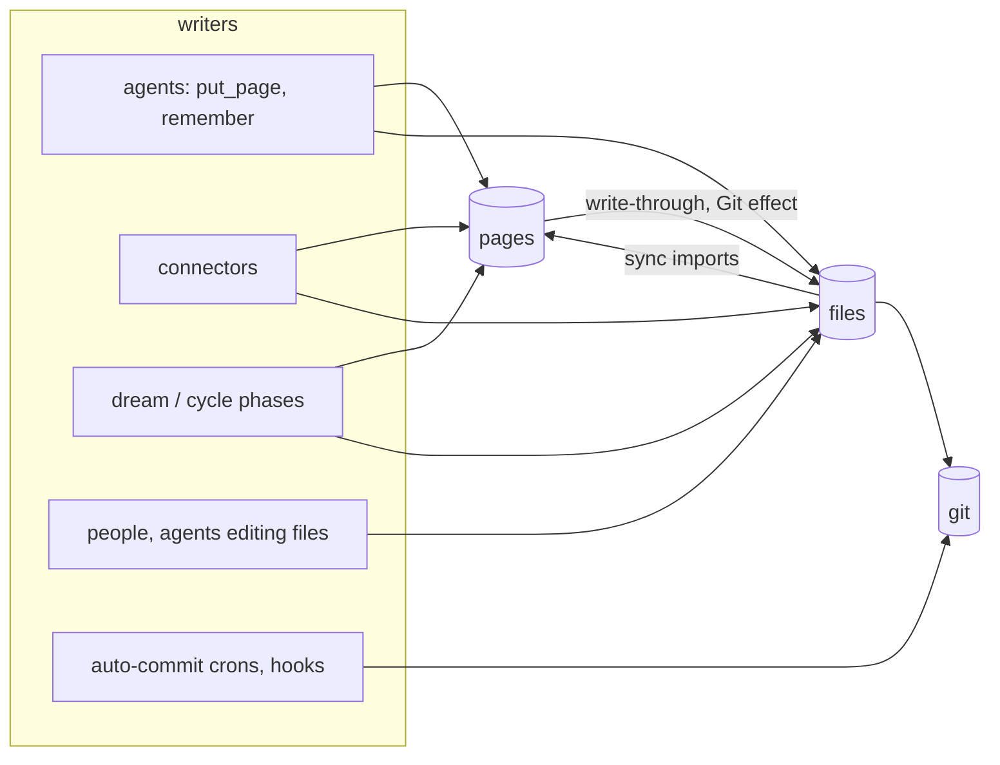
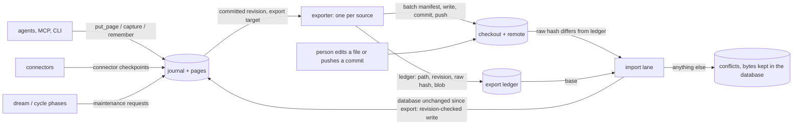

# The database as the source of truth for agent-written memory

> **Superseded.** This direction was not taken: git stays the source of truth and the database is derived from it. See [GIT_CANONICAL_MEMORY.md](GIT_CANONICAL_MEMORY.md). This document is kept for its incident analysis ("What breaks and why", "What it retires").

Status: design only, no production change. Every switch named here ships off.
Revision: 3, after two rounds of the gstack /autoplan review (see "Review record").
Author: GBRA-176 (GBrain Minder crew). Review: see "Review record" at the end.
Citation convention: repo-relative paths on master b247a4c4 (v0.60.361.0).

## Recommendation

Build it, as an opt-in mode chosen per source, and leave every existing brain
on its current mode. In the new mode (`canonical: database`) agents write only
to the database, one exporter per source is the only gbrain writer and
committer of page files, and file edits made outside gbrain come back through
an import lane. The first import lane is deliberately conservative: it imports
an edit only when the database page has not changed since that file was
exported, and records every two-sided edit as a per-page conflict that keeps
both copies and blocks nothing else. An automatic three-way merge is a later,
separately approved step, built only if measurements show people edit agent
pages often enough to need it.

Prove it on new, empty agent sources first (no adoption needed), then offer
conversion of existing sources. Ship every phase behind a brain-level gate
(`persistence.database_canonical.enabled`, default false) that stays off until
the maintainer approves, and convert a production source only after the Step 1
stabilization has been green for 7 days and the production-shaped scale soak
has converted a synthetic brain with thousands of holds. Keep files as the
truth for small and local brains whose people edit Markdown by hand; that is
still the right model for them.

Two caveats. The database becomes the only place an agent edit exists until
the exporter has committed and pushed it, so the mode requires a verified
database backup before activation. And the mode is only worth its cost if it
lets us stop growing the two-way machinery for agent sources; the "Retirement
and cost" section makes that an exit criterion.

## Before → after

| | Before (every mode today) | After (a database-canonical source) |
|---|---|---|
| Copy of record for an agent write | the file and the row, kept equal by coordination | the row |
| An agent write is acknowledged when | the owner host has published the file and the row together (managed), or the row and then the file (classic) | the row commits |
| A person edits a file the database also changed | the page is held (`file_drift`, `concurrent_write`) and every coordinated write to it refuses `source_changed` until someone picks a side | the import lane imports the edit if the page did not change since it was exported; otherwise the edit is kept as one conflict row and the page stays writable |
| A file is missing | the sync has to guess whether that is a deletion (`file_gone`, provenance, delete caps) | only a path the ledger exported and that then disappeared can mean deletion; everything else is "export pending" |
| Commits to page files | the managed Git effect, `gbrain git commit-push`, hooks, crons, agents, people | the exporter (plus people's own commits, which are imported) |
| Freshness | the git import watermark, which disagreement can stall | export lag and import lag, neither of which a conflict can stall |

## Why it matters

Most large-brain incidents of the last six weeks come from one structural
fact: agent memory has two copies of record and many uncoordinated writers.
Each incident got a correct local fix (a guard, a hold kind, a provenance
selector, a repair verb), and the system grew a hold vocabulary of 66
decision-table rows (`docs/guides/sync-unblock-runbook.md:121-189`), a writer
census of 269 rows (`docs/architecture/canonical-writers.tsv`), and a managed
sync that went from 29 files and about 9,000 lines to 65 files and about
18,400 lines between Oct 14 and Oct 22. Large brains still find the next
instance first, because they have years of moves, culls, connectors and
concurrent writers that our synthetic benches do not. The fixes are not
wrong; they are fighting a model in which every pass has to re-adjudicate
whether the file or the row is right.

## What caused this work

A production-shaped audit of a large agent brain (several hundred thousand
pages across sources, a hosted Postgres at about 65 ms round trip, several
crons and resident processes) found: a default source whose freshness stayed
frozen for days while each sync pass ended blocked with thousands of held
deletions; several processes syncing the same source at once; an auto-commit
cron committing every untracked file; a file-drift repair that recreated files
at paths people had deliberately deleted; and an agent that spent most of its
memory effort checking whether gbrain was current and falling back to grep.
The stabilization plan (one writer, freshness that never freezes, backlog
cleanup) treats those symptoms this week. This document is the structural
step it names: one source of truth for agent-written memory.

## Today: the two-way model

### Three modes

| Mode | Copy of record | Order on a page write | Inbound file edits |
|---|---|---|---|
| Classic | the file (`docs/architecture/system-of-record.md:3-5`) | row first, then the file is rendered from the row under a per-source native lock (`src/core/write-through.ts:3-9`) | `gbrain sync` imports any file whose hash changed; no revision precondition on import (`src/core/import-file.ts:556-587`) |
| Managed (persistence active) | both, kept equal by one owner per canonical worktree | durable recovery record, then the file, then the row and receipt in one transaction (`src/core/persistence/coordinator.ts:386-394`) | managed sync imports a file only when its recorded baseline proves the import cannot overwrite a database edit; otherwise it holds the file (`src/core/persistence/sync-prescreen.ts:50-62`, `sync-run.ts:464-468`) |
| Database-only (`sync.write_through=false`, unbound sources) | the row, for pages written that way (`src/core/persistence/unbound-source.ts:8-15`) | row only | sync still imports files and can write frontmatter back (#7084); a committed file edit once silently overwrote a newer database-only edit (PR #6887) |

The third row matters: the mode closest to this proposal is not
database-as-truth today, because its sync still treats files as an inbound
copy of record with the old hold semantics. Flipping a flag is not enough; the
import semantics have to change.

### Every writer

| Writer | Writes rows | Writes files | Commits | Coordination |
|---|---|---|---|---|
| `put_page`, `put_pages`, `capture`, `remember`/`forget`, `edit_page`, `append_page`, `delete_page`, takes ops | yes | yes (managed: before the row; classic: after) | managed: Git effect | managed: journal, revision preconditions, recovery record, worktree lock (`src/core/ops/pages.ts:358-370`); classic: per-source native lock, no check against an editor's bytes |
| Managed sync | yes | managed: frontmatter write-back in some paths (#7084) | no | frozen bytes plus page revision per entry; holds on disagreement |
| Classic sync | yes | full sync re-exports never-committed pages (`src/commands/sync/full.ts:518-535`) | pulls unless `--no-pull` | `gbrain-sync:<source>` database lock |
| Managed Git effect | no | no | `git commit --only` of the paths it wrote, push HEAD, never pulls, parks after 5 failures (`src/core/persistence/effect-git.ts:298`, `effect-model.ts:43`) | owner's native worktree lock |
| Connectors (Google, GitHub, chat transcripts) | yes | yes unless database-only (`src/core/google/sweep-shared.ts:150-195`, `src/core/github-source.ts:970-1035`) | no | managed: coordinator; classic: compare-before-replace guard, item held on mismatch |
| Facts fence and takes writers | yes | yes (classic: file first, then rows; `src/core/facts/fence-write.ts:378-635`, `src/core/takes-write.ts`) | no | page lock or filesystem lock |
| Dream/cycle phases (atoms, concepts, synthesize, patterns, lint fix, extract_facts, fence and content repair) | yes | yes (managed through maintenance requests; classic through derived write-through) | classic lint fix commits | 20 overwrite sites needed the compare-before-replace guard added by PR #7000 (#6982 class) |
| `gbrain git commit-push` / `scripts/brain-commit-push.sh` / post-commit hook | no | no | yes, named paths, in-memory merge on a moved remote (`src/core/git/commit-push.ts`) | commit lock and publish lock per checkout |
| `gbrain sources push` | no | no | `git add -A`, commit, pull, push (`src/core/workspace-push.ts`) | its own lock directory |
| Resident drivers (serve, jobs worker, autopilot, commit notifier) | via sync | no | pull (autopilot) | notifier lease per host and brain (`src/core/commit-notifier.ts`) |
| External committers (people, agents editing files, an auto-commit cron) | no | yes | yes | none that gbrain can see |

Every arrow into both stores is a place where the two copies can disagree, and
every arrow from one store to the other is a place where one copy can
overwrite the other.

## What breaks and why

The incident inventory (about 290 issues and PRs from Sep 5 to Oct 22) groups
into a few mechanisms. Each one exists because a file is a second inbound copy
of record for pages agents also write.

1. **Two-sided change has no safe automatic answer.** When the file and the
   row both moved, sync can only hold the file and refuse writes to the page
   (`source_changed`, `file_database_drift`). Writes that agents meant to make
   are then dropped (#6693: busy pages turned read-only while sync lagged), and
   database-only stamps can make an untouched file look edited, which refused
   most writes to a large source (#6429). Where a path was not guarded, one
   copy silently replaced the other (PR #6887; the 24-site #6982 class fixed in
   PR #7000).
2. **The merge base is often missing.** Managed sync decides a two-sided
   change from a per-page import record. Pages written before records existed,
   or edited between a classic sync and managed activation, have none, so the
   classifier falls through to `side=unknown` and holds them for a person even
   when the database never moved (#7199, `src/core/persistence/sync-classify.ts:181-183`).
3. **Absence has to be interpreted.** A missing file can be a deliberate
   delete, a file that never reached git, a sparse checkout, or a worktree
   deletion. Treating absence as deletion lost pages written into ignored
   directories (#7130). Treating it as "hold" produced thousands of held
   deletions that only per-category human review can clear (PR #7141, PR
   #7300), and a repair that took the database side recreated files people had
   deleted on purpose.
4. **Identity is derived from paths.** Slug folds that differ between writers
   and the importer produce duplicate-origin twins that stopped a whole
   source's sync (#6948); git rename pairing moved one page's facts onto
   another page (#6729); frontmatter `slug:` lines disagree with paths (#6188).
5. **Acceptance is coupled to the file.** A managed write is acknowledged only
   after the owner host publishes the file, so a recreated checkout, an absent
   owner or a slow publication becomes `recovery_required`, `owner_unavailable`
   or `write_pending` for the writer (#5914, #6849, #7203, #5600, #7085).
6. **Many committers share one tree.** Rebase and autostash in a shared
   checkout reverted other agents' edits (#6530); the commit-lock protocol
   fixed that but still says two writers of one file conflict
   (`docs/guides/shared-checkout-git.md:353-359`). A per-write Git effect that
   never pulls parks once anyone else pushes (#7010), and auto-commit jobs move
   HEAD past a sync's pinned commit (#6513).
7. **Freshness depends on every path.** The import watermark measures the file
   lane, so disagreement anywhere in a source shows up as a stalled, lying or
   blocked freshness signal (#5353, #6858, #7189, #7243). Holds are designed
   not to block the watermark (`src/core/persistence/sync-holds.ts:2-6`), but a
   pass that must re-screen and re-classify thousands of held paths at 65 ms
   per statement, plus the hold-escalation and preparation breakers
   (`sync-holds.ts:1053-1056`, `sync-run.ts:160-200`), still ends passes blocked or
   out of time. The committed-through marker GBRA-133 is shipping treats this
   symptom; the cause is that the pass has to judge both copies at all.
8. **Connector pages freeze.** A connector page is a provider render plus a
   row plus a file. A database-only fence addition made the next render
   disagree with the file; the item was held after three failures and no
   command could repair it on an unowned source (#7292, PR #7310).

## Proposed model

### Who writes where

| Store | Written by | How |
|---|---|---|
| Database (pages, versions, fence rows, tags, links, timeline) | every agent and server, connectors, dream/cycle phases, the import lane | the existing journaled write path (`put_page`, `capture`, `remember`, maintenance requests, connector checkpoints), published database-only for this source through a dedicated publication branch (below) |
| Page files in the source checkout | the source's exporter, nothing else in gbrain | a per-source export outbox drained in batches, each batch committed through one Git effect, compare-before-replace against the export ledger |
| Git commits touching page paths | the exporter | one commit per batch, then a push under the existing publish lock |
| Non-page files (`AGENTS.md`, scripts, notes outside the source's page roots) | the operator, as today | plain git or `gbrain git commit-push` |
| Edits to page files made outside gbrain | a person (or a straggling agent) in the checkout or another clone | never written to the database directly: the import lane turns each one into a revision-checked page write, or into a conflict |

Four rules make the model work.

1. **One copy of record.** For a database-canonical source the page row at its
   current revision is the content. A file is a rendering of some revision.
   Nothing copies a file over a row except the import lane, and nothing copies
   a row over a file except the exporter.
2. **The export ledger is the merge base.** For every exported path the
   database records which page and revision it rendered, the raw bytes' SHA-256
   on disk, the committed blob id, and the renderer fingerprint. A file whose
   raw bytes still match is unedited; anything else is an outside edit with an
   exact base. Raw-byte and blob ids are kept separately because autocrlf,
   LFS and clean filters make the working-tree bytes differ from the committed
   blob (`src/core/persistence/sync-git-stream.ts:18` already tells those
   states apart). Today's base is "the last import record", which is missing
   for pages written before records existed; that missing base is what
   produces `side=unknown` holds (#7199).
3. **Nothing freezes a source.** A conflict is one row about one path. The
   import and export watermarks both advance past it. The page stays readable
   and writable through the database while its conflict is open; only that one
   path stops being exported until someone resolves it, and status reports
   that gap explicitly rather than claiming the export is complete.
4. **Absence is not deletion.** A page whose file was never exported is
   "export pending", not "file gone". Only a path the ledger says we exported,
   and that then disappeared, can carry a deletion, and only through the
   import lane.

### Database publication without the file owner

Today a managed write that carries a worktree id needs the owner, takes the
native worktree lock and checks outstanding recovery, whether or not it stages
a file (`src/core/persistence/coordinator.ts:464-490`), and the unbound-source
shortcut stamps pages `database_only_reason='unbound_source'` so they are never
materialized (`src/core/persistence/unbound-source.ts:8-15`). Neither is right
here. A database-canonical source gets its own publication branch keyed on the
source's mode and a mode epoch:

- admission and publication are source-authorized and revision-checked
  exactly as today (grants, slug fences, expected revision, idempotent
  replay, attribution), but carry no worktree id, take no worktree lock and
  write no recovery record;
- the page gets no `database_only_reason`, because it is meant to be
  exported; the export target is not enqueued by the writer at all (see
  "Driven by the database" below), so publication requests stay worktree-free
  and a target survives the owner or its binding being unavailable;
- a write from any authorized host commits while the export owner is stopped,
  its checkout is missing, or an export batch holds the worktree lock.

The existing unbound-source safety checks are not relaxed; this is a separate
branch that only a source in database mode reaches.

### The exporter

- **One per source, on the source's canonical owner host,** inside the
  resident owner (`gbrain serve` or the jobs worker) under the existing
  worktree lease. Losing the lease stops it; it never takes over on a stale
  heartbeat. On PGLite without a resident, the one-shot command that committed
  a write drains its export targets before it exits.
- **Driven by the database, not by writers.** An AFTER trigger on `pages`
  (a change of knowledge revision, slug, visibility or `deleted_at`) and on
  fact withdrawals upserts the page into a per-source **export outbox** keyed
  by (source_id, page_id), for sources in database mode only. Every writer is
  covered without knowing about export: journaled requests, the roughly thirty
  direct coordinated writers that change rendered content without a request,
  fan-out mutations (a `forget` across many pages, purges, renames), and an
  old binary's write. The outbox coalesces repeated writes to one row per
  page, so 10,000 writes with the exporter stopped are 10,000 upserts and no
  growing effect queue; export lag reads the outbox. A sweep that compares
  ledger revisions with page revisions catches anything the trigger missed.
  For these sources no writer inserts withdrawal-mirror or per-request Git
  effects; the implementation enumerates every effect-inserting writer
  (withdrawal, purge, rename, visibility, connector checkpoints, segmented
  repair) and routes it by source mode.
- **One Git effect per batch.** The exporter turns a drained outbox batch
  into one Git effect, so it keeps the registration every checkout-touching
  consumer already knows (worktree refresh, convergence, parking, restore;
  `src/core/persistence/worktree-refresh-schema.ts:45`) without one effect row
  per write holding reservations and receipts open while the exporter is down.
  The effect carries the source's mode epoch and binding generation, so a
  transfer or a flip invalidates it rather than completing it falsely.
- **Eligibility is one predicate.** A new `exportEligible(page, source)`
  decides what may reach a tracked path: not private or alias-private, not
  under a `storage.db_only` prefix, not detached, not in an import-only mirror.
  It is evaluated when a batch renders, and the batch manifest records the
  eligibility generation it saw. Visibility changes bump that generation in
  the same transaction, and the exporter rechecks it after the commit and
  again immediately before the push; a batch whose generation moved is
  re-rendered, never pushed. So a page that becomes private after rendering,
  between commit and push, or during recovery never reaches the remote, and
  its existing file is removed in the next batch. No current reader provides this:
  `readExportPage` (`src/core/export-snapshot.ts:28-40`) and `gbrain export`
  (`src/commands/export.ts:123-150`) select any live page, which is right for a
  trusted local snapshot and wrong for an automatic git publication.
- **Compare before replace, in one place.** The exporter never writes a path
  whose current raw bytes differ from the ledger, including a path with no
  ledger row where a file already exists; it hands the path to the import lane
  and skips it. This is the guard that the #6982 class added to more than
  twenty writers one at a time; here only one writer exists.
- **Keeps bytes it does not need to change.** When a revision renders to
  content equal to the current file, the ledger adopts the file's hashes and
  nothing is rewritten. "Equal" is one contract used everywhere: the parsed
  file equals the canonical export view of the page, after removing a defined
  list of database-only stamps (the #6429 class). The canonical export view is
  the overlaid view: the renderer reads through `readExportPage` and
  `readExportWithdrawals` (`src/core/export-snapshot.ts:28-39`) for inline pages
  and the segmented export reader for segmented ones, then serializes. A
  plain `serializePageToMarkdown` of the stored body would publish forgotten
  facts, because a withdrawal only bumps the revision and the row is removed at
  read time. Segmented pages compare by
  the streamed SHA-256 of their exported Markdown, because their body fields
  cannot be read whole (`src/core/page-body/page-shape.ts:3-7`).
- **Paths are a function of slugs.** A page write whose slug cannot
  round-trip to a path and back is refused at write time (#7305); the ledger's
  live-path key uses the export stage's NFC-plus-case fold, so APFS and NTFS
  cannot hold two pages in one file, and a slug reused after a soft delete gets
  a new ledger lifetime.
- **Durable batch manifest.** Before touching the filesystem the exporter
  records the batch: id, each path's expected prior hash, the pinned revision
  and the digest of the bytes it will write, and the paths it will remove.
  Recovery walks file, commit, ledger and push boundaries forward from that
  manifest, updates ledger rows by compare-and-set, and verifies the committed
  blobs; a crash between commit and ledger write is finished, not mistaken for
  an outside edit.
- **Commits without rewriting the index.** On large checkouts every
  `git add`/`commit` rewrites the whole index, and the Git effect already
  budgets 2 s per MiB of index for each such step
  (`src/core/persistence/effect-git.ts:52`), which would put a batch near a
  minute.
  The exporter requires `core.splitIndex` on the checkout and writes each
  changed entry into the real index (`update-index --index-info`) before the
  commit, so the index never lags HEAD: otherwise `hardenedPathDirty`
  (`src/core/hardened-git.ts:230`) would see every exported path as dirty and a
  person's plain `git commit` would revert the export. A test checks that
  `diff-index --cached HEAD` is clean after a batch. The soak records commit
  time against index size.
- **Locks.** The checkout's commit lock (the one `gbrain git commit-push`
  takes) is held only for the index, commit and fast-forward steps, and never
  while waiting for the publish lock, matching commit-push's own order. Fetch
  and import run with no Git lock held. An operator committing non-page files
  during a batch waits briefly on the commit lock instead of racing it.
- **Integrating a moved remote.** A rejected push fetches with no Git lock
  held and runs the import lane over page paths the fetched commits changed
  (revision-checked: a clean outside edit becomes a database write, a
  two-sided one a conflict). The exporter then builds the next commit with the
  fetched tip as its parent: the tip's tree, including other people's
  non-page files, plus the rendered page entries, where a page path is taken
  only when the tip's blob is the one the lane just imported or adopted.
  It pushes with the tip pinned (at most eight attempts), then fast-forwards
  the branch and worktree under the commit lock. This is how non-page commits
  from other clones reach the owner checkout, and why an imported edit never
  shows up as an `integrate_conflict` (`src/core/persistence/effect-git.ts:326`)
  on the next push. Parked paths stay out of the batch, and page files are
  never merged a second time outside the import lane.
- **Never exports to a mirror.** An import-only or read-only mirror source is
  never an export target (#5409, #6946).

### The import lane

The lane replaces managed sync for a database-canonical source. It uses only
hardened plumbing (`ls-files -s`, `diff-tree -r -z --no-renames`,
`hash-object --no-filters`, `hardenedPathDirty`), never `git status` or
`git diff`, which run a repository's configured filter programs
(`src/core/hardened-git.ts:11-16`).

It runs on its own schedule in the owner, independent of HEAD and of outgoing
exports: a file watch on the source's page roots with a polling fallback, a
stable-bytes rule (a file is read once its hash has not changed for a few
seconds), a bounded full scan on restart, and a fetch for foreign commits.
Each changed path is screened with the same content checks managed sync uses
today (size, frontmatter, fences, encoding, names).

For a changed path with ledger entry (page P, revision r0, raw hash h0),
current database revision r1, and file bytes F:

| Case | What the lane does |
|---|---|
| F is equal to the database at r1 (the shared equality contract) | Adopt F's hashes into the ledger; nothing else. |
| r1 = r0 (the database did not change since export) | Write F as a page revision with `expected_revision = r0`, attributed to an `import` principal with the commit or worktree as provenance. Protected keys (visibility, trust, provenance, allowed tools, source fields; `src/core/persistence/reconcile-merge.ts:12-15`) keep their database values; a file change to one is a `protected_metadata` conflict. |
| r1 ≠ r0 and F ≠ h0 (both changed) | Conflict `both_changed`. The database is untouched, the path is parked, both copies are kept. |
| F is gone, r1 = r0 | A deletion intent: soft-delete P through the normal delete path, but only when git history shows the exported file was committed and then removed (the #7130 evidence rule). Deletions are batched per scan; a batch above the mass-delete valve becomes one `bulk_delete` conflict that needs one approval, never thousands of per-file holds. |
| F is gone, r1 ≠ r0 | Conflict `deleted_vs_edited`. The page stays live; the path stays parked. |
| F is gone from the worktree but still committed at HEAD | Conflict `deleted_uncommitted`; the path is parked so the exporter does not recreate it. It closes as a deletion once the removal is committed (then the row above applies), or with `--take database`. |
| F is larger than the request cap (24 MiB) | A streamed, revision-checked import when r1 = r0; otherwise conflict `too_large_for_lane`. Conflict bytes are stored inline up to 24 MiB; larger ones are kept as a SHA-256 plus a pinned private Git ref that backup notes name. |
| No ledger entry, no page at the slug | Create the page (create-only write). |
| No ledger entry, a page exists at the slug | Conflict `unexported_collision` unless F is equal to the page. |
| Segmented page, any two-sided change | Conflict; no partial comparison. |
| F fails a content screen | Conflict `unparseable` with the screen's code and repair hint; the path is parked so the exporter does not erase the person's broken edit. |

A conflict blocks only its own path's export:

- conflicts live in a table keyed by (source, path), which is also where
  parking lives (a path with no ledger row can be parked too); the outside
  bytes are stored in the database, so they survive checkout loss and are in
  every database backup;
- agents keep reading and writing the page through the database, so
  `source_changed` refusals for drift disappear;
- `gbrain sync status`, `get_brain_health` and doctor count open conflicts by
  kind and age; an MCP read op lists them under the caller's source grant,
  slug fence and page visibility, returns summaries without file bytes to
  remote callers, and binds each conflict id to the page's lifetime;
- resolution is `gbrain sources conflicts <id> resolve <conflict> --take file|database --expect <hash>`
  (preview-bound like every repair; `gbrain import` already names a command, so
  the verb lives with the source admin verbs), or an agent's `put_page` that
  carries `resolves_conflict` for that page and the expected revision. The
  `put_page` route is allowed only for `both_changed`, `unexported_collision`
  and `protected_metadata`; deletion kinds resolve only through the
  preview-bound verb, so an agent write can never make the exporter recreate a
  deliberately deleted file.

**Later, separately approved: a base-aware merge.** `mergeReconcile`
(`src/core/persistence/reconcile-merge.ts:85-138`) is a two-way merge: equal
values pass, any other difference is a conflict, the body is one string, and
tags are unioned, which in a three-way setting would bring back a tag one side
deleted. A real three-way merge (delete-aware fields and tags, fence rows,
paragraphs) is new code. Phase 2 records, for every two-sided conflict, which
fields a merge would have resolved; the conversion dry run counts outside
edits per source over 30 and 90 days. The merge is built only if those numbers
justify it.

### What happens to direct file edits by agents

An agent that edits a page file directly (instead of calling `put_page`)
still works when the page did not change since export: the edit arrives
through the import lane within seconds. When the page did change, the edit
becomes a conflict, which is the honest outcome for an agent that bypassed the
write path. The skills an agent loads should say "write memory with
`put_page` / `remember`; edit files only for content you would otherwise
hand-edit". Automated committers stop committing page paths:
`gbrain git commit-push` keeps refusing managed worktrees as it does today,
and a database-canonical worktree is one of them, so no new page-path marker
or loosening is needed; the refusal names `put_page` for page paths. Doctor's
`git_convergence` check learns the mode: it stops advising plain-git commits
and `--keep-checkout` pushes for a database-canonical checkout
(`src/commands/doctor/checks/git-convergence.ts:188-201`) and points at export
status instead. A cron that commits every untracked file has nothing
left to do for page files; the exporter already committed them, and the lane
catches anything it still writes.

### Enforcing the single writer

A doctor check at conversion is not enough: production upgrades by hand and
an older binary started later is the normal case. The source's mode is
enforced in the database at three points:

- **Inserts:** a per-source protocol fence on persistence request and effect
  inserts, in the trigger pattern of the brain-wide `writer_protocol_floor`
  (`src/core/persistence/administration.ts:269`, `src/schema.sql:2618`),
  refuses managed-sync imports, coordinated file publication and classic
  imports for the source from a binary that does not know the mode.
- **Canonical mutations:** the managed writer allowlist guard
  (`src/schema.sql:2326-2333`) also checks the session's protocol for sources
  in database mode, so a direct coordinated write from an old binary is
  refused, not just its requests.
- **Claims and recovery:** request and effect claims, publication and
  recovery check the source's mode epoch; work prepared before a transition is
  drained, cancelled or re-prepared, never published under the old mode.

Unlike the brain-wide floor the fence is per source and is lowered by the
flip back. The triggers read a brain-level count of database-mode sources
under the existing `FOR SHARE` and return at once when it is zero, so
brains that never use the mode pay nothing; the soak measures the cost when
it is not zero.

### Freshness, status and latency

- Export lag is the age in seconds of the oldest committed revision of an
  eligible, unparked page that is not yet exported (the count is a secondary
  field). Status reports three coverages separately: processed, committed
  locally, and pushed to the remote, plus the list of parked paths whose
  newest revision exists only in the database and how old it is.
- Import lag is the age of the oldest outside change the lane has not
  classified.
- An agent write is visible to search at its database commit; the
  applied-through watermark from #7190 keeps its meaning.
- Writes no longer wait on a file publication on the owner host, so an owner
  that is down or slow delays only the export. Today the same outage returns
  `owner_unavailable` or `write_pending` to the writer.
- On PGLite with no resident, the one-shot command that committed a write
  makes one bounded, best-effort export attempt after the write is
  acknowledged; a missing remote or checkout never fails the write or holds
  the datastore, and unexported targets stay in the outbox for the next
  resident or command.
- The import lane does no full-tree discovery per pass, so the O(repository)
  preparation and walk costs (#6858, the post-activation walk) do not apply;
  its own idle and catch-up costs are measured in the soak.

## Migration for an existing brain with thousands of held items

The conversion must not ask a person to decide thousands of holds before the
source can move, and it must not decide any of them silently. So it adopts
every hold and drift receipt as a conflict, one for one and losslessly, and
lets the person resolve the conflicts later in category batches that already
exist today (the file-drift provenance selectors). Conversion comes after new
sources have proven the mode (Phase 3a); it is Phase 3b.

Preconditions, each checked by the conversion's dry run:

1. The brain is managed (persistence active) and the source has one canonical
   owner. The mode is not offered to classic sources: their writers bypass the
   journal, so there is nothing to make authoritative.
2. Every gbrain process on every host runs a version that knows the mode, and
   every other writer of the source is stopped: crons that run `gbrain sync`,
   hooks, and any external committer of page paths. This is the Step 1 "one
   writer" state. After the flip the per-source protocol fence keeps it that
   way; the dry run only checks the starting point.
3. A verified database backup exists (see "Backup and export" for what
   verified means per engine).
4. No publication recovery is outstanding and no transfer is prepared.

The conversion is a small state machine, so live writes cannot slip between
adoption and the flip:

1. **Census (read-only).**
   `gbrain sources canonical <id> --to database --dry-run --json` counts:
   pages whose file is equal to the database (adopt as exported), drifted pages
   by class, holds by code, side, state and provenance, pages with no file
   (detached, never committed, never exported), files with no page, existing
   origin twins, private pages whose files are tracked today, and outside
   edits to page paths over the last 30 and 90 days. It prints the
   `admin_state` fingerprint the next step binds to; for this verb the
   fingerprint also covers the source's mode and a digest of its hold set.
2. **Flip to `adopting`.** The source's mode becomes `adopting` and its
   epoch advances. Managed sync stops for the source, the protocol fence goes
   up, agent writes switch to database publication, and the import lane starts
   in recording mode: any new outside change becomes a conflict, never a hold.
   From here the hold set can only shrink.
3. **Adopt (resumable, batched, one transaction per batch).** Each entry is
   bound to the page revision, file hash and hold fingerprint it saw, and is
   rechecked inside its batch. For each page:
   - equal: a ledger row with the file's hashes;
   - drifted, or held `file_drift` with `side=both|unknown`: a conflict
     `both_changed` with the database revision and the file's bytes stored in
     the database;
   - held `file_gone` with provenance `deleted_by_commit`: a conflict
     `deleted_vs_edited` with the deleting commit attached. Its path is parked,
     so the exporter can never recreate a file someone deleted on purpose. A
     production incident recreated exactly such files during an earlier repair;
     parking makes it impossible by construction, and a test pins it;
   - held `file_gone` with provenance `never_committed`: a conflict
     `never_exported` whose default resolution is "export" (big decision 5); a
     page already detached stays database-only;
   - `deletion_uncommitted`: a conflict `deleted_vs_edited`, because in this mode
     a worktree deletion is also an outside edit;
   - other holds (frontmatter, fence, slug conflicts) and existing origin
     twins: a conflict of kind `unparseable` or `identity` that keeps the
     hold's code and fix, so the exporter never writes one file for two pages.
   Before the first ledger row is written, the database-only stamps that made
   untouched files look edited (#6429) are removed from the comparison by the
   same defined list the exporter uses. Each adopted hold row is marked
   `adopted_by` its conflict, not deleted.
4. **Flip to `database`, export in shadow.** The exporter computes each batch
   and the diff it would commit, records metrics, and writes nothing.
   Freshness unfreezes at step 2, because no conflict holds a watermark.
5. **Enable export commits** after a soak window with zero unexpected shadow
   diffs (start at 7 days).
6. **Resolve conflicts in batches,** in the order the person chooses, with the
   existing selectors (provenance, path globs, class, since). Each batch is
   preview-bound and every resolution is an ordinary page write or soft delete,
   so `gbrain restore` and page history work as they do today.

Rollback:

- **Every flip back starts with a barrier.** The source moves to a draining
  state bound to its mode epoch: new writes still commit to the database and
  enqueue export work, but the final flip checks that the epoch and the
  outbox frontier it drained are unchanged, so a write landing after the last
  drain check is drained or re-prepared under files mode, never omitted.
- **Before step 5,** the exporter has written nothing, but agents may have
  written database-only revisions (an edit to an equal page, a new page with
  no file, a delete). Restarting managed sync would not write them out: it
  classifies an unchanged file under a newer database revision as `db_ahead`
  with no action (`src/core/persistence/sync-classify.ts:173-177`). So the
  flip enumerates every committed-but-unmaterialized revision from the outbox
  and either materializes it through one exporter batch or keeps it as an
  explicit database-ahead hold with its pending target. Then each adopted
  conflict turns back into the hold it came from (adoption is a bijection,
  pinned by a test that compares hold rows byte for byte), the fence is
  lowered and managed sync restarts. Conflicts created after the flip by new
  outside edits become ordinary holds. A test edits, creates and deletes pages
  during shadow, rolls back, and injects a write after the final drain check.
- **After step 5,** the flip back is a planned conversion. It waits until the
  exporter has committed and pushed every eligible, unparked revision. Parked
  paths cannot be drained, so each one is listed: its conflict becomes a
  `file_drift` hold whose database side is the page's current revision, exactly
  the state managed sync would have produced. The soak demonstrates this flip
  with one parked page and one failed push outstanding.
- Soft deletes made while resolving adopted conflicts are reversible until
  purged, so the conversion keeps adopted pages out of the 72-hour purge for
  30 days.

## Compatibility for small and local brains

Files stay the source of truth by default, for every existing brain and for
new local brains. The mode is a per-source choice for three reasons:

- **People who edit Markdown are the product for small brains.** Obsidian
  vaults, a notes repo, a team's docs: there the person is the main writer,
  the database is a search index, and "rebuild the index from files" is a
  feature. Making the database authoritative there buys nothing and adds a
  backup obligation.
- **One brain often holds both kinds of source.** A person's hand-written
  notes and an agent's memory can live in the same brain as different
  sources; each picks its own truth.
- **A per-prefix split inside one checkout brings the classifier back.** If
  `notes/` were file-canonical and `people/` database-canonical inside the same
  source, every scan would again need to decide which side wins for which
  path, which is the two-way model in miniature. `storage.keep_db` already
  exists for the narrow "regenerated pages" case and stays as it is.

| Brain | Default | Why |
|---|---|---|
| Local PGLite, person edits files | files (classic or managed) | files are the person's tool; rebuild from files is the backup |
| Local or remote, agent writes most memory | files today; database is opt-in per source after Phase 4 | removes drift, holds and freezes for the agent's pages |
| Hosted (gbrain.io) | already database-first; export is the natural add-on | no checkout on the user's side |
| Database-only sources (`sync.write_through=false`) | unchanged | the new mode is database-only plus an exporter |

On PGLite (one process owns the database) the exporter runs inside the
resident owner when one runs, and otherwise at the end of the one-shot command
that committed the write, with the same ledger. The mode needs no Postgres.

## Backup and export

- **Primary backup is the database.** In this mode the database holds edits
  that are not yet pushed, plus everything that was always database-only
  (receipts, attribution, the belief ledger, withdrawals) and now conflict
  bytes. Activation requires a verified backup, defined per engine: for a
  self-managed database, a `gbrain backup create` archive that passed
  `gbrain backup check` or a restore drill within a configured age; for a
  provider's point-in-time recovery, which gbrain cannot inspect, an operator
  attestation with an expiry. Doctor's `database_canonical_backup` check
  reports which kind it saw and when it expires.
- **The git export is the human-readable, offsite copy,** with per-page
  history. It is complete for every eligible page except the parked paths,
  whose newest revisions status lists with their age. Its recovery point for
  file-backed content is the pushed coverage, not the backup interval: a batch
  committed locally but not yet pushed is not offsite.
- **Rebuild drill.** "Rebuild a brain from its export" stays a supported
  disaster path for file-backed knowledge: `gbrain sync` of the pushed export
  into a scratch brain in files mode reproduces pages, fences and links, as
  `docs/architecture/system-of-record.md` promises today. The soak runs that
  drill from the remote with one page parked and one push failed, and the
  result must name exactly those gaps. A nightly `export verify` samples pages
  and checks the committed blob against the rendering of the ledger revision.
- **What does not change.** `gbrain export` stays a point-in-time snapshot.
  Forgetting a fact removes it from active memory and from later exports, but
  git history and backups keep earlier copies; we never promise physical
  erasure. The same holds for a page that becomes private: its file is removed
  in the next batch, and earlier commits still contain it.

## What it retires

Verdicts are for a database-canonical source. "Retired" means the class cannot
occur there, because it exists only while a file is a second inbound copy of
record. "Reduced" means a remainder lives on the import lane or the exporter.

| Class | Representative issues and PRs | Verdict | What is left |
|---|---|---|---|
| Two-sided change (`file_drift`, `concurrent_write`, `source_changed` / `file_database_drift` refusals, writes dropped on held pages, DB-only stamps that look like edits, silent overwrite of a DB-only edit) | #7199, #6693, #6600, #6643, #6650, #6429, #5974, #5182, PR #6887, PR #6891, PR #7228, PR #7280, PR #7300 | retired for agent writes | a conflict row when a person's edit and a database change meet; the page stays writable |
| Deletion inferred from a missing file (held deletions, `file_gone`, never-committed files, purges of pages whose file was ignored) | #7130, #7128, #6609, #5567, PR #7141, PR #7300 | retired for agent pages | a committed removal of an exported path still needs commit evidence and the delete caps |
| File↔database copy writers (the #6982 class: D-1 to D-23 and W-1 in the GBRA-131 audit) and the half-honoured write-through switch | #6982, #6398, #7084, #7085, #7098, #6986, PR #7000, PR #7113 | retired | one exporter with one compare-before-replace guard |
| Identity derived from paths (origin twins, slug conflicts, rename pairing) | #6948, #6517, #7305, #6729, #5589, #5675, #6188, #6865, PR #6955 | twins and slug conflicts retired; renames and new files reduced | path is a function of slug at export; renames read the ledger, not git similarity. Twins already in a database are a one-time repair (#6885, #7311, #7150) |
| The classic/managed activation boundary | #7199, #5182, #5317, #6286, #5243, #6449 | retired as a boundary | a one-time conversion with an explicit baseline per page |
| Write acceptance coupled to file publication (`recovery_required` from root identity, `owner_unavailable`, `write_pending` waiting on a file) | #5914, #6849, #7203, #5600, #5601, #6608, #7085, PR #7229 | retired for file-coupled states | the exporter keeps one checkout-identity check; database-load `write_pending` (#6423, #7106) is unaffected |
| Shared-checkout rebase, stash and repo-wide add | #6530, #5138, #5429, PR #6555 | retired for page files | operator-owned non-page files keep the commit-lock protocol |
| Write-back into mirrored or read-only checkouts | #5409, #6946, #7084, #7098 | retired | an import-only mirror is never an export target |
| Frozen connector pages | #7292, #5317, #5192, PR #7310 | retired (drift and freeze) | provider-side item holds stay (#6831, #6387) |
| Whole-source blocks from one file (sticky `blocked_by_failures`, cancelled siblings, cursor replays) | #6194, #5777, #6513, #6278, #6188, #6858, #6712, PR #7053 | retired for agent-versus-sync collisions; reduced on the import lane | the lane records per-path conflicts and has no blocking cursor |
| Live checkout moving under an import (`worktree_dirty`, pinned-commit conflicts, auto-commit races) | #6340, #6320, #6513, #6138, #5063 | reduced | a person mid-edit; the lane reads committed or stable bytes |
| Per-write Git push (rejected, parked, stranded, removals never committed, stale `index.lock`) | #7010, #4993, #6665, #7089, #7091, #6932, #7019, #7110 | reduced | the exporter still integrates a moved remote in memory before pushing (the PR #7011 shape) |
| Legacy writers fenced out on managed brains (`writer_coordinator_required`) | #5175 through #6619 (22 issues), PR #5440 | reduced | the database writer guard stays; the 44 `filesystem_guard` rows in the writer census go away |
| Freshness that lies | #5353, #6858, #7189, #7243, #7019, PR #7231, PR #7275 | reduced | freshness describes only export and import lag |
| Round-trip placement of fences and metafiles | #6686, #5507, #6545, #6188, #5186, #7132 | reduced | a malformed fence affects one imported file, never agent writes |

Unaffected, to bound the claim: pooler and driver bugs (#7183, #7112), retrieval
and embedding (#7174, #7184, #7193), model pricing and paid loops, upgrade and
install, version skew between processes, code sources (git stays their truth),
and Windows path limits, which become exporter constraints.

## Retirement and cost

Adding a fourth persistence mode is only worth it if it lets the two-way
machinery stop growing for agent sources, and eventually shrink. These are
exit criteria, not hopes:

- **For converted, stable sources:** once a source has run in database mode
  and is green, no new hold kind, sync guard or writer-census
  `filesystem_guard` row is added to serve it; an incident there is fixed in
  the exporter or the import lane.
- **For every files-mode source, until its replacement is available and
  approved:** correctness, security and data-loss fixes keep shipping, agent
  sources included. Phase 3a does not make the existing sources convertible
  (that is Phase 3b) or usable in production (Phase 4), so "recommend the
  mode" is not an answer for them yet. The one added bar: a new hold kind for
  an agent-written source states in its PR why the mode would not have
  prevented the incident. Human-first sources keep getting fixes as today.
- **After Phase 5:** with the largest agent sources converted and green for
  14 days, list the code that only database-canonical sources would have
  needed and that no remaining files-mode source uses (for example the
  keep_db reconcile lane, the post-activation drift classifier for those
  sources, the per-write Git effect path for page files), and delete what the
  list proves unused.
- **The default mode for new agent-first and hosted brains** is decided once
  the first production source of Phase 4 has been green for 7 days, not at
  the end of Phase 3a, when the mode has run only on the soak brain and new
  empty sources. Until then new brains keep files mode and are offered the
  mode as an opt-in when they are created.
- **One model for local and hosted.** The seam is named: rendering, the
  ledger, the batch manifest and the plumbing commit to a ref form the
  engine-level core, and plumbing works on a bare repository. Worktree
  materialization and the Git-effect registration are the local adapter. A
  hosted brain's "mirror my brain to a git repository I own" uses the core
  without the adapter, and a test exports to a bare repository with no
  worktree binding, so there is one export and one conflict model, not two.

Rough size, to be refined in each phase's plan (each extra PR costs one
serial merge slot and one full gate):

| Phase | PRs | Size |
|---|---|---|
| 1: ledger, renderer and equality contract, eligibility predicate, shadow diff | 1 to 2 | medium |
| 2: import lane in observe mode, conflict table, foreign-edit census | 1 | medium |
| 3a: database publication branch, exporter commits, protocol fence, surfaces, new sources only | 2 | large |
| 3b: conversion state machine, adopt, flip back | 1 to 2 | large |

## Risks and one-way doors

| Risk | Kind | Mitigation |
|---|---|---|
| The database is the only copy of an edit until it is pushed | durability | verified-backup precondition and doctor check; pushed coverage and export lag in status; parked paths listed with age |
| A Postgres outage stops all writes for the source (files mode let a person keep editing files offline) | availability | outside edits made during an outage are imported when it ends; agents retry writes as they do on `write_pending` |
| An older binary started later writes files or imports on a converted source | correctness | the per-source protocol fence refuses its request and effect inserts, its direct coordinated writes and its claims; the export outbox trigger still captures any change it commits; tests start an old-protocol writer after conversion and run a bare coordinated write |
| Rendering is lossy or unstable, so exports churn or drop fields | correctness | one equality contract; a property test that `parse(render(page))` equals the canonical export view (empty fields, tags, metadata, timeline, overlays, malformed fences, segmented pages), then that rendering is a fixed point |
| Private or `db_only` content reaches a git remote | privacy | the new `exportEligible` predicate, evaluated at render time and bound to the batch by an eligibility generation rechecked after commit and before push; the renderer reads the withdrawal overlay, so forgotten facts are never rendered; tests for initial exclusion, a page that turns private after render, between commit and push, and during recovery, and a forgotten fact on inline and segmented pages; tracked private files handled by big decision 7 |
| Conflict listings leak private pages or other sources' content to remote tokens | privacy | source, slug and visibility fences before listing and counting; no file bytes for remote callers; `remote=true` tests |
| The import lane or a crash mistakes gbrain's own write for an outside edit | correctness | durable batch manifest with compare-and-set ledger updates; crash tests at each effect fault point |
| Configured clean or textconv filters run during change detection | security | hardened plumbing only; a test with a configured filter driver that must never run |
| People keep committing page files from other clones | process | supported; each foreign commit is imported or becomes a conflict, and status names its author so the operator can move that writer to `put_page` |
| Conflicts pile up unresolved | operability | listed by age on the daily scoreboard; no conflict blocks anything else |
| Shadow work loads production brains | performance | shadow runs only on sources with a per-source shadow flag, fed by the same outbox trigger Phase 3a uses, into a shadow table, with no effect rows; its cost is measured on the soak first |
| Protocol-fence triggers slow brains that never use the mode | performance | the triggers return at once when the brain has no database-mode source; the soak measures their cost when it has one |

One-way doors, honestly stated:

1. **Purging pages deleted while resolving adopted conflicts.** Reversible
   for 72 hours today; the conversion extends that to 30 days for adopted
   pages, after which it is permanent.
2. **Removing tracked private files from the checkout** (big decision 7).
   The removal commit is reversible, but anything pushed before it stays in
   the remote's history.
3. **The workflow change for agents that edit files directly.** Once skills
   say "write with `put_page`" and committers stop, moving back means
   restoring those habits. Technically reversible, socially sticky.
4. **The first canonical rendering of a page changes its file's formatting.**
   It happens only on a real content change, but it changes diffs and blame
   for that file permanently.
5. **Not one-way:** the mode itself. With the exporter drained and parked
   paths turned back into holds, a source can return to files mode through the
   planned conversion above.

## Phased rollout

Every phase ships dark: the brain gate `persistence.database_canonical.enabled`
defaults to false, and a source changes mode only through the preview-bound
admin verb. Nothing converts on upgrade.

| Phase | Ships | Exit criterion |
|---|---|---|
| 0 | this design, with the maintainer's decisions | approval of the direction and of the big decisions below |
| 1 | export ledger, seeded in shadow from managed sync's per-page import provenance (raw blob id and revision, `src/core/persistence/sync-holds.ts:1077-1085`) so it has a base before any export, with seed coverage reported per field (revision, raw hash, disk hash) per source; renderer with the equality contract and the withdrawal overlay; `exportEligible`; the export outbox trigger feeding a shadow diff for opted-in sources; the soak-brain generator if the scale soak has not delivered one | property test green on PGLite and Postgres; shadow diff on the fixture corpus plus synthetic holds shows only expected rows, including two requests that commit in reverse sequence order; shadow overhead measured |
| 2 | import lane in observe mode on opted-in managed sources: records the conflict each hold would have been and which fields a merge would have resolved; a published hold-code to conflict-kind mapping table; foreign-edit census | on a labeled fixture set, where each case carries the outcome a person would choose, the lane agrees with the label; cases where the lane is right and managed sync is not count as agreement |
| 3a | database publication branch, export outbox and exporter commits and pushes, protocol fence, conflict resolution, status/doctor/MCP surfaces, `gbrain sources canonical <id> --to database` for a provably empty source; **new or empty sources only**, no adoption | on PGLite and Postgres and on the soak brain, through the real operator verb: agent writes commit with the export owner down; export lag p95 under 60 s; zero writes refused for file state; restore drill from the remote names exactly the parked and unpushed gaps |
| 3b | the conversion state machine for non-empty sources (census, adopting, adopt, database, flip back) | on the production-shaped soak brain (several hundred thousand pages, years of moves and culls, thousands of synthetic holds of every kind, 65 ms injected latency, pool 25): adopt completes under live writes, freshness never freezes, zero files recreated at deleted paths, flip back restores every hold byte for byte, idle scan cost and outage catch-up within the measured envelope |
| 4 | opt-in on a test brain, then on the smallest production source, after the maintainer approves that source | 7 days: no unexpected shadow diff, conflicts only from real edits, scoreboard green. Then the default-mode decision for new agent-first and hosted brains |
| 5 | the largest sources; page-path auto-commits retired; skills updated to `put_page`-first; the retirement list in "Retirement and cost" | 14 days green on the scoreboard; no held-deletion or drift incidents |
| later | a base-aware three-way merge, only if Phase 2 and the census justify it, as its own design and approval | not part of this plan |

The production-shaped scale soak is a separate lane already under way; Phase
1 does not wait for it (the fixture corpus plus synthetic holds is its gate),
but Phases 3a and 3b do.

## Big decisions

1. **Scope of the switch: per source.** Options: brain-wide, per source, per
   path prefix. Pick per source: one brain mixes human and agent sources, and a
   per-prefix split brings back the two-way classifier inside one checkout.
   Flips if a real user needs mixed authority inside one source.
2. **Outside edits: conservative import lane first.** Options: a read-only
   export, a conflicts-only lane, or a lane with automatic three-way merge.
   Pick conflicts-only: it imports edits whose base is unchanged and keeps
   every two-sided edit as a conflict, which loses nothing and has no merge
   semantics to get wrong. The merge is a later, data-gated decision. Flips if
   the census shows outside edits on agent sources are common and conflicts
   become a burden.
3. **Existing holds: adopt them as conflicts at conversion.** Options:
   resolve every hold first, or adopt. Pick adopt: it is lossless, reversible
   before export commits, and unfreezes the source at once. Flips if adoption
   cannot be made a bijection for some hold kind; that kind then blocks the
   conversion instead.
4. **Exporter output: keep bytes when content is equal.** Options: always
   write the canonical rendering, or adopt equal bytes. Pick adopt: it avoids a
   repository-wide formatting commit on day one.
5. **Never-committed pages: export them by default.** Options: export, or
   keep them database-only. Pick export as the default resolution of their
   conflict (they are agent memory that belongs in the offsite copy), with
   already detached pages left database-only. Flips if the census shows they
   are mostly bulk or private content.
6. **Automated committers: refuse page paths.** Options: allow and import, or
   refuse. Pick refuse for `gbrain git commit-push`, which already refuses
   managed worktrees and keeps doing so, and import for anything else that
   commits. The refusal names `put_page`.
7. **Private pages whose files are tracked today.** Options: keep their files
   (with ledger rows, never updated), or remove them from the checkout in the
   conversion's first export commit. Pick remove, listed in the census and
   the PR's behavior changes, because a database-canonical export must never
   publish private content; note that earlier commits keep it. Flips if the
   census shows a source relies on those files locally; then move them to an
   ignored local cache instead.
8. **New sources before conversions.** Options: convert held brains first, or
   prove the mode on new, empty sources first. Pick new sources first (Phase
   3a before 3b): no adoption, so the exporter, ledger and lane are proven
   separately from the hardest path.
9. **Exporter as an outbox drained into Git effects, not a new effect kind.**
   Pick a per-source outbox filled by a database trigger, with one Git effect
   per export batch, because every checkout-touching consumer already knows
   the Git effect and the trigger removes any per-writer obligation. Flips if
   batching cannot fit the Git effect's model; then a new kind ships with a
   test that fails when any checkout consumer does not know it.

## Open questions

1. **Name and home of the switch.** `sources.<id>.canonical` on the source row,
   set only by the writer-admin lane, versus a `gbrain.yml` key in the checkout.
   Recommendation: the source row, because a checkout file can be edited by the
   writers the mode is meant to stop.
2. **Remote pushes from other clones.** Accept and import them (current
   proposal), or make the exporter the only writer of the remote branch and
   ask people to edit on a separate branch? The first keeps today's habits;
   the second gives a cleaner single-writer guarantee.
3. **When to build the three-way merge,** and at what granularity (fields,
   fence rows, paragraphs). Decided from Phase 2's would-have-merged counts and
   the foreign-edit census, on test brains and each user's own dry run.
4. **Never-committed pages at conversion** (big decision 5) and **tracked
   private files** (big decision 7): both defaults depend on census numbers
   only a real dry run can produce.
5. **Export batching targets.** 200 paths / 30 s is a starting guess; the soak
   picks values that keep export lag p95 under 60 s without a commit per write.
6. **Tagging automated outside edits.** Should status attribute imports whose
   author looks automated (a cron, an agent session) so the operator can see
   who still writes files directly?
7. **Conflict retention.** How long a resolved conflict keeps its bytes, and
   whether unresolved conflicts older than N days should page anyone.
8. **Where the exporter runs.** Inside the resident owner (recommended, as the
   Git effect does today) or as its own process, which isolates it from serve
   restarts but adds the kind of process Step 1 is removing.
9. **The default for new agent-first and hosted brains,** decided once the
   first production source of Phase 4 has been green for 7 days.

## Implementation plan

Design only in this PR. The work below is what Phases 1 to 3b would build; each
step ships behind `persistence.database_canonical.enabled=false` and changes no
existing behavior.

1. **Export ledger (Phase 1).** `export_ledger(source_id, path, path_folded, page_id, lifetime, revision, disk_sha256, blob_oid, renderer_fp, commit_sha, exported_at)`
   with a partial unique index on (source_id, path_folded) for live rows and on
   (source_id, page_id, lifetime); `path_folded` uses the NFC-plus-case fold of
   `src/core/export-stage.ts:42`; renames move both keys in one transaction.
   Writers: the exporter, the import lane's hash adoption, the conversion's
   adopt step, and the Phase 1 shadow seed from `SyncImportProvenance`. A
   seeded row carries `renderer_fp = NULL` ("imported bytes, never
   rendered"), so keep-bytes decisions use the equality contract, never the
   fingerprint; records without a revision or disk hash are not seeded and
   count as "no base" in the shadow report.
2. **Renderer and equality contract (Phase 1).** Render from the overlaid
   export view: `readExportPage` plus `readExportWithdrawals` for inline pages,
   `segmentedExportMarkdown` with `exportBodyLedger` for segmented ones
   (`src/core/export-snapshot.ts:37-90`), after `exportEligible`, and only then
   serialize; `reconcileCanonical` gives the comparison form, with one defined
   list of database-only stamps. Segmented pages compare by streamed SHA-256.
   Property test as in the risk table, plus a forgotten fact on an inline and
   a segmented page: the next committed blob lacks the row and the file still
   compares equal.
3. **`exportEligible` (Phase 1).** One predicate (private, alias-private,
   `db_only` prefixes, `database_only_reason`, detached, mirror sources) used by
   the exporter, the census and the shadow diff; visibility changes bump a
   per-source eligibility generation.
4. **Export outbox and shadow diff (Phase 1).** The `export_outbox(source_id,
   page_id, revision, enqueued_at)` table and its AFTER triggers on `pages`
   and fact withdrawals, active only for sources in database mode or with the
   per-source shadow flag. For shadowed sources a consumer turns outbox rows
   into a shadow table of would-be batches. Because rows are written by the
   committing transaction, out-of-order commits and request-free writes are
   seen, unlike a journal-sequence cursor. No effect rows, so receipt
   true-up, compaction and activation are untouched.
5. **Import lane in observe mode (Phase 2).** Hardened plumbing only; file
   watch plus poll and a stable-bytes rule; the decision table above; an
   `import_conflicts` table with a partial unique index on open rows over
   (source_id, path_folded) and resolved rows kept by id, which also carries
   parking and stores outside bytes (inline up to 24 MiB, above that a SHA-256
   and a private ref); would-have-merged field counts; the hold-code to
   conflict-kind mapping; the foreign-edit census.
6. **Database publication branch (Phase 3a).** Keyed on the source's mode and
   epoch: no worktree id, no worktree lock, no recovery record, no
   `database_only_reason`, and no export work enqueued by the writer. Every
   effect-inserting writer (withdrawal, purge, rename, visibility, connector
   checkpoints, segmented repair) is routed by source mode, so a
   database-mode source gets no `withdrawal-mirror` and no per-request `git`
   effect; fan-out mutations keep old paths until the file removal is
   committed. A streamed, expected-revision import entry serves outside edits
   above the request cap.
7. **Exporter (Phase 3a).** Drains the outbox into one Git effect per batch.
   The effect is bound to the source's canonical worktree, binding generation
   and mode epoch, claimed only by the export owner; a missing owner or
   binding leaves it pending, never `skipped: no_repo_configured`
   (`src/core/persistence/effects.ts:320-322`), and an owner transfer
   re-binds it. Durable batch manifest with the eligibility generation;
   split-index commit that updates the real index; commit lock only for index,
   commit and fast-forward; fetch and import with no Git lock, then a commit
   on the fetched tip; PGLite one bounded best-effort attempt after the
   acknowledged write.
8. **Protocol fence (Phase 3a).** Per-source and reversible: triggers on
   persistence request and effect inserts in the `writer_protocol_floor`
   pattern, a protocol check in the managed writer guard for direct
   coordinated writes, and mode-epoch checks at claim, publication and
   recovery. Short-circuits when the brain has no database-mode source.
9. **Surfaces (Phase 3a).** Export lag (seconds, from the outbox), import lag,
   processed, committed and pushed coverage, parked paths with age, conflicts
   by kind and age in `gbrain sync status` and `get_brain_health`; doctor
   checks `database_canonical_backup`, `export_lag`, `import_conflicts`, and a
   mode-aware `git_convergence`; an MCP read op with remote fences;
   `gbrain sources conflicts <id> list|show|resolve`; `put_page` gains
   `resolves_conflict` (op ledger and contract goldens updated, allowed only
   for `both_changed`, `unexported_collision` and `protected_metadata`, tested
   with `remote=true`).
10. **Mode verb (empty sources in Phase 3a, conversion in Phase 3b).**
    `gbrain sources canonical <id> --to database|files` with `--dry-run`
    (census), `--admin-intent source_canonical` and `--expected-state`
    (fingerprint including mode and hold-set digest). Phase 3a accepts only a
    source that is empty by an explicit test (zero live pages, zero holds, no
    tracked files under its page roots, no prepared transfer) and raises the
    fence and the epoch; anything else is refused with a code that names
    Phase 3b. Phase 3b adds `adopting`, adopt, and the flip-back barrier.
11. **Tests (each on real PGLite and Postgres; `remote=true` where it applies).**
    An agent write commits with the export owner down and never refuses for
    file state; 10,000 writes with the owner stopped leave capacity and
    receipt compaction as in a files-mode control. A non-owner's generic
    effect worker never completes an export; only the owner does, across an
    owner transfer. An outside edit with an unchanged database imports,
    keeping protected keys; a visibility or trust change in the file is a
    conflict. A two-sided edit records one conflict and the page stays
    writable. A deleted exported file soft-deletes only with commit evidence;
    an uncommitted deletion is parked and not recreated after a restart; a
    never-exported missing file does nothing. The exporter never overwrites an
    unimported edit, including on a path with no ledger row. A
    `deleted_by_commit` hold adopted as `deleted_vs_edited` is never
    recreated, across restarts. Adoption is a bijection, including a hold
    written mid-adopt. An old-protocol writer and a bare coordinated write are
    refused after conversion; forget, purge and rename leave no
    `withdrawal-mirror` or per-request `git` rows. Crash at every effect
    fault point of a batch finishes forward. After a batch
    `diff-index --cached HEAD` is clean. autocrlf and LFS checkouts do not look
    edited. A configured filter driver never runs. Segmented pages export and
    compare. A page that turns private after render, between commit and push,
    or during recovery is never published. A 30 MiB outside edit, one-sided
    and two-sided. Conflict listings respect source, slug and visibility
    fences. Slug reuse after soft delete and NFC or case-only path twins get
    distinct lifetimes. PGLite one-shot export with no remote does not fail
    the write. In two real clones, a remote commit to a page and `AGENTS.md`
    races a database write to the same page: no `integrate_conflict`, the
    remote holds the render and `AGENTS.md` reaches the owner checkout; an
    operator `commit-push` of a non-page file during a batch finishes without
    `commit_lock_busy`. Export to a bare repository with no worktree binding.
12. **Scale soak.** Conversion and steady-state cells on the production-shaped
    soak brain: adopt under live writes, idle scan cost as the repository grows,
    sustained mixed imports and writes, a hot page, catch-up after an exporter
    outage, commit and index-update time against index size, fence-trigger
    cost; gates in the rollout table.

Schema by phase, so each PR's migration can be checked when it is stamped at
merge: Phase 1 adds `export_ledger`, `export_outbox` and its triggers, the
shadow table and the per-source shadow flag; Phase 2 adds `import_conflicts`;
Phase 3a adds the source's mode, mode epoch and eligibility generation, the
batch manifest, the per-source fence and the writer-guard check; Phase 3b adds
the `adopting` state and the `adopted_by` marker on hold rows.

## Review record

Reviewed with gstack `/autoplan` (gstack 1.91.176.0), run
`autoplan-20261022031112`, CEO and Eng phases (UI and DX out of scope), each
with a native voice (Claude Opus 5.5) and an outside voice (GPT-6.1 Sol).

**Round 1** (revision 1): 52 findings (CEO 12 + 5, Eng 26 + 9; 24 High, no
Critical). Revision 2 took every recommendation, including the four direction
changes the gate recommended (conflicts-only import lane first, three
findings; new sources before conversions, one finding). The main corrections:

- The first draft claimed the three-way merge reused reconcile's rules; it does
  not (`mergeReconcile` is two-way). The merge is now a later, data-gated step.
- The first draft said the exporter shares the export snapshot's visibility
  filter; no such filter exists. `exportEligible` is now a named component.
- Database publication now has its own branch instead of inheriting the
  owner-bound path or the unbound-source stamps.
- A per-source protocol fence replaces a one-time doctor check for the single
  writer.
- The ledger keeps raw and committed hashes, has a Phase 1 seed, and the
  exporter has a durable batch manifest; parking moved to the conflict table.
- The conversion became a state machine (`adopting` before adopt), conflict
  bytes are stored in the database, and coverage is reported as processed,
  committed and pushed with explicit parked gaps.
- Change detection uses hardened plumbing only and runs on its own schedule.
- A "Retirement and cost" section makes stopping two-way growth an exit
  criterion; `gbrain import conflicts` became `gbrain sources conflicts`.

**Approval of revision 2.** The maintainer answered the round-1 gate on
2026-10-22 (UTC) with "Rec": the plan approved with every recommendation
taken, covering the reviewed plan with sha256 prefix `a4ad6b8bbc13`. The
approval is recorded in gstack's approval log for this branch.

**Round 2** (revision 2): 30 findings (CEO 7 + 2, Eng 15 + 6; 9 High, no
Critical). The reviewers found 15 of the 17 round-1 CEO findings resolved.
Revision 3 takes every recommendation:

- The renderer reads the withdrawal overlay; built on the stored body it would
  have pushed forgotten facts to the remote.
- Export work is no longer enqueued by writers: a database trigger fills a
  per-source outbox, which covers request-free coordinated writers and old
  binaries and coalesces writes while the exporter is down; one Git effect per
  batch, bound to the owner's worktree and the mode epoch, so a non-owner can
  never complete an export.
- A rejected push builds the next commit on the fetched tip, so imported
  edits and other people's non-page files merge cleanly; the commit updates
  the real index through a split index; the commit lock is no longer held
  while waiting for the publish lock.
- Batches carry an eligibility generation rechecked after commit and before
  push; the fence also covers direct coordinated writes, claims and
  recovery; a flip back drains every committed-but-unmaterialized revision
  behind an epoch barrier.
- Phase 3a ships the mode verb for provably empty sources; the shadow uses the
  outbox instead of a journal cursor; Phase 2 is gated on a labeled fixture
  set; uncommitted deletions, oversized edits and `resolves_conflict` have
  defined rules; the hosted seam is named.
- One direction change, recommended by the round-2 gate and accepted: the
  freeze on new two-way machinery applies to converted,
  stable sources, and correctness, security and data-loss fixes continue for
  every files-mode source until its replacement is available and approved;
  the default mode for new brains is decided after Phase 4's first production
  source, not after Phase 3a.

**Approval of revision 3.** The round-2 gate was answered on 2026-10-22
(UTC) by the coordinating thread under the maintainer's standing rule to take
every recommendation: the freeze change above was accepted, and revision 3
was accepted into the approved plan after both review phases had used their
two rounds (gstack approval log for this branch, plan sha256 prefix
`fde49360efaf`). Changes made in this revision are reviewed again when each
phase's own plan is built. The default mode for new brains and turning the
mode on for any source remain the maintainer's decisions.
