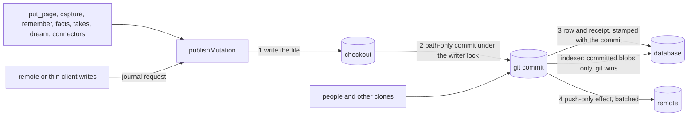

# Git as the source of truth for agent-written memory

Status: design. Every switch named here ships off, and nothing changes on upgrade.
Supersedes: [DATABASE_CANONICAL_MEMORY.md](DATABASE_CANONICAL_MEMORY.md) (database as the source of truth, files as a one-way export), which is kept for its incident analysis.
Citation convention: repo-relative paths on master 5a4c5805 (v0.60.433.0).

## Decision

Git stays the parent. For a source in strict git-canonical mode (`canonical: git`, chosen per source, default off), every page-content write goes through one door: the file is written, it is committed under the checkout's writer lock, and only then does the database commit the row. The database is an index of what git holds. It never holds page content that git does not have, except for declared database-only classes (below) and derived data. When git and the database disagree, git wins and the database re-derives from the committed blob.

This keeps the property small brains already rely on (rebuild the index from files, read and edit memory as Markdown, review it with git) and removes the cause of most large-brain incidents: two copies of record with many uncoordinated writers. The database-canonical design reached the same diagnosis and picked the other parent; this design picks git because the files are the product's identity and the database is the part that can always be rebuilt.

## Today

Almost every content write is database-first today. In managed mode `publishMutation` (`src/core/persistence/coordinator.ts:450`) runs prepare, a durable recovery record, the file rename, then the database row and receipt in one transaction, and only then queues a Git effect that commits later and pushes. In classic mode the row lands first and write-through renders the file from it. Several writers (unmanaged `importFromContent` callers, direct coordinated database writes, the withdrawal ledger, some fact paths) write rows with no file at all. So between the database commit and the Git commit the database is ahead of git, and when anything interferes (a crash, a parked push, a person editing the file, a foreign merge) sync has to decide which copy is right. That decision is the hold vocabulary: `file_drift`, `concurrent_write`, held deletions, `source_changed` refusals.

## The model

1. **One door.** `publishMutation` stays the single write path. For a strict source it commits the written paths locally (the path-only commit `gbrain git commit-push` already performs) between the file rename and the database transaction, and stamps the commit on the receipt. The Git effect becomes push-only. Writes that arrive while a commit is in flight join the next commit (group commit), so commit cost is paid per group, not per write.
2. **Recovery follows git.** A crash after the commit and before the database transaction is finished by indexing the committed file, not by restoring the previous bytes.
3. **The indexer reads commits, not the worktree.** For a strict source the managed sync pass reads the level at HEAD alone and imports each committed blob the database does not hold, keyed by path and blob id so replays are idempotent: a database version sync never saw, a drifted page and a page under an uncommitted edit all take the committed bytes, and the edit stays on disk. A committed removal deletes the page. An uncommitted absence means nothing. There is no hold classification, because there is nothing to classify: git is right by definition. The pass refuses `--working-tree`, the level it keeps between passes is dropped when `canonical` flips, and a pass that runs between a door commit and its database transaction leaves that write's replay to finish it (the door's own bytes are already committed, so the replay publishes them once). `gbrain sources reindex <id> --from-git` previews every database version Git replaces, bound to HEAD by a hash, and `--apply --expect <hash>` runs that pass; doctor `git_index_lag` reports how many commits and seconds a strict source's index trails HEAD.

   The one place the working tree reaches Git on a strict source is the door commit itself. `commitThroughDoor` commits each written path in its planned state (the bytes the write published) or not at all: an edit made to that path after the write's rename and before its commit refuses `git_target_changed` and leaves the edit on disk (the write is held for `gbrain repair stuck-recovery` when the file holds neither the write's bytes nor the version before it, and fails with nothing held when it holds the version before it), and a staged change of the path refuses `git_index_conflict` with the index untouched. Nothing else, sync included, reads the working tree of a strict source.
4. **Push is off the write path.** Pushes are batched, integrate a moved remote in memory, and skip changes that are patch-equivalent to commits this checkout already made. A genuine two-sided conflict on a page path parks only the push; local commits and writes continue, and doctor reports it.
5. **Enforced in the database.** For a strict source, a page-content change that does not come from the door or the indexer is refused, so an older binary cannot write database-first.

## Declared database-only classes

Some content deliberately has no file. In strict mode each such class is declared, and anything undeclared is refused with a typed code that names the git home to configure.

| Class | Handling |
|---|---|
| Private, alias-private and lineage-private pages | Never committed. Making a page private is a door commit that removes its file, and the row stays database-only; making it public writes the file through the door. Content pushed before it became private stays in git history. Conversion withholds a private page whose committed file differs from it; one whose committed file still equals it keeps that file in HEAD, as before the conversion (see Conversion). |
| `storage.db_only` prefixes and the derive-phase folders (`DERIVE_PHASE_DB_ONLY_DEFAULTS`, `src/core/storage-config.ts:425`) | The door refuses to commit under them and the indexer ignores them. |
| Paths the checkout's Git ignores (for example archived images) | Never committed and never given a Git effect, so they cannot park. |
| Database-only sources (no checkout, `sync.write_through=false`, unbound) | Outside strict mode; the whole source is the class. |
| Derived data (chunks, embeddings, mention links, rows parsed from fences and timelines, receipts) | Rebuilt from git or kept as metadata; never content of record. |

The database backup covers the declared classes; git covers everything else.

## What has to gain a file form

Some authored content lives only in database rows today. Each gets a Markdown home before its writer can go through the door: fact withdrawals become fence edits and the withdrawal ledger is derived on import; facts with no fence move into fences; manual links, owner actions and extraction-authored timeline rows get a Markdown form. Forgetting removes a fact from current files and from the index; earlier commits keep it, and gbrain never promises physical erasure.

## What this retires, for a strict source

| Class | Why it cannot occur |
|---|---|
| `file_drift`, `concurrent_write`, `source_changed` drift refusals | The database is never ahead of git, and when git moves the index follows. |
| Held deletions, `file_gone`, never-committed files | Only a committed removal deletes; worktree absence is not read. |
| Per-write Git effects that park | Commits happen in the door; pushes are batched and never block writes. |
| Database-first writers overwriting a file (the compare-before-replace class) | No writer writes a row whose file is not already committed. |
| Ignored-path parking | Ignored paths are a declared class and never get a Git effect. |

What remains: a bad merge from another clone is indexed as committed (git wins), so a merge that reintroduces older blobs changes the index too; doctor flags a foreign commit that sets a path back to a blob the door had replaced, and the fix is a git revert. Write latency includes a local commit; group commit and plumbing commits keep that bounded on large checkouts, and the soak sets the window.

## Remote and hosted writes

A write from a remote MCP caller or a thin client becomes a journal request that the checkout owner's door commits. The caller receives the revision once it is committed and indexed, or `write_pending` with a request id while the owner is unavailable. It is never written database-first. A hosted brain runs the door against a server-side bare repository, with an optional push to a repository the user owns.

The request carries the bytes, the expected revision, the idempotency key (`request_id`) and the caller's grant, and the owner re-authorizes it against the live grant inside the publication transaction, before the door commit. A grant revoked while the request waits is refused with no commit and no row. If a door commit landed and the transaction then failed, the request is replayed; should the replay end without committing (its grant revoked meanwhile), the receipt still names the landed commit (`outcome.persistence.landed_before_row`), because Git holds those bytes and the indexer will import them: they were authorized when they were committed, and a later revocation does not retract committed content.

A hosted source (`gbrain sources host-repo`, G7b-2) keeps one bare repository per source and a gbrain-owned linked worktree of it, claimed with the same claim and physical-root checks as any canonical worktree, so the door, recovery, receipts and the push effect are unchanged: a door commit moves the branch the worktree shares with the bare repository. Only the door moves that branch. A pre-receive hook refuses every push, because Git's own refusal to update a checked-out branch ends once the worktree is removed and pruned; door commits are local ref updates and the push to the user's repository is outgoing, so neither passes the hook. A claim refuses a linked worktree whose link is broken (`git_worktree_link_broken`). The verb starts only from an empty source; adopting existing pages is conversion. A doctor check for a missing or changed hook is a G8 follow-up; until then the verb's preview reports it.

## Conversion

A source changes mode only through a preview-bound verb. The preview is the [git-gap census](#the-git-gap-census): every page whose row differs from its committed blob, every page with no file that is not in a declared class, held items and parked effects, by category. The preview lists any database content that git-wins would discard, and the apply binds to that preview. A source can return to its previous mode.

G8a ships it as `gbrain sources canonical <source-id> --to git|mixed [--dry-run | --apply --expect <hash>] [--json]`: trusted local CLI on a managed brain only, never an MCP operation. `--dry-run` (the default) writes nothing and puts every live page in one category, with counts, a capped path sample and the preview hash (HEAD, the source incarnation and every planned item with its revision):

| Category | What the apply does |
|---|---|
| adopt (`database_ahead`, `undeclared_database_only`, `worktree_only`) | Writes the page's export view to its file and commits it through the door, up to 200 pages per commit. The worktree writer lock is taken per group and dropped between groups. No row changes: the bytes read back `equal`, and the strict pass after them rewrites none of those rows. A page with no import record whose row differs from HEAD counts as `database_ahead`, so it is adopted before the strict import could overwrite it. |
| declared | Nothing. A page under an ignored path is `git_ignored` and never gets a file or a Git effect. A declared page whose committed file reads back equal to it (`declared.committed_equal`) keeps that file in HEAD: a strict import of it changes nothing. Another declared page whose committed file differs is withheld when it is a privacy class, and a discard otherwise. |
| withhold (`file_committed`, `file_absent`) | G7a's private transition for a privacy-class page whose committed file differs from it, or whose recorded file a commit already removed. Group by group under the writer lock, a transaction stamps the class and moves `source_path` to `withheld_source_path`, then a committed file's removal goes through the door. The page stays live with its body unchanged. Stamped first, no sync reads the removal as a deletion; a crash before the commit leaves the file in HEAD and the rerun withholds it again. |
| git wins | The strict pass indexes the committed blob: Git moved and the database did not, Git deleted a page the database had not edited, a held deletion, or a held `file_drift` whose side is unknown and whose row already equals the committed file. |
| holds | Cleared, so Git's verdict runs over them. |
| parked effects | Retried once, or, for targets Git ignores, the page is stamped `git_ignored` (declared) in the same transaction that marks each parked target `declared: git_ignored`; the target stays as a record and the next preview no longer lists it. |
| discard | Refused: `git_conversion_blocked` names each category (both sides moved, a both-sides drift hold, an unknown-side drift hold whose row differs from the committed file, a database edit Git deleted, an uncommitted working-tree edit that differs from HEAD and the export, an ignored target, a target whose ignore status Git cannot read (`ignore_status_unknown`: beyond a symlink, outside the checkout, a failed check; only that path is refused), unparseable, unsafe path, segmented page, export mismatch, or a row a strict pass would overwrite unplanned). There is no override. |

`--apply --expect <hash>` re-plans and refuses `preview_changed` on any difference, adopts group by group (a crash leaves the source mixed and the rerun preview lists only what is left), withholds group by group, settles the parked effects, rechecks what a strict pass would overwrite, clears the holds only after that recheck passes, runs the full strict-equivalent pass, then sets `canonical: git` in the transaction that records the conversion. Writes can land between that pass and the flag, so it runs one genuine strict pass and previews again. A live writer's door commits (`gbrain git commit-push`) that land after that pass read its level leave Git ahead of the database at their paths and nothing else; the source is git-canonical by then, so the apply runs up to three closing strict passes (phase `strict_pass_closing`, incremental), previewing again after each, and reports `closing_passes`. The conversion is complete only when nothing is left; otherwise it reports `git_conversion_incomplete` with what remains and the source stays strict, because Git wins. Where durability applies the apply pushes its door commits itself, after the groups and once at the end; a push that does not land leaves them local, the receipt says so, and the next page write's push-only effect sends them. The apply prints a progress line per phase and every 10 seconds on stderr, and SIGTERM, SIGINT or SIGHUP prints a partial report (phase, groups committed, items scanned, canonical state); `GBRAIN_MEMORY_TRACE=<seconds>` (1 to 3600) adds a memory line on stderr every that many seconds, and `gbrain sync` honors it too. `--to mixed` removes the flag and changes nothing else; Git keeps every door commit. Both strict passes read the whole level (a full round) without opening a `--full` re-import episode, so a page already equal to its blob is not re-imported, and a re-import that changes nothing queues no embedding effect when every chunk already holds a vector for its text (#7866). Each pass drains under the source's drain lease as `gbrain sync` does, so a write of its own that outlives one receipt wait does not stop it; an unrelated write that never settles, or another drainer, still stops it with `git_conversion_incomplete` before the flag. Every `git_conversion_incomplete` carries `fix` (preview again; verify with `gbrain sync status --source <id> --json`), and with `--json` the refusal carries `progress`. In a strict pass, progress `total` is the planned paths for the whole pass; `round`, `candidates`, `batch` of `batches` and `scanned` say where the round stands. On a source whose managed root is not inside a Git checkout, or is a checkout with no commit yet, the preview and the apply refuse with `git_checkout_required` or `git_branch_unborn` before they read or write anything (#7885); the source stays usable as it is, and the fix asks the user before the folder becomes a Git repository (then `gbrain sources canonical <id> --to git --dry-run --json` previews again).

## The git-gap census

`gbrain sources git-gap <source-id> [--sample n] [--json]` is the read-only preview conversion will bind to, and doctor `db_ahead_of_git` reports its totals per source with a Git checkout (informational in G1: always ok). It compares every live page with the blob committed at HEAD, read with hardened plumbing (`ls-tree`, `cat-file --batch`, `check-ignore`), so no repository filter, textconv or hook runs. It never reads `git status` or `git diff`. Each page lands in exactly one state:

| State | Meaning | What conversion does with it |
|---|---|---|
| `equal` | The row equals the HEAD blob under the export equality contract (fact withdrawals overlaid; a segmented page byte for byte). | Nothing; the indexer would derive the same row. |
| `database_ahead` | A blob exists at HEAD and the row differs; the sample lists the differing field paths. | The operator commits the database content through the door or lets git win; the preview lists what git-wins would discard. |
| `git_ahead` | The HEAD blob is not the blob the page last imported, per its sync import record (`blob_oid` / `disk_blob_oid`), so git moved since the import. `git_ahead_database_also_moved` counts pages whose row moved too. | Git wins: the indexer imports the committed blob. Where both moved, the preview lists the database edit git-wins would discard. |
| `declared_database_only` | A declared class (counted per class): `mirror_source`, `private`, `alias_private`, `lineage_private`, `database_only` (`database_only_reason`), `db_only_prefix` (`storage.db_only`), `derive_folder` (a never-filed page under the derive-phase defaults), `git_ignored`. `declared_with_head_blob` counts those whose file is still committed, such as a page that turned private. | They stay out of git. A still-committed file of a private page is removed by a door commit; earlier commits keep it. |
| `undeclared_database_only` | No blob at HEAD and no declared reason. | Commit it through the door, declare its class, or delete it. Strict mode refuses it until then. |
| `worktree_only` | A file exists in the working tree but not at HEAD. | Commit it through the door or remove it; a strict indexer reads only commits. |
| `unparseable` | The committed blob is not UTF-8 Markdown the importer accepts, or is a symlink. | A person fixes the file; conversion refuses the page until then. |
| `unsafe_path` | The recorded `source_path` maps to no safe file path. | Reconcile the path first. |

Without an import record (classic sync, or a page imported before records were written) the census cannot tell which side moved, so a page whose file changed in git counts as `database_ahead`; `database_ahead_without_import_record` says how many. The working tree is reported separately by raw bytes against HEAD (`clean`, `modified`, `deleted`, `untracked`, `absent`); a checkout whose attributes convert line endings reads as modified. In strict mode an uncommitted change means nothing. A page withheld from Git by its private transition (`withheld_source_path`) is compared with the file at that withheld path, where a page-prepare write would put it again. The census reads each batch's export views together (`readExportPages`, which looks pages up by primary key). A path whose ignore status Git cannot read (beyond a symlink, outside the checkout, a timed-out check) refuses the census report, so `gbrain sources git-gap` and doctor's `db_ahead_of_git` name the path and the reason and count nothing for that source. The conversion plan classifies it as not ignored and discards it as `ignore_status_unknown`; other paths in the batch are unaffected.

The census also counts rows with no Git home, which G4 and G5 give a file form: active facts with no fence row, fenced facts whose fence page is missing or has no committed file, links whose `link_source` is not one a file derives (`markdown`, `frontmatter`, `mentions`, `wikilink-resolved`; `manual`, custom tags, `concept-provenance`, `atom-provenance` and legacy NULL rows all count), and timeline rows on pages with no committed file. Open sync holds are counted by code and parked effect targets by kind and code; strict mode retires both in G8.

## Waves

| Wave | Ships |
|---|---|
| G1 | this document; the read-only git-gap census (`gbrain sources git-gap`) and doctor `db_ahead_of_git` |
| G2 | the door: path-only commit before the database transaction, inverted recovery, group commit, push-only effect, per-source strict flag |
| G3 | the indexer: committed blobs only, unconditional import, re-derive verb with preview, index-lag check |
| G4 | memory and facts get a file form (withdrawals as fence edits, unfenced facts into fences) |
| G5 | authored rows written by direct coordinated database writes get a file form |
| G6 | unmanaged writers routed through the door with batched commits |
| G7 | declared classes, large files, remote and hosted writes |
| G8 | conversion verb (G8a: `gbrain sources canonical`), retirement of the hold machinery for strict sources |

Every wave is default-off and changes nothing for existing sources until a source is converted.
