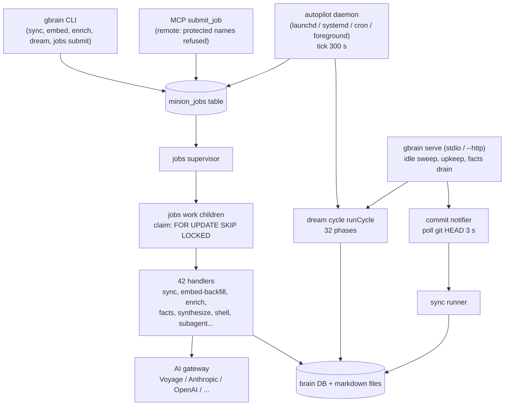
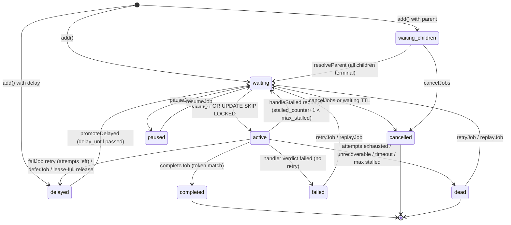

# Background jobs, workers, schedulers, and daemons

Research map for the Rust port. Reference: [garrytan/gbrain](https://github.com/garrytan/gbrain) at `origin/master` commit `8bbfd0b5e8` (v0.60.x), read on 2026-11-16. All paths are relative to that repo root. Statements were checked in code unless marked "(unverified)". Doc comments in the reference are sometimes stale (for example, the `cycle.ts` header says 9 phases and a 30-minute lock TTL; the code has 32 phases and a 5-minute TTL), so trust the code-derived values here over in-repo comments.

Related maps: [subsystems.md](./subsystems.md) (one paragraph per `src/core` directory) and [test-suites.md](./test-suites.md). The BrainEngine, schema and Postgres-feature maps are [brain-engine.md](./brain-engine.md), [schema.md](./schema.md) and [postgres-features.md](./postgres-features.md).

## How the pieces fit

## Key facts

| Area | Value | Source section |
|---|---|---|
| Queue table | `minion_jobs`, 9 statuses, token fencing (`lock_token`, `claim_generation`) | [Minions job queue engine](#minions-job-queue-engine) |
| Claim | `UPDATE ... WHERE id = (SELECT ... FOR UPDATE SKIP LOCKED LIMIT 1)` in `MinionQueue.claim` | same |
| Wakeups | Postgres: `LISTEN` in `sync-queue-wake.ts` + NOTIFY trigger on `minion_jobs`. PGLite: no LISTEN, foreground drain, 1 s poll | same, and [locks](#autopilot-cycle-serve-schedulers-and-locks) |
| Retry | `max_attempts` 3, backoff `2^(n-1) * 1000 ms` with ±20% jitter; deferred / lease-full / shutdown bounces burn no attempt; timeout and max-stall go to `dead` | engine section 6 |
| Handlers | 42 registered job names (`registerBuiltinHandlers`, `src/commands/jobs.ts`); 13 protected names; remote submit allow-list `sync`, `import`, `lint`, `lint-fix` | [Job handler catalog](#job-handler-catalog) |
| Autopilot | tick 300 s adapted by brain score; full cycle floor 60 min per source; pid lock `~/.gbrain/autopilot.lock` + heartbeat JSON | daemons section 1 |
| Dream cycle | 32 phases in `ALL_PHASES`; per-phase USD caps; cycle lock row TTL 5 min, renewed every 50 s | daemons section 2 |
| Serve idle work | 10 min tick; upkeep once per 24 h capped at `maintenance.embed_daily_usd` ($1); facts drain; corpus drain (HTTP) | daemons section 3 |
| Embedding default | `voyage:voyage-4`, 1024 dims; reranker `voyage:rerank-3-lite`; embed-backfill $10 per job, $25 per source per 24 h | [pipelines](#sync-embedding-enrichment-and-ingestion-pipelines) |
| Locks | about 25 primitives: DB lock rows with TTL (`gbrain_cycle_locks`), file pid locks, native `flock`/`LockFileEx` addon, transaction advisory locks (admission, quota, rate leases, budget, generations, facts) | daemons section 6 |

## Top parity risks (consolidated)

1. **Claim and fencing semantics.** One winner per claim, stale-worker completions rejected by `lock_token`, stall reclaim after lease expiry plus 15 s grace. An embedded store must give the same observable outcomes under concurrent workers.
2. **Advisory-lock mutual exclusion.** Admission, quota, rate leases, budget, generations, mentions, chronicle, and facts use `pg_advisory_xact_lock(hashtext(...))`. Rust needs per-key mutual exclusion with transaction-scoped release, across processes if more than one process can write.
3. **Attempt accounting and error classes.** `JobDeferredError` (no attempt), `UnrecoverableError` (dead), plain throw (backoff) are relied on by sync, facts-absorb, embed-backfill, and webhooks.
4. **On-disk and DB contracts read by `doctor` and operators.** Lock-file formats (`autopilot.lock`, `cycle.lock`, page locks), `autopilot.heartbeat.json`, `sync-failures.jsonl`, `sources.last_commit`, `maintenance.last_run`, the weekly budget JSONL ledgers.
5. **Bookmark ordering in sync.** `last_commit` advances only after the failure-ledger gate; auto-skip after 3 failing runs; deletes batched at 500 with a 500-delete / 1% cap.
6. **Timing-dependent behavior.** Lease renewal `min(lock/2, 60 s)`, adaptive autopilot interval, 3 s stdin-idle gates, backoff jitter. Parity tests need clock and jitter seams.
7. **Log lines and `--json` events are a contract.** `[cycle] score=...`, `[dispatch] job #...`, idle-sweep lines, and autopilot JSON events are read by benchmarks and agents.
8. **Nondeterministic LLM phases.** synthesize, patterns, consolidate, facts extraction, enrich, chronicle need recorded or stubbed provider responses for parity.

## Open questions for Garry (consolidated)

1. **Process model.** With embedded storage, is there one writer process (serve owns workers, cycle, and notifier; the CLI talks to it over a socket), or may several processes open the store? This decides whether Rust needs a cross-process lease table or only a file lock plus IPC, and whether the supervisor + child-worker model survives.
2. **Per-job process isolation.** Keep `--job-isolation process` (the only way to kill a hung handler), or run handlers as in-process tasks?
3. **Autopilot packaging.** Keep autopilot as a separately installed daemon with launchd/systemd/cron generators (about 1,650 lines of OS-specific installer), or fold it into `serve`?
4. **Job surface.** Keep `shell` jobs? Keep cycle-phase wrappers (`synthesize`, `patterns`, `consolidate`, ...) as separately submittable jobs? Drop `chronicle_extract` and the unregistered protected names `edge_contradictions` / `standing_questions`?
5. **Providers.** Keep hosted Voyage as the default embedder, or require a local model for an embedded/offline build? Keep `think`'s direct Anthropic SDK path? Carry transcription (`transcription.ts` is published but unused internally)?
6. **Connectors in v1.** Google, Slack, meetings (Fireflies), and the cookie-based ChatGPT / Claude.ai connectors: which ship in the first Rust release?

---

## Minions job queue engine

Scope: the queue engine under `src/core/minions/` and its CLI entrypoints. The per-handler catalog (what each job name does) is out of scope. Reference: `garrytan/gbrain` at 8bbfd0b5e8 (v0.60.x). All citations are verified in the code unless marked "(unverified)".

### 1. Storage: tables and columns

Primary table is `minion_jobs` (`src/schema.sql:1248`). Key columns:

| Group | Columns |
|---|---|
| Identity | `id SERIAL`, `name`, `queue` (default `'default'`), `priority` (default 0), `data JSONB` |
| Status | `status` (CHECK: `waiting, active, completed, failed, delayed, dead, cancelled, waiting-children, paused`) |
| Attempts | `max_attempts` (3), `attempts_made`, `attempts_started`, `stalled_counter`, `max_stalled` (5) |
| Backoff | `backoff_type` (`fixed`/`exponential`), `backoff_delay` (1000 ms), `backoff_jitter` (0.2) |
| Lease | `lock_token`, `lock_until`, `lock_duration_ms` (CHECK 5000..3600000), `claim_generation` |
| Deadlines | `delay_until`, `timeout_ms`, `timeout_at` |
| Tree | `parent_job_id` (FK, ON DELETE SET NULL), `on_child_fail` (`fail_parent`/`remove_dep`/`ignore`/`continue`), `depth`, `max_children` |
| Results | `result`, `progress`, `error_text`, `stacktrace` (append-only JSON array), token counters `tokens_input/output/cache_read` |
| Dedup | `idempotency_key` with partial unique index `uniq_minion_jobs_idempotency` |
| Trust | `submission_authority JSONB` (NULL = legacy row, refused until authorized), `spend_authorization`, `spend_claim_token` (added by v205 migration) |
| Private queues | `private_queue_owner_job_id`, `private_queue_owner_token`, `private_queue_lease_until` |
| Lifecycle flags | `remove_on_complete`, `remove_on_fail` |

Related tables (all in `src/schema.sql`):

- `minion_inbox` (`:1324`): parent mailbox; `child_done` messages are written here by `failJob` and `completeJob`.
- `minion_attachments` (`:1336`): per-job blobs, unique on `(job_id, filename)`.
- `subagent_rate_leases` (`:1469`): rate-lease rows, FK-cascaded to `minion_jobs`.
- `minion_budget_log` and `minion_lease_pressure_log` are referenced by the v093 migration (`src/core/schema-migrations/v093-minions-v0-41-audit-and-budget.ts`). `migration_impact_log` is a separate table. (The exact DDL for the budget/lease-pressure tables was not re-read; unverified in this pass.)

Indexes (`src/schema.sql:1304-1320`):
- `idx_minion_jobs_claim` on `(queue, priority, created_at) WHERE status='waiting'`. This is the claim index.
- `idx_minion_jobs_stalled` on `lock_until WHERE status='active'`.
- `idx_minion_jobs_delayed` on `delay_until WHERE status='delayed'`.
- `idx_minion_jobs_timeout` on `timeout_at WHERE status='active' AND timeout_at IS NOT NULL`.
- Parent and parent-status indexes, and private-queue recovery indexes.

Triggers (Postgres only for NOTIFY):
- `enforce_minion_queue_protocol` (`src/schema.sql:1789`, `BEFORE INSERT OR UPDATE`). It rejects inserts with NULL `submission_authority` or non-zero `claim_generation`. It requires `claim_generation = OLD + 1` on every transition into `active` or on a new `lock_token`. It also enforces the spend protocol.
- `notify_minion_job_change` (`:1813`, `AFTER INSERT OR UPDATE OF status`). It calls `pg_notify('minion_jobs', {id, status, name, queue, prev_status})`.

The `MinionJob` row type and its mapper are in `src/core/minions/types.ts` (`rowToMinionJob`). The input shape is `MinionJobInput` (`types.ts:121`).

### 2. Job lifecycle and state machine

Statuses are defined in `src/core/minions/types.ts:20` (`MinionJobStatus`). The transitions below come from `queue.ts` and `worker.ts`:

| From | To | Trigger (function) |
|---|---|---|
| (insert) | `waiting` | `MinionQueue.add` (`queue.ts:227`) |
| (insert, with parent) | `waiting-children` | `add` sets the parent to `waiting-children` (`queue.ts:680`) |
| (insert, `delay` set) | `delayed` | `add` (via `delay_until`) |
| `waiting` | `active` | `claim` (`queue.ts:1463`), `UPDATE ... FOR UPDATE SKIP LOCKED` |
| `delayed` | `waiting` | `promoteDelayed` (`queue.ts:2153`), `delay_until <= now()` |
| `active` | `completed` | `completeJob` (`queue.ts:1745`), token-fenced |
| `active` | `delayed` | `failJob(..., 'delayed', backoffMs)` (`queue.ts:1853`), retry path |
| `active` | `failed` | `failJob(..., 'failed')`, from a handler verdict (`worker.ts:1569`, `jobResultOutcome`). Not retried. |
| `active` | `dead` | `failJob(..., 'dead')` when `attemptsExhausted` or `isUnrecoverable` (`worker.ts:1728-1732`). Also `handleTimeouts` and `handleWallClockTimeouts` (`error_text='timeout exceeded'` / `'wall-clock timeout exceeded'`) and `handleStalled` dead branch (`'max stalled count exceeded'`). |
| `active` | `waiting` | `handleStalled` requeue (`queue.ts:2166`), stall counter +1 |
| `active` | `delayed` | `deferJob` (`queue.ts:2027`, `JobDeferredError`) and `releaseLeaseFullJob` (`queue.ts:2000`, no attempt burned) |
| `active` | `delayed` (+1 min) | `releaseClaimForPause` and quiet-hours defer (`worker.ts`, around line 984-1031) |
| `waiting` / `delayed` / `waiting-children` / `paused` / `active` | `cancelled` | `cancelJob` / `cancelJobs` (`queue.ts:1042`) |
| `waiting` | `cancelled` | `handleWaitingTTL` (`queue.ts:1161`), admission TTL (`admission.ts`, 48 h default for `subagent`) |
| `waiting-children` | `waiting` | `resolveParent` (`queue.ts:2269`), and the backstop sweep at the end of `handleStalled` |
| `waiting-children` | `failed` | `failParent` (`queue.ts:2285`), when a child fails with `on_child_fail='fail_parent'` |
| `paused` | `waiting` | `resumeJob` (`queue.ts:2310`) |
| `failed`, `dead` | `waiting` | `retryJob` (`queue.ts:1227`) and `replayJob` (`queue.ts:2379`) create or reset rows |

Note on terminal states. `completed`, `failed`, `dead`, and `cancelled` are terminal. `remove_on_complete` and `remove_on_fail` delete the row instead of keeping it. `terminal-events.ts` is a cursor over `(finished_at, id)` for these events.

### 3. Claim mechanism

**Claim SQL** (`src/core/minions/queue.ts:1463`, `MinionQueue.claim`). This is one `UPDATE ... WHERE id = (SELECT ... FOR UPDATE SKIP LOCKED LIMIT 1) RETURNING *`:

- Subselect predicates: `queue = $3 AND status = 'waiting' AND submission_authority IS NOT NULL AND name = ANY($4)`, plus optional watchdog-suspect and exclusion filters.
- Order: `priority ASC, created_at ASC`, with an optional overdue-suspect sort key first.
- Assignments: `status='active'`, `claim_generation = claim_generation + 1`, `lock_token = $1`, `lock_until = now() + lock`, `attempts_started + 1`, `started_at = COALESCE(started_at, now())`. Also `timeout_at` is set from `timeout_ms` when one resolves.
- Lock duration resolves in order: row `lock_duration_ms`, then handler map (`HANDLER_DEFAULT_LOCK_DURATION_MS`, `handler-timeouts.ts`), then worker default `$2`. The row-level value is clamped to [5 s, 1 h] in SQL.
- Timeout resolves: row `timeout_ms`, then `HANDLER_DEFAULT_TIMEOUT_MS`. Examples: 30 min for `subagent`, `autopilot-cycle`, `extract`; 10 min for `facts-absorb`; 5 min default lock for `subagent`.

`claim()` first calls `assertNoUnreviewedJobs` (`submission-authority.ts:371`). Any live legacy row with NULL `submission_authority` makes the claim refuse.

**Locking primitives.** Two different mechanisms are used:

- Row-level: `FOR UPDATE SKIP LOCKED` in claim, and in the sweeps (`handleStalled`, `handleTimeouts`, `handleWallClockTimeouts` at `queue.ts:1547/1687/2166`). Completion and failure use `SELECT ... FOR UPDATE` on the job row and on its parent (`completeJob:1759`, `failJob:1871`), with the parent locked first. Updates are token-fenced: `WHERE id=$ AND status='active' AND lock_token=$`.
- Transaction advisory locks (`pg_advisory_xact_lock`) are used for admission and quota (`queue.ts:385/431/488`), for rate leases (`rate-leases.ts`, keyed by `hashKey(key)`), and for budget reservation (`budget-meter.ts`). Claim itself does not use advisory locks.
- Stale-plan retries: `retryOnStalePlan` wraps `completeJob` and `failJob`.

**Wakeups.** Workers poll. The claim loop waits `pollInterval` (default 5000 ms in `MinionWorker`, `worker.ts:310`; `IdleWaiter` in `idle-wait.ts`). On Postgres, `sync-queue-wake.ts` can wake an idle loop early in two modes:
- `listen`: `LISTEN minion_jobs`. Used only on a direct session, not behind a transaction pooler. A probe NOTIFY must arrive within `LISTEN_PROBE_MS` (3 s), or the mode falls back to poll. Only `sync` jobs trigger a wake.
- `poll`: one indexed read every `GBRAIN_WORKER_SYNC_WAKE_POLL_MS` (default 1000 ms, clamped 250 to 5000).
- `off`: on PGLite, with `GBRAIN_WORKER_SYNC_WAKE=0`, or on a non-Postgres engine.

The claim loop's own poll remains the backstop. Delayed rows are promoted by `promoteDelayed` on each loop tick.

**PGLite differences.**
- The claim SQL is the same (`executeRawDirect`). PGLite is a single-connection WASM Postgres, so contention is handled by one process, not by row locks between processes.
- No LISTEN/NOTIFY wake (`sync-queue-wake.ts` returns `not_postgres`). The notify trigger is documented as Postgres only (`schema.sql:1812`).
- No supervisor. `supervisor.ts:8` states the supervisor is Postgres-only because PGLite's exclusive file lock blocks a second process. `jobs.ts` rejects that combination.
- `gbrain jobs work` on PGLite drains the queue in the foreground (`src/commands/jobs/work.ts:57`, `drainPgliteQueue` at `:348`) with `pollInterval: 200` and `healthCheckInterval: 0`. Wakeshift drains run afterward.
- `reconnect` is absent on PGLite (`reconnect.ts`). Cancellation signals are ignored by PGLite in some paths (`queue.ts:2091` comment).
- `rate-leases` and `admission` IDs are coerced to Number because PGLite returns Numbers where postgres.js returns BigInt (`rate-leases.ts`, comment near `leaseId`).

### 4. Worker process model

Three layers, each in its own file:

1. **CLI entrypoints** (`src/commands/jobs.ts`, `src/commands/jobs/*.ts`):
   - `jobs work` (`src/commands/jobs/work.ts`): one worker process, claim loop, handlers registered from `registerBuiltinHandlers`.
   - `jobs supervisor [start|status|stop]` (`src/commands/jobs/supervisor.ts`): the daemon. `start --detach` forks a background process.
   - `jobs run-child` (`src/commands/jobs/run-child.ts`): child side of per-job process isolation.
   - `jobs submit`, `jobs stats`, `jobs list`, `jobs smoke`.
   - `autopilot` (`src/commands/autopilot.ts`): when `minion_mode != off` and the engine is Postgres, spawns a `gbrain jobs work` child and submits one `autopilot-cycle` job. On PGLite or with `--inline`, it runs sync in-process.
2. **MinionSupervisor** (`src/core/minions/supervisor.ts:554`) and **ChildWorkerSupervisor** (`src/core/minions/child-worker-supervisor.ts`). The supervisor takes a queue-scoped DB lock (`supervisorLockId`, `SUPERVISOR_LOCK_TTL_MIN = 5`, refreshed every `SUPERVISOR_LOCK_REFRESH_MS = 60000`) and a PID file (`DEFAULT_PID_FILE`, `supervisor-<brain-id>.pid`). It spawns `gbrain jobs work` via `buildWorkerArgs` (`supervisor.ts:187`). Lock loss exits with code 4 (`ExitCodes.LOCK_LOST`).
3. **MinionWorker** (`src/core/minions/worker.ts:200`). Runs the claim loop, `launchJob`, lock renewal, and the sweeps.

**Heartbeat and stall detection.** There is no separate heartbeat table. The heartbeat is `lock_until`, renewed by the lock-renewal timer (`worker.ts:1303`, `lock-renewal-tick.ts`):
- Renewal interval is `renewalIntervalFor(lockMs) = min(floor(lockMs/2), RENEWAL_INTERVAL_CAP_MS=60000)` (`lock-renewal-tick.ts:170-171`).
- Verify-before-evict: a failed or timed-out renewal triggers a bounded verify (fenced renew). Only a certain fence loss aborts the job.
- The stall sweep runs every `stalledInterval` (default 30 s, `worker.ts:632`). It calls `handleStalled` (with grace `GBRAIN_MINION_STALL_RECLAIM_GRACE_MS`, default 15 s), then `handleTimeouts`, then `handleWallClockTimeouts`.

**Watchdog and health.**
- RSS watchdog: `--max-rss` (`MinionWorker.checkMemoryLimit`, `worker.ts:1080`). It checks `RssAnon + RssShmem` (`proc-rss.ts`) on a 60 s timer and after each job. A soft line at 80% logs a warning. Crossing the cap triggers graceful drain and exit code `WORKER_EXIT_RSS_WATCHDOG = 12` (`worker-exit-codes.ts`). Jobs in flight are charged to the watchdog only when alone (`watchdog-attribution.ts`, `WATCHDOG_SUSPECT_MARK`).
- Default RSS cap is auto-sized (`rss-default.ts`): half of min(cgroup limit, total mem), clamped to [4096, 16384] MB. The supervisor's `maxRssMb` default is 2048 (`supervisor.ts` DEFAULTS), and the supervisor spawns the worker with `--max-rss` only when the value is > 0.
- DB probe: a worker that cannot reach the DB exits after `dbFailExitAfter` failures (default 3).
- Stall warn and exit: `stallWarnAfterMs` (5 min) and `stallExitAfterMs` (10 min), as worker options.
- Wedge watchdog in the supervisor: `wedgeRestartMinutes` (15), `wedgeRestartChecks` (3), `wedgeRestartLoopBudget` (3 in a 30 min window) (`supervisor.ts` DEFAULTS). It restarts a child that has claimable work but no forward progress.

**Niceness.** `niceness.ts` (`NICE_MIN -20`, `NICE_MAX 19`) applies `--nice N` or `GBRAIN_NICE`. The CLI reniceses the supervisor, and the worker re-applies the value to itself. Children inherit it. The effective value is recorded in `worker-registry.ts` for `jobs stats` and doctor.

**Per-job isolation.** `--job-isolation inline|process` (`job-isolation.ts`, default `inline`; env `GBRAIN_JOB_ISOLATION`). In `process` mode, each claimed job runs in a SIGKILL-able child (`child-job-runner.ts runJobInChild`, `run-child.ts`). The child reports one outcome file (`CHILD_OUTCOME_PROTOCOL_VERSION=1`, max 32 MB). Termination is SIGTERM to the group, then SIGKILL after `CHILD_KILL_GRACE_MS` (25 s). The parent still owns claim, renewal, and all result recording.

**Graceful shutdown.** `worker-shutdown.ts` settles claims token-fenced with no attempt burned when a job is interrupted by shutdown. It drains for 30 s, then force-evicts (`drainForced`, exit `WORKER_EXIT_DRAIN_FORCED = 17`).

**Crash backoff.** `calculateBackoffMs(crashCount) = min(1000 * 2^crashCount, 60000) + up to 10% jitter` (`supervisor.ts:245`). `ChildWorkerSupervisor` counts real crashes (non-zero exit, runtime under `stableRunResetMs` = 5 min). Clean exits do not increment it. Soft stop at `maxCrashes` (default 10). Hard stop at `maxCrashes * HARD_STOP_CRASH_MULTIPLIER` (10), so 100 by default, overridable with `GBRAIN_SUPERVISOR_HARD_STOP_CRASHES` (`child-worker-supervisor.ts:180`).

### 5. Concurrency, lanes, rate leases, admission, budget

**Per-worker concurrency.** `concurrency` option (default 1 in `MinionWorker`; CLI default 1 via `GBRAIN_WORKER_CONCURRENCY`; supervisor default 2). The loop claims only while `inFlight.size < concurrency`.

**Lanes** (`src/core/minions/lanes.ts`). Long jobs may hold at most `concurrency - reserved` slots, with at least one slot always available for long work. Reserved slots default to 1 (`DEFAULT_SHORT_JOB_RESERVED_SLOTS`). The lane budget applies only when `concurrency >= 2`.
- `DEFAULT_LONG_JOB_NAMES` (`lanes.ts`): `autopilot-cycle`, `autopilot-global-maintenance`, `embed-backfill`, `connector-sync`, `extract`, `doctor-refresh`.
- `claimExclusions` returns the long names as `excludeNames` once the long budget is full. The claim SQL then adds `AND NOT (name = ANY(...))`.
- Config keys: `minions.long_job_names` (JSON array or comma list, added to defaults) and `minions.short_job_reserved_slots` (non-negative integer).

**Queue families** (`queue-families.ts`). `dream-inline-*` private queues fold into one `dream-inline` row in `jobs stats`. Those queues exist because dream phases create a private queue per run.

**Rate leases** (`src/core/minions/rate-leases.ts`). Lease-based limiter for outbound providers, keyed by name (e.g. `anthropic:messages`). Table `subagent_rate_leases(key, owner_job_id, expires_at)`.
- `acquireLease(engine, key, ownerJobId, maxConcurrent, {ttlMs})` runs in a transaction with `pg_advisory_xact_lock(hashKey(key))`. It prunes expired rows, counts, and inserts if under `maxConcurrent`. Default TTL 120 s.
- `renewLease` bumps `expires_at`. `releaseLease` deletes.
- If full, the caller throws `RateLeaseUnavailableError` (`rate-leases.ts:166`). The worker treats it as a lease-full bounce: `releaseLeaseFullJob` re-queues after `leaseFullBackoffMs()` (1-3 s jittered) and burns no attempt. It writes `minion_lease_pressure_log`.
- Callers include `subagent-oneshot.ts:423` and `contextual-reindex-per-chunk`.

**Global LLM halt cooldown** (`llm-halt-cooldown.ts`). Process-local, keyed by provider identity. After an `auth`, `billing`, or `model_not_found` error, jobs defer for 5 min. After `rate_limit`, they defer for 60 s. The cooldown doubles up to `HALT_COOLDOWN_MAX_MS` (30 min). The cooldown is applied to `facts-absorb` only. Its remaining time overrides the lease-full backoff through `RateLeaseUnavailableError.retryInMs`.

**Admission** (`src/core/minions/admission.ts`). Submit-side only:
- Param coalescing: `coalesce_params` is on for `subagent` (`PARAM_COALESCE_DEFAULT`). It hashes the payload (`computeParamHash`, `__submitter` and `__param_hash` excluded) and returns the newest matching waiting row with `coalesced: true`. Parented submits never coalesce.
- Waiting TTL: `WAITING_TTL_DEFAULT_HOURS = { subagent: 48 }`. The sweep `runWaitingTtlTick` cancels stale waiting rows with `waiting_ttl_expired`.
- Name-global quota: `minions.quota_max_waiting.<name>`. No default. Rejects with `QueueQuotaExceededError`.
- `maxWaiting` and `maxPending` options in `queue.add` use advisory locks (`queue.ts:385/431/488`).

**Budget and spend metering.**
- `budget-meter.ts`: durable reserve-then-settle for paid OAuth/MCP operations. Reservations are atomic under `pg_advisory_xact_lock` keyed by client ID or group key. `RESERVATION_TTL_MS = 10 min`. `sweepExpiredReservations` releases stale ones.
- `spend-authorization.ts`: consent-gated producers (`book-mirror`, `enrich`, subagent submits) store a `spend_authorization` on the job (through the trusted `MinionQueue.add` option, not job data). Each provider call under `runWithJobSpend` reserves its maximum liability against `group:<group_id>`, then settles measured usage. Legacy NULL rows are stamped `legacy_default`.
- `delegated-*` (`delegated-admission.ts`, `delegated-policy.ts`, `delegated-spend.ts`): replays keep the original owner and spend ceiling. Current grants may narrow a ceiling, never widen it.

### 6. Retry, failure, dead-lettering, timeouts, idempotency, parent/child

**Attempt accounting.** `attempts_started` increments on claim. `attempts_made` increments on every `failJob` (including `dead` from timeouts and max-stall). `chk_attempts_order` requires `attempts_made <= attempts_started`.

**Retry decision** (`src/core/minions/worker.ts:1720-1745`):
- `JobDeferredError`: `deferJob` (delayed, no attempt burned).
- `RateLeaseUnavailableError`: `releaseLeaseFullJob` (delayed, no attempt burned).
- `ChildNotClaimedError`: return silently.
- Shutdown-interrupted: settled without attempt burn (`worker-shutdown.ts`).
- `UnrecoverableError` or refusal (`jobRefusal`): `dead` immediately.
- `attempts_made + 1 >= max_attempts`: `dead`.
- Otherwise `delayed` with backoff.

**Backoff formula** (`src/core/minions/backoff.ts:calculateBackoff`):
- Exponential: `delay = 2^max(attempts_made - 1, 0) * backoff_delay`. The worker passes `attempts_made + 1`, so the first retry is 1000 ms, the second 2000 ms, and so on.
- Fixed: `delay = backoff_delay`.
- Jitter: `delay ± delay * backoff_jitter` (uniform, default 0.2).
- Default `max_attempts = 3`, meaning up to two retries (1 s then 2 s) before `dead`.

**Verdicts.** A handler that returns a result whose `jobResultOutcome` is `failed` (for example `blocked_by_failures`, or a failed phase) goes to `failed` with no retry (`worker.ts:1569`). `completed` is the default for clean results.

**Error classification.** Two layers:
- `error-classify.ts`: a string classifier for dashboards and the self-fix path. Buckets include `prompt_too_long`, `rate_limit`, `timeout`, `http_5xx`, `auth`, and `rate_lease_full`. Only `prompt_too_long`, `tool_schema_mismatch`, and `malformed_json` are recoverable for auto-resubmit.
- `retry-matcher.ts` (`isRetryableConnError`, used in `worker.ts:574/823/888`): decides whether a DB error triggers `reconnectEngineAfterConnError` and retry, not whether the job retries.

**Timeouts** (three separate, each terminal, no retry):
- `handleTimeouts` (`queue.ts:1547`): `timeout_at < now()` on active rows, to `dead` with `error_text='timeout exceeded'`.
- `handleWallClockTimeouts` (`queue.ts:1687`): elapsed since `started_at` over a threshold, to `dead`.
- Per-handler defaults are in `handler-timeouts.ts` (`HANDLER_DEFAULT_TIMEOUT_MS` and `HANDLER_DEFAULT_LOCK_DURATION_MS`). Examples: `subagent` 30 min timeout and 5 min lease; `facts-absorb` 10 min timeout and 2 min lease; `sync` 5 min lease.

**Stalls** (`queue.ts:2166`, `handleStalled`):
- Candidate: active row with `lock_until < now() - grace`.
- If `stalled_counter + 1 < max_stalled` (default `max_stalled` 5): back to `waiting`, `stalled_counter + 1`, and `attempts_made` is not incremented.
- Otherwise `dead` with `error_text='max stalled count exceeded'`, and `killJobs` notifies the parent.
- A co-runner requeue path (`requeueCoRunnerStalls`) treats claims lost in one worker crash (for example an OOM kill) as one event.

**Cancellation** (`queue.ts:1042`, `cancelJobs`): cancels a root plus all descendants. It writes `child_done` to parents and applies `on_child_fail`. Waiting-TTL and quiet-hours skip use the same path. `pauseJob` and `resumeJob` move between `waiting` and `paused`.

**Idempotency** (`src/core/minions/idempotency-coalesce.ts`, `queue.ts:589-669`):
- The `uniq_minion_jobs_idempotency` partial unique index enforces dedup.
- Insert uses `ON CONFLICT (idempotency_key) WHERE idempotency_key IS NOT NULL DO NOTHING`. If nothing was inserted, the existing row is returned after `coalesceDecision` (`submission-authority.ts:359`). The result is `coalesced: true`.
- The lease is INSERT-only. A re-submit never changes the first submitter's `lock_duration_ms`.

**Parent and child jobs.**
- `add` with `parent_job_id` (`queue.ts:227`) sets the parent to `waiting-children` in the same transaction (`:680`).
- `MinionQueue.add` locks the parent with `SELECT ... FOR UPDATE` before insert, so concurrent submissions serialize.
- `max_children` (default NULL, unlimited) caps live children. `max_spawn_depth` caps depth.
- A child completing or failing writes a `child_done` message to `minion_inbox`, then `resolveParent` flips the parent back to `waiting` when every child is terminal.
- `on_child_fail` on the child: `fail_parent` makes the parent `failed` (`failParent`, `queue.ts:2285`); `remove_dep` detaches the child; `ignore` and `continue` let the parent proceed.
- `readChildCompletions` (`queue.ts:2415`) is how an aggregator reads child results.
- Backstop: the end of `handleStalled` re-flips any `waiting-children` parent with no non-terminal children.

### 7. Trust boundary

**Protected job names** (`src/core/minions/protected-names.ts`, `PROTECTED_JOB_NAMES`). Includes `shell`, `subagent`, `subagent_aggregator`, `synthesize`, `patterns`, `consolidate`, `edge_contradictions`, `standing_questions`, `contextual_reindex_per_chunk`, `extract-takes-from-pages`, `unify-types`, `skillopt`, and `extract-atoms-drain`.

- `MinionQueue.add` (`queue.ts:251`) throws unless `trusted.allowProtectedSubmit` is set.
- Local CLI and trusted operations set it. Callers: `ops/jobs.ts:211` (only when `ctx.remote === false`), `remediation/run.ts:433`, and `ops/jobs.ts:468` for delegated submits.
- Remote MCP and OAuth calls are blocked for protected names at `ops/jobs.ts:198`.
- The `shell` handler additionally requires `GBRAIN_ALLOW_SHELL_JOBS=1` or `--allow-shell-jobs` (`supervisor.ts:89/209`, `ops/jobs.ts:191`).

**Submission authority** (`src/core/minions/submission-authority.ts`).
- Every row carries `submission_authority`. Kinds: `application`, `remote_generic` (for `sync`, `import`, `lint`, `lint-fix`), and `remote_agent` (OAuth client, with grant scopes and `payloadHash`).
- Claim requires `submission_authority IS NOT NULL`. `authorizeJobExecution` (`:282`) re-checks the principal before the handler runs.
- Payloads and caller-spread options are never authority. The authority is stored by the server.
- `REMOTE_JOB_NAMES` is the allowlist for remote generic submits.

**Plugins.** `plugin-loader.ts` loads subagent definitions from `GBRAIN_PLUGIN_PATH` (colon-separated, each with `gbrain.plugin.json`).

**Terminal hook.** `terminal-hook.ts` runs a command set in local file config (`minions.terminal_hook`), never from the DB or job data. It runs as an argv array with no shell, with job metadata in `GBRAIN_JOB_*` env vars.

### 8. Scheduling: delays, quiet hours, recurring

- **Delayed jobs.** `delay` at submit sets `delay_until` and status `delayed`. `promoteDelayed` moves rows with `delay_until <= now()` to `waiting`. `deferJob` and `releaseLeaseFullJob` use the same path.
- **Quiet hours** (`quiet-hours.ts`). Evaluated at claim time, not dispatch. Config: `{start, end, tz, policy}` with `start`/`end` as local hours, possibly wrapping midnight. `policy: 'skip'` cancels with `skipped_quiet_hours`. `policy: 'defer'` (default) delays 15 min (`worker.ts:984-1031`). The config lives on the job row as `quiet_hours` JSONB (`types.ts:205`, migration v013).
- **Recurring jobs.** The queue has no cron table. Scheduling is done by callers: `autopilot` (`src/commands/autopilot.ts`) submits `autopilot-cycle` jobs, and the `stagger_key` column (v013) spreads them. Recurring behavior beyond that was not traced in this pass (unverified).
- **Wakeshift** (`src/core/wakeshift/drain.ts`) runs after PGLite foreground drains. Its details are out of scope here.

### 9. Config knobs and env vars

| Knob | Default | Where | Effect |
|---|---|---|---|
| `--concurrency` / `GBRAIN_WORKER_CONCURRENCY` | 1 (worker CLI); 2 (supervisor) | `jobs/shared.ts:92`, `supervisor.ts` | In-flight jobs per worker |
| `--queue` | `default` | `jobs/work.ts:56` | Queue name |
| `--max-rss` | auto (`rss-default.ts`); 0 = off | `jobs/shared.ts:56` | RSS drain threshold (MB) |
| `--nice` / `GBRAIN_NICE` | inherit | `jobs/shared.ts:81` | OS niceness, -20 to 19 |
| `--job-isolation` / `GBRAIN_JOB_ISOLATION` | `inline` | `job-isolation.ts` | `process` runs each job in a child |
| `--allow-shell-jobs` / `GBRAIN_ALLOW_SHELL_JOBS` | off | `jobs/work.ts:54` | Enables the `shell` handler |
| `--health-interval` | 60000 ms | `supervisor.ts` | Supervisor health probe |
| `GBRAIN_SUPERVISOR_PID_FILE` | `~/.gbrain/supervisor-<brain-id>.pid` | `supervisor.ts:147` | PID file path |
| `GBRAIN_SUPERVISOR_LOCK_WAIT_SECONDS` | (see code) | `supervisor.ts:503` | Wait for a held supervisor lock |
| `GBRAIN_SUPERVISOR_HARD_STOP_CRASHES` | `maxCrashes * 10` | `child-worker-supervisor.ts:180` | Hard crash stop |
| `GBRAIN_SUPERVISED` | set by supervisor | `worker.ts:664` | Disables self-run stall timers |
| `GBRAIN_MINION_STALL_RECLAIM_GRACE_MS` | 15000 | `queue.ts:99` | Grace before stall reclaim |
| `GBRAIN_LOCK_RENEWAL_MAX_FAILURES` / `_CALL_TIMEOUT_MS` / `_SAFETY_MARGIN_MS` / `_HARD_EVICT_MS` | (see `lock-renewal-tick.ts`) | `lock-renewal-tick.ts:102-133` | Lock renewal tuning |
| `GBRAIN_WORKER_SYNC_WAKE` | on (Postgres) | `sync-queue-wake.ts:39` | `0` disables LISTEN/poll wake |
| `GBRAIN_WORKER_SYNC_WAKE_POLL_MS` | 1000 (250 to 5000) | `sync-queue-wake.ts:50` | Idle wake poll cadence |
| `GBRAIN_LOCK_STEAL_GRACE_SECONDS` | (see code) | `core/db-lock.ts:93` | Supervisor DB lock steal grace |
| `GBRAIN_JOB_ID`, `_NAME`, `_QUEUE`, `_STATUS` | set per hook call | `terminal-hook.ts:91` | Terminal hook environment |
| `GBRAIN_PLUGIN_PATH` | unset | `plugin-loader.ts` | Subagent plugin dirs |
| `GBRAIN_SERVE_STALL_WATCHDOG_MS` | (see code) | `core/process-watchdog.ts:362` | Serve-process watchdog (not the worker's) |
| `minions.long_job_names` | defaults in `lanes.ts` | DB config | Extra long-lane names |
| `minions.short_job_reserved_slots` | 1 | DB config | Reserved short slots |
| `minions.coalesce_params.<name>` | on for `subagent` | DB config | Param coalescing |
| `minions.ttl_waiting_hours.<name>` | 48 for `subagent` | DB config | Waiting TTL |
| `minions.quota_max_waiting.<name>` | none | DB config | Name-global waiting quota |
| `minions.terminal_hook` | off | local `~/.gbrain/config.json` only | Terminal-event hook argv |
| `minions.ttl_notice_shown` | n/a | DB config | One-time TTL notice |

Per-job knobs (set at submit): `max_attempts` (3), `backoff_type`, `backoff_delay` (1000), `backoff_jitter` (0.2), `max_stalled` (5, range 1 to 100), `timeout_ms`, `lock_duration_ms` (5 s to 1 h), `priority`, `delay`, `parent_job_id`, `on_child_fail`, `max_children`, `remove_on_complete`, `remove_on_fail`, `idempotency_key`, `quiet_hours`, `stagger_key`, `coalesce_params`, `maxWaiting`, `maxPending`.

### Parity risks

- **Atomic claim with row locks.** `UPDATE ... WHERE id = (SELECT ... FOR UPDATE SKIP LOCKED)` plus token fencing (`lock_token`, `claim_generation`) is the main correctness property. An embedded engine with one writer (PGLite-style) needs the same observable outcome: one winner per claim, and a fenced completion from a stale worker must be rejected.
- **Lease timing.** Lock renewal (`min(lock/2, 60 s)`), verify-before-evict, and the stall grace (15 s) are timing rules. Black-box tests that expect a job to be reclaimed after N seconds will be sensitive to these values.
- **Attempt accounting.** Lease-full, deferred, shutdown, and watchdog bounces burn no attempt, while stall requeues and timeouts have their own counters. A Rust port must reproduce all of these paths, or retry counts will differ.
- **Backoff jitter.** Backoff is randomized (±20%), so exact-delay tests need a seam.
- **Parent/child unblocking.** `waiting-children` to `waiting`, `child_done` inbox writes, and `on_child_fail` ordering (inbox row before parent update) are transactional invariants.
- **Advisory locks.** Admission, quota, rate leases, and budget use transaction advisory locks keyed by hashed names. The Rust port needs an equivalent mutual exclusion per key, not only per row.
- **Wake behavior.** Postgres uses LISTEN/NOTIFY with a probe, and PGLite drains in the foreground. Tests that depend on latency will differ across these.
- **Supervisor restart semantics.** Exit codes 0, 2, 3, 4, 12, 16, and 17 each have different respawn behavior (`supervisor.ts`, `worker-exit-codes.ts`). Crash-count logic (soft stop at 10, hard stop at 100) is observable.

### Open questions for Garry

- **Single-writer embedded store vs. concurrent workers.** The Postgres model assumes many worker processes and a supervisor lock. Does the Rust engine need multi-process workers on an embedded store, or is a single-process worker with threads acceptable? This changes the whole supervisor/child model.
- **Process isolation.** Is `--job-isolation process` (per-job child processes, group SIGKILL) required in Rust, or is the inline model enough? Child processes are the only way to kill a hung handler mid-run.
- **Advisory locks replacement.** Admission, quota, and budget rely on transaction advisory locks. Is an in-process mutex keyed by name acceptable for a single-writer embedded store?
- **LISTEN/NOTIFY.** Is the 1-second poll enough, or should the Rust port provide an in-process notification channel? Only the `sync` job uses it today.
- **Scope of protected names.** Should the full protected list (including `shell`) carry over unchanged, and is the `remote_agent` authority model (OAuth grants per job) in scope for the first port?

## Job handler catalog

Scope: every Minion job name that a worker can execute in the gbrain v0.60.x reference (`8bbfd0b5e8`). Handlers are registered in `registerBuiltinHandlers` (`src/commands/jobs.ts:532`) plus a few inline registrations. Every handler is a `MinionHandler` that receives a `MinionJobContext` and returns a result object. Queue mechanics (claim, lease, stall sweep, retry) live in `src/core/minions/queue.ts` and `src/core/minions/worker.ts`; this section covers the handler layer only.

### Queue-wide defaults (apply unless a row says otherwise)

| Setting | Value | Source |
|---|---|---|
| Worker concurrency | `--concurrency` flag, else `GBRAIN_WORKER_CONCURRENCY`, else 1 | `src/commands/jobs/shared.ts:91` |
| Lock lease / stalled interval | 30 s / 30 s worker defaults | `src/core/minions/worker.ts:307-308` |
| Max attempts | 3 | `src/core/minions/queue.ts:635` |
| Backoff | exponential, base 1000 ms, jitter 0.2 (`2^(attempts-1) * delay`) | `queue.ts:636-638`, `backoff.ts` |
| Wall-clock timeout when `timeout_ms` is null | `2 * lockDuration * max_stalled` | `queue.ts:1685`, `1718` |
| Per-handler timeout map | subagent, aggregator, embed-backfill, connector-sync, autopilot-cycle, autopilot-global-maintenance, extract: 30 min; chronicle_extract, facts-absorb: 10 min; contextual_reindex_per_chunk: 60 min | `src/core/minions/handler-timeouts.ts` |
| Per-handler lock lease map | 300 s for subagent, aggregator, embed-backfill, connector-sync, autopilot-*, sync, contextual; 120 s for chronicle_extract, facts-absorb; `shell` deliberately null (30 s default) | `handler-timeouts.ts` |
| Long-job lane | `autopilot-cycle`, `autopilot-global-maintenance`, `embed-backfill`, `connector-sync`, `extract`, `doctor-refresh`. With concurrency >= 2, one slot is kept free for short jobs (`minions.short_job_reserved_slots`, default 1) | `src/core/minions/lanes.ts` |
| Error semantics | `UnrecoverableError` dead-letters at once; `JobDeferredError` re-queues without burning an attempt; a plain throw retries with backoff | `src/core/minions/errors.ts`, used across handlers |

### Job catalog

Protected = in `PROTECTED_JOB_NAMES` (`src/core/minions/protected-names.ts`). Protected jobs cannot be submitted over MCP (`src/core/ops/jobs.ts:198`). Remote submit is restricted further to `sync`, `import`, `lint`, `lint-fix` (`REMOTE_JOB_NAMES`, `src/core/minions/submission-authority.ts:19`).

"Cycle phase" below means the handler wraps `runCycle({ phases: [name] })` from `src/core/cycle.ts`. Source paths are relative to `src/`.

| Job name | Handler file | What submits or triggers it | Cadence | Lane / timeout / lease / retry | External services | State read | State written | Protected |
|---|---|---|---|---|---|---|---|---|
| `sync` | `core/minions/handlers/sync.ts` → `commands/sync/perform.ts` `performSync` | Webhooks (`commands/serve-http-webhooks.ts:245,884`), CLI sync, autopilot freshness (`commands/autopilot-dispatch.ts:445,634`), `core/github-source.ts` | Event-driven, plus autopilot freshness ticks | Short; null timeout; 300 s lease; busy lock = skip, not failure | git fetch/pull only when pull is true (default managed no-pull) | `sources` row, `sync.repo_path`, `sources.last_commit`, sync-drain lease | Pages, chunks, sources, sync markers | No (remote-allowed) |
| `embed` | `handlers/embed.ts` → `commands/embed.ts` `runEmbedCore` | `embed --background`, brain-score recommendation (`core/brain-score-recommendations.ts:265`), doctor remediation | On demand | Short; null timeout unless submitter sets one; retry default | Embedding provider via gateway | Pages/chunks with null or stale embedding signature | Chunk embeddings | No |
| `embed-catch-up` | `handlers/embed-catch-up.ts` → `runEmbedCore({stale, catchUp})` | Onboard remediation (`core/onboard/checks.ts:246,263`) | On onboard | Short; retry default | Embedding provider | Stale pages for source | Embeddings | No |
| `embed-backfill` | `handlers/embed-backfill.ts` → `core/embed-stale.ts` `embedStaleForSource` | `core/embed-backfill-submit.ts` `submitEmbedBackfill`, called from sync, `commands/sources.ts`, `core/github-source.ts`, `core/google/google-source.ts`, `core/sync-embed-backfill.ts` | Per source: 10 min cooldown; 24 h spend cap $25 per source | Long lane; 30 min timeout; 300 s lease; DB lock `gbrain-embed-backfill:<source>` TTL 60 min; $10 per-job budget | Embedding provider | Pages/chunks for one source | Chunk embeddings, job progress | No |
| `connector-sync` | `handlers/connector-sync.ts` → `core/connectors/sync.ts` `runConnectorSync` | `commands/connectors/sync.ts:178`; autopilot per connector (`commands/autopilot-fanout.ts:831`, slot-keyed) | Meetings every 60 min, Slack every 30 min (defaults in `core/meetings/types.ts:19`, `core/slack/types.ts:11`) | Long lane; 30 min; 300 s lease; per-provider lock TTL 35 min; auth errors are terminal (returned, not thrown); fetch failure limit 5 | Chat/meeting provider APIs; no LLM in fetch | Connector cursor state, `auto_sync` config | Ingested pages, connector state | No (remote blocked by design) |
| `ingest_capture` | `handlers/ingest-capture.ts` → `importFromContent` | Ingestion daemon (`core/ingestion/daemon.ts`: file watcher, inbox folder, cron); `serve --http` POST `/ingest` (`commands/serve-http-webhooks.ts:609`) | Event-driven | Default lane; refuses (kept for `jobs retry`) when source is gone | None | Source grant, revision backfill state | Pages under `inbox/YYYY-MM-DD-<hash6>` or caller slug | No |
| `lint` | `handlers/lint.ts` → `commands/lint.ts` `runLintCore` | CLI submit; remote-allowed; also inline cycle phase `lint` | Per cycle | Short | None | Markdown under `dir` or `.` | Report only | No |
| `lint-fix` | `handlers/lint-fix.ts` → `runLintCore({fix:true})` | Doctor remediation; remote-allowed | On demand | Short | None | Markdown files | Markdown fixes on disk | No |
| `integrity` | `handlers/integrity.ts` → `commands/integrity.ts` `runIntegrity` | CLI submit | On demand | Short | Unverified | Pages | Pages when mode is auto | No |
| `integrity-auto` | `handlers/integrity-auto.ts` → `runIntegrity(['auto'])` | Doctor data-integrity remediation (`commands/doctor/checks/data-integrity.ts:56`) | On doctor remediate | Short | Unverified | Pages | Pages | No |
| `sync-retry-failed` | `handlers/sync-retry-failed.ts` → `runSync(engine, [])` | Doctor sync-failures remediation (`commands/doctor/checks/sync-failures.ts:90`) | On doctor remediate | Short | Git (via sync) | Sources | Sync state | No |
| `import` | `handlers/import.ts` → `commands/import.ts` `runImport` | CLI submit; remote-allowed | On demand | Short; throws if any file errors | None | Markdown dir (`job.data.dir`) | Pages | No |
| `extract` | `handlers/extract.ts` → `commands/extract.ts` `runExtractCore` or `extractStaleFromDB` | Sync finalize when deferred (`commands/sync/finalize.ts:539,548`); brain-score recommendation (`core/brain-score-recommendations.ts:300`); self-chained continuation | On demand; stale continuations | Long lane; 30 min (+5 min for continuation) | None for links/timeline modes (unverified) | Pages, extraction watermark | Links, timeline entries | No |
| `backlinks` | `handlers/backlinks.ts` → `commands/backlinks.ts` `runBacklinksCore` | Brain-score recommendation (`core/brain-score-recommendations.ts:284`) | On recommendation | Short | None | Markdown under repo | Markdown when `action=fix` | No |
| `extract-ner` | `handlers/extract-ner.ts` → `core/extract-ner.ts` | Onboard checks (`core/onboard/checks.ts:384`) | On onboard | Short | None (regex only) | Pages | Links (typed_ner and plain kinds) | No |
| `extract-timeline-from-meetings` | `handlers/extract-timeline-from-meetings.ts` → `core/extract-timeline-from-meetings.ts` | Onboard checks (`core/onboard/checks.ts:462`) | On onboard | Short; throws on refused writes | None (SQL and string scan) | Meeting pages | Timeline entries | No |
| `extract-takes-from-pages` | `handlers/extract-takes-from-pages.ts` → `core/extract-takes-from-pages.ts` | Onboard checks (`core/onboard/checks.ts:515`) | On onboard with consent | Refuses unless `takes.bootstrap_enabled` | Anthropic (Haiku classifier per page) | Pages, `takes.bootstrap_enabled` | Takes | Yes |
| `extract-conversation-facts` | `handlers/extract-conversation-facts.ts` → `commands/extract-conversation-facts.ts` | Doctor local-audits (`commands/doctor/checks/local-audits.ts:246`); CLI | On demand | Needs `sourceId`; `max_cost_usd` default $5 | Chat LLM via gateway | Conversation pages | Facts | No |
| `facts-absorb` | `handlers/facts-absorb.ts` → `core/facts/backstop.ts` `runFactsBackstop`; wrapper `core/minions/llm-halt-cooldown.ts` | `core/facts/backstop.ts:447`, once per page write (sources: `sync:import`, `mcp:put_page`, `file_upload`, `hook:writeback`) | Per page | 10 min; 120 s lease; 3 attempts; keyless worker defers 30 min without an attempt | Chat LLM via gateway | Page truth and frontmatter, chat config | Facts, fence blocks, absorb log | No |
| `chronicle_extract` | `handlers/chronicle-extract.ts` → `core/chronicle/job.ts` `runChronicleJob` | None in current code; drains legacy rows (comment: nothing enqueues it since #5876) | Legacy drain | 10 min; 120 s lease; provider errors retry, other failures unrecoverable | Chat LLM | Page content, content hash | Chronicle ledger and events | No |
| `loops_extract` | `handlers/loops-extract.ts` → `core/google/loops-extract.ts` | `core/google/loops-enqueue.ts:134`; `core/google/loop-catchup.ts:322` | Enqueued by Google sync on recent trickle threads, capped per sweep | Default | Chat LLM judge | Google email pages, `loops.extraction_enabled` | Open loops, loop-extract outcome record | No |
| `enrich` | `handlers/enrich.ts` → `commands/enrich.ts` `runEnrichCore` | CLI `gbrain enrich` (one job per source) | On demand | Needs `sourceId`; `maxCostUsd` default $5 | LLM via gateway (provider unverified) | Pages for source | Page enrichment | No |
| `unify-types` | `handlers/unify-types.ts` → `core/schema-pack/unify-types-handler.ts` | Manual only (`core/remediation/manual-only.ts`); `gbrain jobs submit unify-types` | Manual | Requires `target_pack`; dry run unless `apply:true` | None | Roughly 25K pages | Retyped pages, alias rows, link rows, active schema pack | Yes |
| `autopilot-cycle` | `handlers/autopilot-cycle.ts` → `core/cycle.ts` `runCycle` | `commands/autopilot-fanout.ts:497,597`; autopilot daemon | Autopilot tick every 300 s (`commands/autopilot-daemon.ts:79`); per-source full-cycle floor 60 min | Long lane; 30 min; 300 s lease; yields event loop between phases | Per phase | Source checkout | Per phase writes | No |
| `autopilot-global-maintenance` | `handlers/autopilot-global-maintenance.ts` → `runCycle` per phase | `commands/autopilot-fanout.ts:746` (`dispatchGlobalMaintenance`) | Global floor 60 min (`GLOBAL_FLOOR_MIN`, config `autopilot.global_floor_min`); single-flight per slot, `maxPending:1` | Long lane; 30 min (override `GBRAIN_GLOBAL_MAINTENANCE_TIMEOUT_MS`, min 60 s); 60 s deadline reserve | Depends on phases, including LLM phases | Config `autopilot.global_maintenance.progress`, `autopilot.last_global_at` | Phase writes; stamps `last_global_at` | No |
| `synthesize` | `handlers/cycle-phase.ts` → `runCycle(['synthesize'])` | CLI submit; also cycle phase inline (`core/cycle/synthesize.ts`) | On demand | Default; children get 30 min each | Anthropic via subagent children | Pages | Concept and synthesis pages; child `subagent` jobs | Yes |
| `patterns` | `handlers/cycle-phase.ts` → `runCycle(['patterns'])` | CLI submit; inline cycle phase (`core/cycle/patterns.ts`) | On demand | Default; children 30 min | Anthropic via subagent children | Pages, `PATTERNS_FIRST_BATCH` 25 | Pattern pages | Yes |
| `consolidate` | `handlers/cycle-phase.ts` → `runCycle(['consolidate'])` | CLI submit | On demand | Default | Unverified | Pages | Pages | Yes |
| `extract_facts` | `handlers/cycle-phase.ts` → `runCycle(['extract_facts'])` | Inline in freshness phases; CLI submit | Per cycle | Default | Chat LLM (unverified) | Pages | Facts | No |
| `resolve_symbol_edges` | `handlers/cycle-phase.ts` | Cycle job | On demand | Default | None (DB only) | Pages | Symbol edges | No |
| `recompute_emotional_weight` | `handlers/cycle-phase.ts` | Source freshness phase (inline); job | Per cycle | Default | None (DB only) | Pages | Emotional weight | No |
| `extract-atoms-drain` | `handlers/extract-atoms-drain.ts` → `core/cycle/extract-atoms-drain.ts` | Autopilot auto-drain (`commands/autopilot-dispatch.ts:798`); doctor atom-holds (`commands/doctor/checks/atom-holds.ts:15`); CLI `--drain` | Autopilot auto-drain | Window default 120 s per run; lock contention completes as deferred; deadline is unrecoverable | Anthropic Haiku, about $0.30 per source per run; budget default $0.3 | Sources, atom queue | Atom rows, managed atom batches | Yes |
| `contextual_reindex_per_chunk` | `handlers/contextual-reindex-per-chunk.ts` → `core/contextual-retrieval-service` | `commands/reindex-synopsis.ts:176` (sweep); mode-switch hook and doctor remediate (per protected-names comment; call site unverified) | On demand; idempotency per page revision | 60 min; 300 s lease; global rate lease, default 50 per key (`GBRAIN_CONTEXTUAL_SYNOPSIS_RPM`) | Anthropic Haiku, one synopsis per chunk | Chunks, pages | Chunk synopses, re-embeds | Yes |
| `subagent` | `handlers/subagent.ts` (+ `subagent-persistence.ts`, `subagent-oneshot.ts`) | `commands/agent.ts:336,391,431`; `core/cycle/patterns.ts:349`; `core/cycle/synthesize.ts:971,1015`; `commands/book-mirror.ts:470`; `core/ops/jobs.ts:466` | On demand; children of cycle phases | 30 min; 300 s lease; max 20 turns; per-turn timeout 30 min | Anthropic Messages API; default model `claude-sonnet-4-6` | Pages via `brain_*` tool allowlist | Page writes (staged when `stage_writes`), child result messages | Yes |
| `subagent_aggregator` | `handlers/subagent-aggregator.ts` | `commands/agent.ts:405` after children | After children finish | 30 min; 300 s lease; reads inbox | None | Child-done inbox messages | Aggregated markdown result | Yes |
| `shell` | `handlers/shell.ts` (+ `shell-validate.ts`, `shell-audit.ts`, `shell-redact.ts`, `shell-inherit.ts`) | `gbrain jobs submit shell` (CLI); `core/ops/jobs.ts` for trusted local callers | On demand | Refused unless worker has `GBRAIN_ALLOW_SHELL_JOBS=1`; lease 30 s; timeout null | Arbitrary command | Child env allowlist (PATH, HOME, USER, LANG, TZ, NODE_ENV) plus `inherit` config | Arbitrary | Yes |
| `reindex` | `handlers/reindex.ts` → `commands/reindex.ts` `runReindex` | CLI `jobs submit reindex`; search-mode switch consent prompt | On demand | Paid run needs stored spend record, else `confirmation_required` (unrecoverable) | Embedding provider (re-embed) | Pages, chunks | Embeddings | No |
| `repair-jsonb` | `handlers/repair-jsonb.ts` → `commands/repair-jsonb.ts` | Doctor remediation; CLI | On demand | Local DB only | None | JSONB columns | Repaired rows | No |
| `orphans` | `handlers/orphans.ts` → `engine.findOrphanPages()` | Doctor remediation; inline phase `orphans` | On demand; per cycle | Default | None | Pages, links | None (report) | No |
| `purge` | `handlers/purge.ts` → `persistence/purge-deleted.ts` | Inline phase `purge`; job submit | Per cycle; retention from config | Scope `pages`, `sources` or `all` (default all) | None | Soft-deleted pages and sources | Hard deletes | No |
| `doctor-refresh` | Inline in `commands/jobs.ts` → `commands/doctor/last-known.ts` `runDoctorRefresh` | `queueRefresh` (`commands/doctor/last-known.ts:153`); config `doctor.background_refresh` | At most once per hour (slot key) | Long lane; 15 min; max_attempts 1; priority 10; maxWaiting 1 | None | DB doctor checks | Doctor last-known cache | No |
| `skillopt` | Inline in `commands/jobs.ts` → `core/skillopt/job.ts` `runSkillOptJob` | `commands/skillopt.ts:301` (`--background`) | On demand | Queue `default`; no explicit timeout | Anthropic (optimizer, judge, rollouts) | Skill dir, benchmark file | Skill edits, results | Yes |
| `edge_contradictions` | No handler registered (absent from `registerBuiltinHandlers`) | Inline cycle phase only | Per cycle | n/a | Chat model (phase) | Edges | Edge flags | Yes (name only) |
| `standing_questions` | No handler registered | Inline cycle phase only | Per cycle | n/a | Chat model (phase) | Questions | Question pages | Yes (name only) |
| `noop`, `smoke-sigkill-probe`, `smoke-wedge-probe` | `commands/jobs/smoke.ts` | `gbrain jobs smoke` (queues the probes on queue `smoke`) | Manual | Test only | None | None | None | No |

Count: 42 handler rows backed by a worker registration (`registerBuiltinHandlers` plus inline registrations), 2 protected names with no registration, and the smoke-only names. `noop` is registered in `commands/jobs/smoke.ts:69`; the two probe names are queued there (`smoke.ts:101`, queue `smoke`), and their handler registration was not verified.

### Key handler detail

**Embedding backfill (`embed-backfill`, `embed`, `embed-catch-up`).** `embed-backfill` is the per-source path (v0.40 federated sync). Submission (`core/embed-backfill-submit.ts`) gates on a 10-minute cooldown after a run and on a rolling 24 h spend cap of $25 per source; PGLite refuses at the worker surface. The handler checks keyless mode first and returns `skipped` when no embedding key exists. It takes the per-source DB lock, then runs `embedStaleForSource` under a `BudgetTracker` (default $10 per job, skipped when the model has no known price). The submit path uses `batchSize` 500; with no `batchSize` the stale pass defaults to 2000 (`core/embed-stale.ts:393`). Concurrency comes from `GBRAIN_EMBED_CONCURRENCY` (default 20, `core/embed-concurrency.ts:25`). Sub-batches are 100 texts (`core/embedding.ts:74`). Rate-limit retries cap at 5 (`core/embed-retry.ts:75`). Progress goes to `job.updateProgress`. Failure handling: a stall watchdog fails the job for retry; an incomplete run throws a retryable error; a run with no progress and the same blockers as the previous attempt dead-letters (`UnrecoverableError`, see `embed-backfill-stall.ts`). A lost lock aborts the run (`LockStolenError`). The lock is always released in `finally`.

**Sync (`sync`).** The handler resolves `sourceId` from the job or by `sources.local_path`. It reads the pull flag through `job-pull.ts`. When pull is not set, `implyManagedNoPull` applies the managed default. `noEmbed` defaults to true and `noExtract` defaults to true; the embed and extract work is queued separately (`embed-backfill` via `sync-embed-backfill`, `extract` via finalize). For managed sources a drain plan (`sync-job-drain.ts`, #6706) keeps one drainer per source: a second sync job for the same source completes as a skip, while a GitHub single-item webhook that finds the source busy throws `JobDeferredError` (30 s). The run is wrapped in `performSync` and reads or settles "wanted markers" (`notifier/handoff.ts`). A busy per-source lock completes as a skip rather than failing.

**Enrich (`enrich`).** The job requires `sourceId`, because the CLI fans out one job per source. `maxCostUsd` defaults to $5 (`DEFAULT_MAX_COST_USD`, `commands/enrich.ts`). The handler creates its own `BudgetTracker`. A `BudgetExhausted` returns `budget_exhausted` in the result, not a failure, unless a spend authorization makes it terminal.

**Transcripts and transcription.** This checkout has no transcription job. Conversation text reaches the system through `extract-conversation-facts` (conversation pages to facts), `facts-absorb` (per page), and `connector-sync` (meeting and chat providers fetched and ingested). `core/ops/transcripts.ts` is an operation, not a worker handler.

**Extract (`extract`).** Non-stale mode runs `runExtractCore` in `links`, `timeline` or `all` mode against `dir` (default `sync.repo_path`). Stale mode (`data.stale === true`, the deferred follow-up for sync runs over 100 changes) runs `extractStaleFromDB` under a 30 min budget (`GBRAIN_EXTRACT_TIME_BUDGET_MS`). If work remains and the sweep made progress, it enqueues one continuation job with `continuation_of` and a timeout of budget + 5 min. Refused timeline writes throw, so the job retries.

**Synthesize, patterns, consolidate (cycle-phase wrappers).** All use `makeCyclePhaseHandler` (`handlers/cycle-phase.ts`). The handler resolves `repoPath` from job data or `sync.repo_path`, uses it only when absolute, then calls `runCycle` with a single phase, the job's abort signal, `deadlineAtMs`, and the job id as the private queue owner. The phase core fans out `subagent` children with `allowProtectedSubmit`. Per-child timeout is 30 min (`DEFAULT_SUBAGENT_TIMEOUT_MS`, `core/cycle/synthesize.ts:124`). The wait budget is 35 min.

**Shell (`shell`).** The handler is always registered. It refuses unless the worker has `GBRAIN_ALLOW_SHELL_JOBS=1`, and the refusal is unrecoverable. Validation runs before the row is inserted (`shell-validate.ts`). The child env is an allowlist of PATH, HOME, USER, LANG, TZ and NODE_ENV, plus `inherit` config keys and caller `env`. Commands run through `/bin/sh -c` or argv. On cancel, timeout or worker shutdown the handler sends SIGTERM, waits 5 s, then SIGKILL (`KILL_GRACE_MS`). A non-zero exit throws, so the job retries. stdout keeps a 64 KB tail and stderr 16 KB.

**Subagent and aggregator.** `subagent` runs a tool-using model turn loop. Defaults: model `claude-sonnet-4-6`, 20 max turns, 8192 output tokens (larger for thinking models), rate-lease key `anthropic:messages` with inflight cap `GBRAIN_ANTHROPIC_MAX_INFLIGHT` (`subagent.ts:138`), lease TTL 120 s, per-turn timeout from `ai.chat.per_turn_timeout_ms` (default 30 min). Tools are limited to the `brain_*` allowlist. Writes can be staged and persisted. `subagent_aggregator` waits for child-done messages in its inbox, then builds a summary and markdown. It is spawned by `commands/agent.ts` after its children.

**Autopilot cycle and global maintenance.** `autopilot-cycle` runs `SOURCE_FRESHNESS_PHASES` (lint, backlinks, sync, extract, extract_facts, recompute_emotional_weight) for a source, or `CONNECTOR_SOURCE_PHASES` for a connector. It normalizes queued phase lists. `autopilot-global-maintenance` runs `MAINTENANCE_PHASES` (all non-source phases) one phase per `runCycle`, records the current phase in `autopilot.global_maintenance.progress`, and stops starting phases when less than the next phase's measured duration remains before the deadline. A phase that dies mid-run is skipped for the rest of that pass. After `STREAK_BYPASS_PASSES` (3) it stamps past the failing phase, and backoff caps at 24 h. A successful pass stamps `autopilot.last_global_at`.

**Facts-absorb.** Keyed worker: a chat-unavailable result throws, so the job retries (config drift is visible). Keyless worker: `JobDeferredError` with a 30 min delay, no attempt counted. Write refusals with deterministic codes (`DETERMINISTIC_WRITE_REFUSALS`) go straight to dead. Before activation, a legacy filesystem writer guard runs first, so no inference is paid for a refused write.

**Extract-atoms-drain.** Thin wrapper over `runExtractAtomsDrainForSource`, shared with the CLI `--drain` path. `LockUnavailableError` (the routine cycle holds the source lock) completes as `deferred`. A deadline stop is unrecoverable; a lost lock is a plain retryable error. Provider failures are classified (auth, billing, model_not_found, content_block, rate_limit, transient) for the outcome record.

**Contextual reindex.** One Haiku synopsis per chunk, sequential within a page, each call under a rate lease keyed on the synopsis model. The global lease default is 50 (`GBRAIN_CONTEXTUAL_SYNOPSIS_RPM` or `GBRAIN_CONTEXTUAL_HAIKU_RPM`).

### Parity risks

- Queue semantics in `minion_jobs` (claim, lease, `timeout_at`, `max_stalled`, `lock_until`, idempotency keys, `maxPending`, `on_child_fail`, parent/child spawn) are the base for everything above. Any embedded store must reproduce them exactly, or dedupe and single-flight behavior will drift.
- The three-layer timeout and lease defaults (`handler-timeouts.ts`) are applied at submit time and claim time (COALESCE). A Rust port that applies them only at submit will miss rows inserted by older releases.
- `JobDeferredError` (no attempt burned) versus `UnrecoverableError` (dead) versus a plain throw (backoff) is relied on by sync, facts-absorb, embed-backfill, and the GitHub webhook path. Mapping all three is required.
- Gateway refresh: `GATEWAY_REFRESH_JOB_NAMES` (`commands/jobs.ts:98`) wraps 17 names so that a long-lived worker sees config changes. A test pins this set. Losing this in Rust means stale-key and stale-model failures, as the #3387 comment describes.
- Protected names are a trust boundary keyed on `ctx.remote`. Shell and subagent spend must stay CLI-only, and any MCP-facing change must keep the fail-closed `remote !== false` check.
- PGLite runs an inline queue drain (`commands/jobs/work.ts:58`, `drainPgliteQueue`) and refuses some background paths (embed-backfill). An embedded Rust store has the same single-process constraint, so its inline behavior needs its own tests.

### Open questions for Garry

- Keep `shell` in the Rust port at all? It is env-gated, and it is the largest host-execution surface in the catalog.
- `edge_contradictions` and `standing_questions` are protected names with no registered handler. Should the port register them as jobs, or are they inline-only, so the protected entries can be removed?
- Drop `chronicle_extract` and the legacy drain, since nothing submits it since #5876?
- Should the cycle-phase job wrappers (`synthesize`, `patterns`, `consolidate`, `extract_facts`, `resolve_symbol_edges`, `recompute_emotional_weight`) stay as separately submittable jobs, or be reachable only through `dream` and autopilot?
- Keep the long-job lane (reserved slot) and its `minions.long_job_names` override, or replace it with a simpler per-name concurrency limit?

## Autopilot, cycle, serve, schedulers, and locks

Reference: `garrytan/gbrain` at origin/master 8bbfd0b5e8. Minions queue internals (`src/core/minions/queue.ts`) are excluded; this part only names the queue where a daemon touches it. Every claim below was read in code unless marked "(unverified)".

### Summary: processes and schedules

| Process or schedule | How it starts | Cadence | Concurrency | State read or written | External calls |
|---|---|---|---|---|---|
| Autopilot daemon | `gbrain autopilot` via launchd (`KeepAlive`), systemd user unit (`Restart=always`), a `*/5` crontab line, a container start script, or foreground (`src/commands/autopilot.ts`, `src/commands/autopilot-daemon.ts`) | Tick, then sleep `--interval` (default 300 s), adapted by brain score (see 1.2) | One loop; one managed `gbrain jobs work` child on Postgres when `minion_mode != off` | `~/.gbrain/autopilot.lock`, `autopilot.heartbeat.json`, pause and disable markers, `sources`, minion jobs | Git (fetch/pull), dispatched LLM jobs, sync |
| Autopilot inline cycle | `--inline`, PGLite, or `minion_mode=off` | Same loop | Sequential | Brain DB and files | Same as `runCycle` phases |
| Dream cycle (`runCycle`) | `gbrain dream` (cron-friendly, one shot), autopilot, or the `autopilot-cycle` job | One run per invocation | Source phases per source; brain-wide phases under `gbrain-cycle` | Lock rows, cycle report, phase stamps | LLM and embedding calls per phase (see 2.3) |
| Serve idle sweep (stdio) | Inside `gbrain serve` (stdio) | Interval 10 min; runs only if no stdin data arrived since the previous tick | One at a time | Pages, facts, links, corpus `.ingested` sidecars | Corpus ingest uses LLM, spend-gated |
| Serve idle upkeep (stdio) | After the idle sweep, same tick | Due once per 24 h (`UPKEEP_INTERVAL_MS`) | One; aborted by stdin data or a foreground request | `maintenance.last_run` config | Embeddings, capped at `maintenance.embed_daily_usd` ($1 default) |
| Serve idle upkeep (HTTP) | `armIdleUpkeep` in `serve-http` | Tick 10 min; run when no `/mcp` request since last tick | One | Same | Same |
| Corpus drain (HTTP) | `armCorpusDrain` in `serve-http` | 10 min, 60 s budget | One | Corpus files | LLM, spend-gated |
| Facts drain scheduler | `startFactsDrainScheduler` in stdio and HTTP serve | Tick 10 min; run when idle, or 30 min after last run | One in flight | Facts-absorb queue | LLM (Haiku-class facts extraction) |
| Commit notifier | `startResidentNotifier`: serve (stdio and HTTP), `jobs work`, autopilot | Poll HEAD 3 s; markers 15 s; flags 30 s; source list 60 s; lease heartbeat 10 s | Per-source single flight; host cap 1 on PGLite | `sync_notifier_leases`, `sync_notifier_sources`, wanted markers | `git rev-parse`; in-process sync runner |
| Wakeshift drain | `startWakeDrain` in serve and in the worker | 5 s tick | One in flight | Wake rows | Wakeshift HTTP service |
| MCP request-log prune | Hourly ticker, PGLite serve only | 1 h (`MCP_LOG_PRUNE_TICK_MS`) | Batched | `mcp_request_log`, rollup | None |
| CLI socket | `gbrain serve --cli-socket` (opt-in, Postgres only) | Per connection | Max 32 connections | Unix socket file | None |
| PGLite graduation poll | PGLite serve | 2 s stat | n/a | Graduation intent marker | None |
| Serve boot watchdog | `gbrain serve` | 60 s boot window, env-tunable | n/a | None | None |
| `gbrain maintain --schedule` | User-installed launchd agent, systemd timer, or crontab line | Every 6 h | Runs `maintain --unattended --runner schedule` once | Same as idle upkeep | Same as idle upkeep |
| Brain-repo pull cron | `hardenBrainRepo` (`src/core/brain-repo-durability.ts`) | Every 30 min | One | Git working tree | Git remote |
| Autopilot self-upgrade check | Autopilot tick, opt-in `self_upgrade.mode=auto` | 24 h TTL (`AUTO_CHECK_INTERVAL_MS`) | Inside tick | Update cache | GitHub release fetch |

### 1. Autopilot

#### 1.1 Start paths and install targets

- Entry: `runAutopilot` in `src/commands/autopilot.ts` dispatches to `runAutopilotDaemon` (`src/commands/autopilot-daemon.ts`) unless an install, uninstall, status, or pause flag is present.
- Install target chosen by `detectInstallTarget()` (`src/commands/autopilot.ts`): `macos` (launchd), `linux-systemd` (user manager present), `ephemeral-container` (start script), or `linux-cron`.
- launchd: `generateLaunchdPlist` sets `KeepAlive=true` and `ThrottleInterval=60`.
- systemd: `generateSystemdUnit` sets `Restart=always`, `RestartSec=30`, `StartLimitIntervalSec=300`, `StartLimitBurst=10`, and `WantedBy=default.target`.
- cron: `*/5 * * * * <wrapper>` (`installCrontab`, `src/commands/autopilot.ts` ~1278 to 1315). Each run execs `autopilot --repo`, which exits 0 at once when a live autopilot holds the lock.
- The generated wrapper (`writeWrapperScript`) sources `~/.gbrain/env` with `set -a`, prepends the running bun's directory to `PATH`, `cd`s to the repo, and self-disables after three consecutive "repo directory missing" checks (strike file `autopilot-disable-strikes`, marker `autopilot-disabled`).
- PGLite: `pgliteDaemonGuardMessage` refuses to install the daemon (issue #677) unless `--force`, because a daemon would hold the single-writer lock 24/7.

#### 1.2 Loop and cadence

Per tick (`runAutopilotDaemon`, in order):

1. Touch the lock file mtime (`utimesSync`) and write heartbeat `phase: cycle`.
2. Skip while processing is configuration-blocked.
3. Exit for relaunch if `~/.gbrain/config.json` engine identity changed since boot (post-migration).
4. Honor the pause marker (`autopilot-paused`). Orphaned migrate-owned markers are cleared when their pid is dead. While paused, sleep `min(interval, 30 s)`.
5. Probe the DB (`getConfig('version')`); reconnect on failure. Consecutive reconnect failures cap at `GBRAIN_AUTOPILOT_MAX_RECONNECT_FAILS` (default 30). Unrecoverable errors exit at once.
6. Self-upgrade check (opt-in), restart serve after upgrade, `--no-worker` peer probe, and `autopilotReconcile` git reconcile unless automatic pull is disabled.
7. Dispatch (Minions mode) via `dispatchAutopilotTick`, or inline `runCycle({ pull: true })`.
8. Adaptive interval (`adaptiveInterval`): score null means base; score >= 90 means 2x base; score < 70 means `max(floor(base/2), 60)`; otherwise base.
9. Five consecutive failed ticks stop the daemon with exit 1 (`cycle-failure-cap`).
10. Nightly quality probe and parser probe steps (`src/commands/autopilot-probes.ts`).
11. Write heartbeat `phase: sleep` with `next_tick_at`, then sleep. In Minions mode, `sleepWatchingHeads` probes each checkout HEAD every 3 s (`GBRAIN_AUTOPILOT_HEAD_PROBE_MS`, clamped 1 to 30 s) and wakes early when `sync.on_commit` sees a move.

#### 1.3 What a Minions-mode tick dispatches

`dispatchAutopilotTick` (`src/commands/autopilot-dispatch.ts`):

- Per-source freshness syncs (`dispatchFreshnessSyncs`): a source is due when its checkout HEAD differs from the last synced commit, or on the wall-clock interval backstop. Idempotency key is the HEAD, not the wall-clock slot.
- `dispatchAutoDrain`: extract_atoms backlog drain per source. Threshold 25 backlog items, window 120 s (clamped to the job anchor), daily cap `autopilot.auto_drain.max_usd_per_day` ($2 default, $0.30 per attempt, so about 6 attempts per UTC day). Gated by `autopilot.auto_drain.enabled`.
- Remediation plan (`computeAutopilotPlan`). Routing (`src/commands/autopilot-remediation-policy.ts`):
  - Sleep when score >= 95, plan empty, and less than 60 min since the last full cycle.
  - Full cycle (`dispatchPerSource` plus global maintenance, connector syncs, transcript archive) when 60 min have passed, plan length > 3, estimate >= 300 s, or score < 70.
  - Otherwise targeted steps, submitted with `max_attempts: 2`, `maxWaiting: 1`, and an idempotency key `<step>:autopilot:<slot>`.
- Dispatch timeout (`src/commands/autopilot-timeout.ts`): `max(2 x interval, 300 s)`, and never below the full-cycle floor (the larger of the `autopilot-cycle` and `autopilot-global-maintenance` handler anchors, 30 min each per `src/core/minions/handler-timeouts.ts`).
- Per-source fanout (`src/commands/autopilot-fanout.ts`): `fanoutMax` (1 on PGLite). Failure cooldown `10 min x 2^(n-1)`, capped at 120 min, exponent capped at 4.

#### 1.4 Worker child, lock, heartbeat, and markers

- Worker: `ChildWorkerSupervisor` runs `gbrain jobs work --max-rss <auto>`. `maxCrashes: 5`. SIGTERM to the child, a 35 s drain window, then SIGKILL.
- Lock: `~/.gbrain/autopilot.lock` (`autopilotLockPath`), file content is the pid. `decideLockAcquisition` (`src/commands/autopilot.ts`):
  - no file: acquire;
  - pid is a live gbrain autopilot: exit 0;
  - pid is dead: take over;
  - alive but foreign or unknown, and the lock is at least `AUTOPILOT_FOREIGN_PID_TAKEOVER_GRACE_MS` (10 min) old: take over;
  - alive but fresh (foreign or unknown): exit 0;
  - pid is this process: take over.
  Liveness uses `process.kill(pid, 0)` and `/proc/<pid>/cmdline` (or `ps`), in `src/core/autopilot-lock.ts`.
- Heartbeat: `autopilot.heartbeat.json` (`src/core/autopilot-heartbeat.ts`), written tmp-then-rename. `--status` grades staleness from it: phase `cycle` is stale after 6 x base interval; phase `sleep` is stale after the time to the next tick plus `max(base, 120 s)`.
- Markers under `~/.gbrain/`: `autopilot-paused` (cooperative, from migrate or operator), `autopilot-operator-paused`, `autopilot-disabled`, `autopilot-disable-strikes`, `autopilot-global-maintenance` verdict (`src/core/autopilot-paths.ts`).

#### 1.5 Failure handling and shutdown

- Errors in a tick set `cycleOk=false` and increment `consecutiveErrors`. Five in a row stop the daemon.
- Shutdown on SIGTERM or SIGINT: stop the notifier, abort the in-flight inline cycle (2 s cap), disconnect the engine (PGLite flush), unlink the lock, exit.
- The unrecoverable DB error path exits so launchd `ThrottleInterval` or systemd `RestartSec` applies backoff.
- Comments in `autopilot.ts` and `autopilot-daemon.ts` describe "restart with 10 s backoff" and "~5 min at 10 s ticks". Both are stale against the code: the crash backoff comes from `ChildWorkerSupervisor` events (value unverified) and the tick is `--interval` (300 s default).

### 2. The dream cycle (`src/core/cycle.ts`, `src/core/cycle/`)

#### 2.1 Entry points and coordination

- Three entry points converge on `runCycle` (`src/core/cycle.ts`): `gbrain dream` (`src/commands/dream.ts`), the autopilot inline path, and the `autopilot-cycle` Minions handler.
- `runCycle` resolves the phase list with `resolveCyclePhases`. Default is `ALL_PHASES`. Source-scoped implicit runs drop brain-wide phases (`PHASE_SCOPE`).
- Phase scopes (`src/core/cycle/phase-scope.ts`): `source` (safe per source), `mixed` (reads brain-wide input, writes pages), `global` (serialized). `SOURCE_FRESHNESS_PHASES` is the deterministic subset that per-source autopilot cycles run: lint, backlinks, sync, extract, extract_facts, recompute_emotional_weight.
- Managed-brain classification per phase (`src/core/cycle/phase-table.ts`): `writes`, `no_coordinated_write`, or `managed_skip`, with a tier of `free`, `paid`, `deletes`, or `filesystem`.

#### 2.2 Coordination and lock sequence

- `needsLock` is true when any selected phase is in `NEEDS_LOCK_PHASES`. Filesystem-only or read-only selections (lint, backlinks, orphans) take no lock.
- Postgres: `acquireDbCycleLock` takes the per-source lock `gbrain-cycle:<source>` (or `gbrain-cycle` when no source). Source-scoped runs that include brain-wide phases also try the shared `gbrain-cycle` lease as optional. A busy optional lease makes the run skip brain-wide phases with `maintenance_lock_busy` and run source phases only (`src/core/cycle/lock-set.ts`).
- PGLite: `acquireFileLock` on `~/.gbrain/cycle.lock` (content `pid\n<iso timestamp>`). Stale if the pid is dead or the mtime is older than the TTL.
- A held lock returns `status: 'skipped', reason: 'cycle_already_running'`, with the holder in `lock_holder`.
- Refresh: `startCycleLockRefresher` renews every `max(15 s, TTL/6)` = 50 s, serialized, and aborts with `LockStolenError` on a fenced refresh failure. `yieldBetweenPhases` also renews. `GBRAIN_CYCLE_LOCK_REFRESH_MS` overrides (minimum 10 ms).
- Phases run under `timeContainedPhase` (`src/core/cycle/phase-containment.ts`): a throwing phase becomes `status: 'fail'` and later phases run. Aborts, lease loss, and budget exhaustion stop the whole job.
- Stamp: `last_full_cycle_at` and `last_source_cycle_at` are written only on success or partial success. `stamp: 'none'` (upkeep) skips this.

#### 2.3 Phases in order

`ALL_PHASES` (`src/core/cycle.ts`), with scope and tier from `PHASE_SCOPE` and `MANAGED_PHASE_TABLE`. The report order is pinned to `ALL_PHASES` by a test named in `cycle.ts`.

| # | Phase | Scope / tier | Gate or default | Reads and writes | LLM or embedding |
|---|---|---|---|---|---|
| 1 | lint | source / filesystem | `cycle.lint.enabled` | Brain files (repairs), publishes via coordinator | None |
| 2 | backlinks | source / filesystem | Always | Read-only audit of missing back-links | None |
| 3 | sync | source / filesystem | Needs checkout; `pull` flag | Imports changed files; drain lease `gbrain-sync:<source>` | None |
| 4 | fence_repair | global / free | Repairs held fences | Fence repair publishes through coordinator | Optional LLM (`fenceRepairLlmEnabled`); 300 s budget |
| 5 | content_repair | global / free | Other repair kinds | Coordinated file repairs | 120 s budget |
| 6 | unindexed_files | global / filesystem | Always | Schedules re-screen rows in `op_checkpoints` | None |
| 7 | synthesize | mixed / filesystem, paid | Dream synthesis config; `dream.synthesize.max_submissions_per_source_per_day` default 0 (off) | Transcripts to pages; cursor `dream.synthesize.last_completion_ts` | LLM via gateway and subagents; $5 default (`DEFAULT_SYNTH_BUDGET_USD`); subagent timeout 30 min, wait 35 min |
| 8 | extract | source / free | Always | Derived links and timeline rows | None |
| 9 | extract_facts | source / free | Always | Fence facts re-projected into facts index | None |
| 10 | extract_atoms | source / paid | Pack-gated (`phases:` in active pack) | Atom pages | Haiku-class extraction (`models.dream.extract_atoms`); $0.30 (`DEFAULT_BUDGET_USD`) |
| 11 | resolve_symbol_edges | global / free | Always | Chunk edge metadata (derived) | None |
| 12 | patterns | mixed / filesystem, paid | `dream.patterns.min_interval_hours` (6 h default) | Pattern pages | LLM subagent (`models.dream.patterns`); 30/35 min |
| 13 | synthesize_concepts | global / paid | Pack-gated | Concept pages | `models.dream.synthesize`; $1.50 default |
| 14 | recompute_emotional_weight | source / free | Always | Derived `emotional_weight` column | None |
| 15 | consolidate | source / free | Always | Consolidated takes and facts (never deleted) | Unverified |
| 16 | propose_takes | source / paid | Always | `take_proposals` review queue | Haiku and Sonnet defaults; $5 default; 90 s call timeout |
| 17 | grade_takes | global / paid | Always, auto-resolve off | `take_grade_cache` | Sonnet 4.6 default; $3 default; 30 min phase deadline |
| 18 | calibration_profile | global / paid | Always | `calibration_profiles` side table | Sonnet 4.6 default; $0.50 default |
| 19 | edge_contradictions | global / paid | Always | Proposals in `link_edge_proposals`; closures append timeline lines | Judge model (`models.dream.edge_contradictions`); $1.00 default |
| 20 | claim_conflicts | global / free | Default off | `decide_proposals` | None (keyless) |
| 21 | drift | global / paid | `dream.drift.enabled`, default off | Report page `reports/drift-<date>` | `models.drift` |
| 22 | standing_questions | global / paid | Always | Question pages; `pinned_questions` | `models.standing_questions` |
| 23 | chronicle | global / paid | Default on | Life Chronicle event pages | LLM (chronicle extraction) |
| 24 | facts_drain | global / paid | PGLite only (no job worker) | Queued facts-absorb jobs | LLM |
| 25 | conversation_facts_backfill | source / paid | Default off | Facts | LLM; brain-wide budget tracker |
| 26 | enrich_thin | source / paid | Default off | Enriched pages | Grounded synthesis (LLM) |
| 27 | skillopt | global / paid | Default off | Skill files and proposals outside DB | $0.50 per skill, $2 brain-wide |
| 28 | embed | global / paid | Skipped when `embedding_disabled` | Chunk embeddings (`runEmbedCore`, stale only) | Embedding provider |
| 29 | orphans | global / free | Always | Read-only report | None |
| 30 | schema-suggest | source / free | Always | Suggestions outside canonical tables | LLM only when a chat provider exists |
| 31 | purge | global / deletes | Always | Hard-deletes soft-deleted pages and expired archived sources (72 h window) | None |
| 32 | bookkeeping_gc | global / deletes | Always | Deletes retention-bound bookkeeping rows and files | None |

Notes: `CYCLE_DEADLINE_RESERVE_MS` (60 s) is subtracted from any job deadline before phase defaults apply (`src/core/cycle/base-phase.ts`). `CYCLE_STALE_DRAIN_BUDGET_MS` (3 min) bounds the stale-drain path. `GRADE_TAKES_PHASE_DEADLINE_MS` is 30 min. Budget meters write JSONL to `~/.gbrain/audit/dream-budget-YYYY-Www.jsonl`.

#### 2.4 Budgets and retries

- Budgets are per phase USD caps (`BaseCyclePhase.budgetUsdKey` and `budgetUsdDefault`), overridable by `cycle.<phase>.budget_usd` config. `BudgetMeter` refuses the next submit once cumulative cost exceeds the cap. Unpriced models fall back to a Sonnet-tier rate unless `dream.budget.allow_unpriced=true`.
- Retries are phase-specific: edge_contradictions has `JUDGE_MAX_ATTEMPTS = 3`; concept writes stop at `MAX_CONCEPT_ATTEMPTS = 3`; extract_atoms has `MAX_DETERMINISTIC_FAILURES = 3` (page-state record, `src/core/cycle/extract-atoms-page-state.ts`); propose_takes has a retry max-token limit of 4096 (`PROPOSE_TAKES_RETRY_MAX_TOKENS`).
- A contained paid failure is recorded for `doctor`'s dream paid-loop check (`recordContainedPaidFailure`, `src/core/cycle/dream-breaker.ts`).

### 3. `gbrain serve`

#### 3.1 stdio

- Idle sweep: `IDLE_SWEEP_INTERVAL_MS` = 10 min (`src/commands/serve.ts`). Each tick that saw no stdin data since the previous tick runs `runMaintenanceSweep` (`src/core/sweep.ts`) with `budgetMs: IDLE_SWEEP_BUDGET_MS` (3 s, `src/commands/serve.ts` line 118 and 808). The three passes are facts-fence reconcile (zero LLM), link and timeline extraction (zero LLM), and corpus ingest (LLM, spend-gated). It skips while a delegated sync runs. `GBRAIN_SWEEP=0` disables it. `GBRAIN_SWEEP_IDLE_INTERVAL_MS` overrides (minimum 1 s).
- After the sweep, idle upkeep (`src/core/maintenance/idle.ts`, `runIdleUpkeep`) runs unless stdin data or a foreground request arrived. Each run has a 3 s budget.
- Upkeep (`src/core/maintenance/run.ts`): one run is a list of work items. One global item covers the brain-wide free phases under `gbrain-cycle`; one item per source covers source-scoped free phases under the source lease; then the embedding catch-up under `gbrain-maintenance-embed` (60 min TTL), capped at `maintenance.embed_daily_usd` ($1 default). Upkeep never purges pages and never calls a chat model. Interval `UPKEEP_INTERVAL_MS` = 24 h. Three consecutive failures back off for 7 days (`UPKEEP_BACKOFF_FAILURES`, `UPKEEP_BACKOFF_MS`). An item is parked after 30 slices (`UPKEEP_PARK_AFTER_SLICES`); a serve's first idle run retries parked items.
- Facts drain: `src/core/facts/drain-scheduler.ts`, tick 10 min, max gap 30 min, one run in flight, `stop()` waits 5 s.
- Wakeshift drain: `startWakeDrain` at 5 s (`WAKE_DRAIN_TICK_MS`), unref'd. The worker comment says the tick is a no-op while wakeshift is off.
- MCP request-log prune: PGLite only, hourly (`src/core/mcp-request-log-retention.ts`).
- Graduation handoff poll (PGLite): every 2 s.
- Boot watchdog: `DEFAULT_BOOT_TIMEOUT_SECONDS` = 60, env-tunable, exits only if boot progress stops.
- Stdio idle timeout: off by default (`--stdio-idle-timeout`).
- Commit notifier: `startResidentNotifier` via `src/core/serve-head-watcher.ts` (adapter).

#### 3.2 `--http`

- Idle upkeep: `armIdleUpkeep` on `idleSweepIntervalMs()` (10 min). Keyed on `/mcp` request activity (`onForegroundRequest` aborts a running upkeep). Same `GBRAIN_SWEEP=0` kill switch.
- Corpus drain: `armCorpusDrain` every `CORPUS_DRAIN_INTERVAL_MS` (10 min), budget `CORPUS_DRAIN_BUDGET_MS` (60 s). Runs LLM-backed corpus ingest when a corpus file has no `.ingested` sidecar.
- Facts drain: `startFactsDrainScheduler` with owner `serve_http` (`src/commands/serve-http.ts`).
- MCP log prune: PGLite only.
- CLI socket: when `--cli-socket` is set. Not a daemon in itself; see 3.3.

#### 3.3 Other residents

- CLI socket (`src/core/cli-socket/server.ts`): opt-in, Postgres only, host brain only. Socket path under `GBRAIN_HOME`. Bind lock `<socket>.bind.lock` (native lock, see 6). Peer-uid check on every connection (`peer-cred.ts`). `MAX_CONNECTIONS = 32`. A self-test verifies peer credentials before binding. A second serve already answering on the path causes this one to skip with a log line.
- Process cleanup registry (`src/core/process-cleanup.ts`) runs SIGTERM handlers with a 3 s deadline.
- Background-work registry (`src/core/background-work.ts`) drains fire-and-forget DB writes before disconnect (order 0 to 5).

### 4. Commit notifier and live sync

`src/core/commit-notifier.ts` is the single loop that turns a commit into a sync. Residents: serve (stdio and HTTP), `jobs work`, and autopilot (`src/core/notifier/resident.ts`).

- Ownership: on Postgres, one owner per host holds the `sync_notifier_leases` row. Claim is atomic; the fence counter increments on takeover; lease length is 2 x heartbeat (default 10 s). Non-owners keep `fs.watch` and forward HEAD moves as freshness wanted markers. On PGLite the process holding the DB is the owner, with `POLL` and nudge (`sync_nudge` IPC).
- Watched sources: managed sources whose worktree this host owns, and classic sources whose last sync ran on this host (`syncer_host_id`) or that `GBRAIN_NOTIFIER_CLASSIC_SOURCES` binds here. HEAD is watched while `sync.on_commit` is on and the source is not in `sync.on_commit.sources`.
- Cadence: poll `GBRAIN_NOTIFIER_POLL_MS` (default 3 s, git rev-parse); quiet window `GBRAIN_NOTIFIER_QUIET_MS` (default 400 ms); flags every 30 s; source list every 60 s; markers every 15 s; `fs.watch` brings the next poll forward.
- Scheduling: per-source single flight, host cap 1 on PGLite, fair order (least recently started first). Durable states: `due`, `running`, `retry`, `operator_blocked`. Retry backoff: 5 s, 15 s, 60 s, 5 min. After the last tier with no progress, the reason becomes `notifier_stalled`.
- Sync runs in-process through the delegated sync runner as the `cli` writer. It never pulls unless a marker asked for it.
- Postgres drain lease: `DRAIN_LEASE_TTL_MINUTES` = 2 (`src/core/persistence/sync-lease.ts`), same `gbrain-sync:<source>` row. A stalled holder (no commit or cursor save for 5 min) is reported as `drain_holder_stalled`.
- Live-sync docs: `docs/guides/live-sync.md` (managed-catch-up behavior), `docs/guides/on-commit-sync.md` (knobs and status), `docs/guides/facts-drain.md`.

### 5. Other schedulers and cron surfaces

- `gbrain maintain --schedule` (`src/commands/maintain-schedule.ts`): opt-in, every 6 h. macOS launchd agent; Linux systemd user `.service` plus `.timer`, or one crontab line; containers install nothing (the resident serve runs upkeep); Windows prints a `schtasks` line. Install goes through `requireConsent`. A scheduled run exits 0 when a live serve owns the brain.
- `gbrain dream` in cron: `docs/guides/cron-schedule.md` recommends `gbrain dream` nightly (the header comment in `src/commands/dream.ts` shows `0 2 * * *`). The doc says "dream beside autopilot" is supported: brain-wide phases are skipped with `maintenance_lock_busy` while the other holds `gbrain-cycle`.
- `docs/guides/cron-schedule.md` lists example crontab lines for collectors, meeting sync, and a health gate (`gbrain autopilot --status` exit codes). These are recipes, not code.
- `skills/cron-scheduler/` teaches an agent to manage its harness's scheduler (no code in gbrain).
- `hardenBrainRepo` (`src/core/brain-repo-durability.ts`) installs a DB-free pull cron every 30 min for brain git repos.
- Wakeshift (`src/core/wakeshift/drain.ts`): 5 s drain tick, started by serve and the worker. Watches are listed only after `gbrain wakeshift enable` (`src/core/ops/wakeshift.ts` header).
- The `autopilot-cycle` Minions handler and the queue are covered by the queue part.

### 6. Locks

#### 6.1 Lock inventory

| Lock | Primitive and location | TTL or timeout | Stale recovery | Scope and notes |
|---|---|---|---|---|
| `gbrain-cycle` and `gbrain-cycle:<source>` | DB row in `gbrain_cycle_locks` (PG); file `~/.gbrain/cycle.lock` (PGLite) | 5 min TTL; renewed every 50 s | Expired TTL plus 100 s steal grace; same-host dead pid after 60 s; fenced refresh | Dream cycle; `src/core/cycle.ts`, `src/core/cycle/lock-set.ts` |
| `gbrain-sync:<source>` (legacy `gbrain-sync`) | DB row, `syncLockId` (`src/core/db-lock.ts`) | Default 30 min if the caller passes no TTL (performSync's TTL unverified); drain lease 2 min (`sync-lease.ts`) | `--break-lock` (`src/core/sync-lock.ts`) | Sync writer and drain lease |
| `gbrain-embed-backfill:<source>` | DB row (`embed-backfill-lock.ts`) | 60 min | TTL, steal grace | Shared by CLI embed and the embed-backfill handler |
| `gbrain-maintenance-embed` | DB row | 60 min | TTL | Upkeep embedding step |
| `gbrain-apply-migrations` | DB row (`migration-orchestration-lock.ts`) | 60 min | TTL | Migration orchestration |
| `gbrain-embedding-migration` | DB row (`migrate-embeddings.ts`) | 60 min | TTL | Global embedding migration |
| `gbrain-transcript-archive` | DB row | 30 min | TTL | Archive maintenance |
| `gbrain-unify` | DB row (`schema-pack/unify-types-handler.ts`) | 60 min | TTL | Pack unify |
| `gbrain-reindex-multimodal` | DB row | 360 min | TTL | Reindex |
| Connector sync `connectorSyncLockId(provider)` | DB row | 35 min | TTL | Connector sync handler |
| Supervisor lock `supervisorLockId(queue)` | DB row | 5 min | TTL | Minions supervisor (queue) |
| Publication guard `publicationGuardId(source)` | DB row | 5 min | TTL | Publication |
| Page embedding lease | DB row (`page-embedding-lease.ts`) | 2 min | TTL | Per-page embedding |
| skillopt lock `lockIdFor(skill)` | DB row | Caller-supplied (unverified) | TTL | Per-skill optimization |
| `~/.gbrain/autopilot.lock` | File, content is pid; mtime is heartbeat | Refreshed every tick; takeover after 10 min for foreign/unknown pid | Dead pid: take over. Alive autopilot: exit 0 | Single-instance daemon; `src/commands/autopilot.ts` |
| `~/.gbrain/autopilot.heartbeat.json` | Sidecar JSON, tmp then rename | Written per tick and per sleep | n/a | Read by `--status` |
| `~/.gbrain/page-locks/<sha256>.lock` | File, content `pid\ntimestamp\ntoken` | 5 min by mtime | mtime staleness; pid is diagnostic | Per-page read-modify-write (`src/core/page-lock.ts`) |
| `<datadir>.gbrain-owner.lock` | Native OS lock (flock or LockFileEx) on a stable sibling file | No TTL; kernel releases on process death | Never unlinked | PGLite single-writer; `src/core/pglite-lock.ts` |
| `<datadir>.gbrain-owner.json` | Marker json, `protocol: kernel-v1` | n/a | n/a | Protocol marker |
| `<datadir>.gbrain-lock/` | Legacy mkdir lock with metadata | Metadata pid | Refuses unverifiable legacy owner (`LegacyOwnerUnverifiedError`) | Pre-kernel lock; `pglite-repair --legacy-lock` |
| `<datadir>.gbrain-migrations.lock` | Native lock | None | Kernel | PGLite migration orchestration |
| `<socket>.bind.lock` | Native lock | None | Kernel | CLI socket bind (`src/core/cli-socket/server.ts`) |
| Thin-client upgrade prompt | Exclusive create (`wx+`) | Reclaim if mtime older than 60 s | Unlink and retry once | `src/core/thin-client-upgrade-prompt.ts` |
| Notifier host lease | DB row `sync_notifier_leases` with fence | 2 x heartbeat (20 s default) | Takeover when lease missed | Commit notifier owner |
| Init-schema advisory lock | `pg_advisory_lock(42)` session lock (`src/core/postgres-engine/init-schema-lock.ts`) | Deadline 600 s; poll 500 ms; heartbeat 5 s | Holder visible in `pg_locks` | Schema DDL; brain-global |
| Derivation scope | `pg_advisory_xact_lock_shared(hashtextextended('gbrain:derivation-scope:'||src))` (`src/schema.sql` trigger) | Transaction | Transaction end | Page segment derivation purge |
| Mention entries | `pg_advisory_xact_lock(hashtext('gbrain:mention-entries:'||sourceId))` (`src/core/mentions/pass.ts`) | Transaction | Transaction end | Per-source mention set |
| Rate lease | `pg_advisory_xact_lock(bigint)` on a key hash (`src/core/minions/rate-leases.ts`); table `subagent_rate_leases` | Transaction; row `expires_at` | Expired rows pruned on acquire | Provider concurrency cap |
| ANALYZE lock | `LOCK TABLE ... SHARE UPDATE EXCLUSIVE MODE NOWAIT` (`src/core/analyze-lock.ts`) | Transaction | Deferred on 55P03 | Avoids cancelling autovacuum |
| Native writer lock | `flock` (POSIX) or `LockFileEx` (Windows); `native/locks/locks.c` | Wrapper default 5 s wait, 25 ms poll; `tryLock` is 0 wait | OS release | `src/core/persistence/native-lock.ts`; no TTL by design |

#### 6.2 Lock rules

- DB rows (`src/core/db-lock.ts`): every acquisition mints a UUID `acquisition_token`. Refresh, release, and cleanup match on `(id, holder_pid, acquisition_token)`. `DEFAULT_TTL_MINUTES` = 30 when callers do not pass one.
- Steal grace: `resolveStealGraceSeconds(ttl) = max(2 x max(15, ttl x 60 / 6), 60)` seconds (`GBRAIN_LOCK_STEAL_GRACE_SECONDS` overrides). For the 5 min cycle lock, 100 s.
- Same-host liveness: `classifyHolderLiveness` probes pid. Dead pid with age under 60 s is `too_young` (PID reuse defense). Cross-host holders are TTL-only.
- `gbrain sync --break-lock` clears a holder with an expired TTL, or a dead local pid older than 60 s. Otherwise it refuses.
- PGLite `acquireLock` polls `tryAcquireNativeLock` until a 30 s deadline, then throws `PgliteBusyError` or `LiveServeLockError` (names the live serve pid and transport).
- The kernel-lock heartbeat (`HEARTBEAT_INTERVAL_MS` = 30 s) rewrites metadata only; ownership is the OS lock.

### 7. LISTEN/NOTIFY

- Schema trigger: `notify_minion_job_change` (`src/schema.sql` ~1812 to 1825) calls `pg_notify('minion_jobs', json)` after insert or status update on `minion_jobs`. It is Postgres only, not PGLite. `src/core/schema-embedded.generated.ts` carries the same DDL.
- The only `LISTEN` in source is `src/core/minions/sync-queue-wake.ts`. In `listen` mode, `jobs work` listens on `minion_jobs` and wakes on a `sync` job turning `waiting`. It listens only on a detected direct session (dual pool or session pooler). Behind a transaction pooler it polls every `GBRAIN_WORKER_SYNC_WAKE_POLL_MS` (default 1 s, 250 ms to 5 s). A probe `pg_notify` must arrive within 3 s or the worker polls. `GBRAIN_WORKER_SYNC_WAKE=0` turns it off. PGLite is always off.
- The claim loop poll stays as the backstop in every mode.
- No `NOTIFY` is used by the autopilot daemon, the cycle, or serve. Their coordination is row-based (locks) and file-based (markers, heartbeat).

### Parity risks

- Cross-process single-writer coordination: autopilot, serve, dream, and the worker coordinate through DB lock rows (Postgres) or the PGLite kernel lock (embedded). The Rust port must keep "one owner, others get `cycle_already_running` or `LiveServeLockError`" with the same reason strings, or CLI and agent callers that branch on them break.
- Lock-file contents: `autopilot.lock` (bare pid), `cycle.lock` (`pid\n<iso>`), `page-locks` (`pid\n<iso>\n<token>`), and the kernel-v1 marker. Doctor and `--status` read these. Keep the formats or migrate them explicitly.
- Adaptive interval and the 60 min full-cycle floor depend on wall-clock and on score. Black-box tests that expect a full cycle after roughly an hour will need seams.
- Heartbeat grading in `--status` (`6 x base` in cycle phase, `next_tick - mtime + max(base, 120 s)` in sleep phase) is observable behavior.
- Log lines are part of the contract: `[cycle] score=... next=...`, `[dispatch] job #...`, `[autopilot] ...`, and the `--json` `event` records (`skip_healthy`, `fanout_summary`, `dispatched`). Idle-sweep lines (`[gbrain serve] idle sweep: started/finished`) are also read by benchmarks.
- Idle timing: the stdin-activity gating (`stdinSawData`), the foreground abort (`onForegroundRequest`), and the 3 s idle budgets are timing-sensitive and hard to reproduce exactly in a Rust port.
- Upkeep state lives in `maintenance.last_run` and the `dream-budget-YYYY-Www.jsonl` ledger, both read by `doctor`. Field names are part of the contract.

### Open questions for Garry

- Single writer: with embedded storage, will serve, dream, and autopilot be one process (serve owns all residents, the CLI talks to it through a socket), or may several processes open the store? PGLite today forbids the second. The answer decides whether the Rust port needs a cross-process lease table or only a file lock plus IPC.
- Is `autopilot` kept as a separately installed daemon (launchd, systemd, cron generators), or folded into `serve`? The installer code (`src/commands/autopilot.ts`, about 1,650 lines) is large and OS-specific.
- Keep the opt-in `gbrain maintain --schedule` installers and the `doctor` cron-gbrain-home check, or drop OS scheduler generation in favor of serve-idle upkeep only?
- Do the subagent-based phases (`synthesize`, `patterns`) keep spawning child workers, or do they become in-process calls in the Rust port? This changes the budget and timeout model above.
- Should the notifier (git HEAD polling and `fs.watch`) be kept as-is, or should embedded storage get a commit hook path instead?

## Sync, embedding, enrichment, and ingestion pipelines

Reference: `garrytan/gbrain` at `8bbfd0b5e8` (v0.60.x). All paths are relative to that repo root. Defaults are quoted from code unless marked "(unverified)".

### Pipeline index

| Pipeline | Main trigger | Cadence / batch | Writes |
|---|---|---|---|
| Sync (`gbrain sync`) | CLI, Minion `sync` job, autopilot freshness tick, webhook, `sync trigger` | Git diff from `sources.last_commit`; checkpoint every 1000 files or 10 s | `pages`, `content_chunks`, `sources.last_commit`, `sync-failures.jsonl` |
| Embed (`embed --stale`) | CLI, `cycle` phase `embed`, `embed-backfill` job | Keyset batches of 2000 stale chunks; 100-text provider sub-batches | `content_chunks` embedding columns, `page_embedding_budget` holds |
| Embed backfill job | Sync completion, webhook, `sources federate`, `sync trigger`, autopilot | One job per source; 60-min lock; $10 per-job cap | Same as embed; `gbrain_cycle_locks` row |
| Backfill registry (`gbrain backfill`) | CLI only | Batch 1000, min 16, halves on timeout | Column backfills on `pages` / `content_chunks`; `config` checkpoint rows |
| Enrich (`gbrain enrich`) | CLI, `enrich` Minion job (one per source) | 50 candidates default; checkpoint every 25 | Pages (`## Facts` fence preserved), op-checkpoint |
| Facts / extract / reindex | `cycle` phases `extract`, `extract_facts`; `reindex --markdown` | Extract is regex; reindex batches 100 | Links, timeline, facts tables |
| Transcript archive | `serve` idle tick (10 min), autopilot, `transcripts archive run` | At most once per 360 min; 120 s budget per pass | Day pages (`conversations` source), `transcripts.archive.*` config |
| Transcript ingest | `transcripts ingest`, connectors | Per session (atomic unit) | Session pages; no embedding unless opted in |
| Ingestion daemon | `gbrain` daemon / autopilot daemon | Debounce 500 ms to 1 s; 100 events / 10 s per source | `ingest_capture` Minion jobs |
| Connectors (Google, Slack, meetings, chatgpt, claude) | Autopilot freshness, `google`/`slack` commands | Google: base interval; Slack 30 min; meetings 60 min | Markdown pages via import; cursors in connector DB rows |

### 1. Sync (`gbrain sync`)

**Entry and routing.** The CLI flow lives in `src/commands/sync/` (`run.ts`, `perform.ts`, `preflight.ts`, `finalize.ts`); `src/commands/sync.ts` (568 lines) still holds the older helpers (`resolveParallelism`, `syncOneSource`). `runSyncInner` (`run.ts:102`) parses flags and resolves the source. `performSync` (`perform.ts:33`) calls `routeSync` (`perform.ts:46`), which picks one route in order:

1. Company-brain sync (`core/company-brain/runtime.ts`).
2. Connector source (`runConnectorSync`), when the source kind is a connector.
3. Plain-directory sync (`plainDirectorySyncRoot`).
4. Managed branch (`performManagedBranch`) when the brain is managed (serve-owned PGLite delegation; see below).
5. Filesystem-root path: `withSourceFilesystemLock` around `performSync`, when `repo_path` is known.
6. Default: `withRefreshingLock(engine, syncLockId(sourceId), ...)` around `performSyncInner`.

Lock details (`src/core/db-lock.ts`): the per-source lock id is `gbrain-sync:<sourceId>` (`syncLockId`, `db-lock.ts:883`). The lock row lives in `gbrain_cycle_locks` (Postgres) with `ttl_expires_at`. `DEFAULT_TTL_MINUTES = 30` (`db-lock.ts:73`). A refresh timer fires about every TTL/6 (per the comment at `db-lock.ts:103`). A lost refresh aborts the import loop and blocks the bookmark advance. A busy lock becomes `SyncLockBusyError` (`perform.ts:97`); the Minion `sync` handler marks that job skipped, not failed.

**Incremental delta.** `src/core/sync-delta.ts` computes the change set:

- `computeLosslessSyncDelta(repoPath, fromCommit, toCommit)` runs a raw `git diff` with NUL-separated output (`parseRawDiffZ`, `sync-delta.ts:214`). Rename and copy records are kept, and quoted paths are unquoted (`unquoteGitPath`, `sync.ts:181`).
- The from-commit is the bookmark, read by `readSyncAnchor(engine, sourceId, 'last_commit')` (`src/core/sync-anchor.ts`). With a source id it reads the `sources` row (`last_commit`, `local_path`); the legacy global key is `config.sync.last_commit`. A full sync (`--full`) starts from null.
- Paths are filtered by `isSyncable` / `unsyncableReason` (`src/core/sync.ts:686`, `:700`). Skip rules include root `AGENTS.md`/`CLAUDE.md` and `schema.md`, `index.md`, `log.md`, `README.md`, `RESOLVER.md` (`SYNC_SKIP_FILES`, `sync.ts:566`). Metafile pages follow `sync.metafile_pages` (`typed` or `off`, default `typed`).
- Preflight (`src/commands/sync/preflight.ts`) validates the repo state, optionally pulls, and resolves HEAD. `pullAndResolveHead` (`preflight.ts:572`) calls `pullRepo` at `:652`. `pullRepo` (`src/core/git-remote.ts:206`) runs `git fetch` (300 s timeout) and then `git merge --ff-only @{upstream}`. Stopped pulls return `reason: 'pull_timeout'`. Failed pulls return `reason: 'pull_failed'`.

**Phase order inside an import** (`src/commands/sync/finalize.ts` and siblings): renames (`renames.ts`), deletes (`deletes.ts`), imports (`imports.ts`), then `finalizeIncrementalSync` (`finalize.ts:106`), which runs the bookmark gate (`applyBookmarkGate`, `finalize.ts:288`), affected-page extraction, facts backstop, and embedding.

**Bookmark (`last_commit`).** The bookmark advances only through `applyBookmarkGate`, which calls `applySyncFailureGate` (`src/core/sync-failure-ledger.ts:1038`). Partial results never advance it (`buildPartialResult`, `src/core/sync-lock.ts:289`). The next run re-walks `last_commit..HEAD`, and content hashes make the re-walk idempotent.

**Failure ledger (`sync-failures.jsonl`).** Path resolution: `GBRAIN_SYNC_FAILURES_DIR` if set; else `GBRAIN_HOME` (parent dir, `.gbrain` appended); else `~/.gbrain`. The file is `sync-failures.jsonl` (`syncFailuresPath`, `sync-failure-ledger.ts:459`). One JSON row per `(source_id, path)` holds `error`, `code`, `commit`, `attempts`, `infra_isolated_runs`, and `state`. States are `open`, `acknowledged`, and `auto_skipped`. A write lock (`withLedgerLock`) guards the file, and the write is best-effort on lock failure.

Gate decision (`decideGateAction`, `sync-failure-ledger.ts:917`), in order:

| Condition | Action |
|---|---|
| Any `<head>` sentinel (history rewrite) | `hard_block` (never auto-skipped) |
| No file failures | `advance` |
| Any mode-refusal code (`MODE_REFUSAL_CODES`) | `block` |
| `--skip-failed` | `advance` (acknowledges) |
| Threshold `<= 0` | `block` (pure fail-closed) |
| Systemic run (most files failed) | `block`, and attempts do not count |
| Path failed `>= threshold` consecutive runs | auto-skip that path, advance |
| Otherwise (fresh failures) | `block` |

`GBRAIN_SYNC_AUTOSKIP_AFTER` sets the threshold; default `DEFAULT_AUTOSKIP_AFTER = 3` (`sync-failure-ledger.ts:67`). `0` disables the valve.

**Deletes and renames.**
- `DELETE_BATCH_SIZE = 500` (`src/core/engine-constants.ts:25`). `runDeletesPhase` (`src/commands/sync/deletes.ts:100`) slices removed paths into batches of 500. Each batch resolves slugs by exact `source_path` (`resolveSlugsForRemovedPaths`, `src/core/sync-git.ts:116`) and then soft-deletes them (`softDeletePages`, #4587). The purge is owned by the autopilot purge phase. If a batch fails, the code falls back to one-slug calls for that batch only.
- Mass-delete caps (`src/core/sync-reconcile.ts`): `sync.max_deletes` default 500; `sync.max_delete_ratio` default 0.01, applied only above a 50-page floor (`SYNC_DELETE_RATIO_FLOOR`). A #2828 valve withholds deletes when more than 50% of a source with over 20 pages would go (`MASS_RECONCILE_RATIO`, `MASS_RECONCILE_MIN_PAGES`).
- Renames (`src/commands/sync/renames.ts:55`): cheap `updateSlug` when the old slug resolves. Otherwise add-plus-reconcile, with `<rename:...>` sentinels (`sync-failure-ledger.ts:115`) so a reconcile failure is held rather than silently dropped.

**Checkpoints, yields, watchdogs.**
- Checkpoint every `GBRAIN_SYNC_CHECKPOINT_EVERY` files (default 1000) or every `GBRAIN_SYNC_CHECKPOINT_SECONDS` (default 10 s). Failures stop after `GBRAIN_SYNC_MAX_CHECKPOINT_FAILURES` (default 3). Source: `src/commands/sync/checkpoint.ts`.
- `GBRAIN_SYNC_YIELD_EVERY` inserts `setImmediate` yields so lock timers can fire (`checkpoint.ts:82`).
- Stall watchdog: `GBRAIN_SYNC_STALL_ABORT_SECONDS`, default `DEFAULT_SYNC_STALL_ABORT_SEC = 900` (`src/core/sync-reconcile.ts:224`). It is keyed on file-import progress and aborts with `reason: 'stall_timeout'`. It fires between files only.
- Hard deadline: `GBRAIN_SYNC_MAX_RUNTIME_SECONDS`. Non-TTY default is 3600 s (`sync-reconcile.ts:291`). `0` or a negative value disables it.

**Multi-source (`sync --all`).** `resolveParallelism` (`src/commands/sync.ts:477`, re-exported from `run.ts`):
- PGLite forces 1.
- Otherwise the default is `DEFAULT_PARALLEL_SOURCES = 4` (`src/core/sync-concurrency.ts:47`), capped by `--workers` and the source count.
- `--parallel N` overrides, clamped to the source count.
- Each source's output is prefixed `[<source-id>]` (`withSourcePrefix`).

**Bulk and lanes (Postgres only).** `resolveGrouping` (`src/core/persistence/sync-group.ts:40`) enables bulk publish only on Postgres. PGLite always reports "publishes without network round trips". Knobs: `GBRAIN_SYNC_BULK` (0 or false disables), `GBRAIN_SYNC_BULK_SIZE` (default 16, range 1 to 64, `src/core/persistence/sync-group.ts:46`), `GBRAIN_SYNC_BULK_MAX_TXN_MS` (default 15000, `envWhole` range 100 to 300000). Lanes: `--lanes`, `GBRAIN_SYNC_LANES`, or `sync.lanes`, default `MAX_SYNC_LANES = 16`.

**Remote sources.** `src/core/sources-ops.ts` `addSource` calls `cloneRepo(url, tmp, { skipLfs })` (`:564`) and `recloneIfMissing` calls it again (`:1166`). `cloneRepo` (`src/core/git-remote.ts:147`) defaults to `--depth=1` with a 600 s timeout, and spreads `GIT_SSRF_FLAGS`. URL parsing rejects internal hosts unless `GBRAIN_ALLOW_PRIVATE_REMOTES=1`. `divergenceSafePull` (`git-remote.ts:543`) reads `pull_strategy` (`rebase` default, or `merge`) and is the strategy-aware pull helper. The sync preflight calls `pullRepo`, which is fast-forward only (see above). Which helper a given remote source reaches at sync time is (unverified; not traced past `preflight.ts:652`).

**Concurrency with `gbrain serve`.** `docs/architecture/serve-sync-concurrency.md` describes the model. On PGLite, `serve` (HTTP or stdio) holds the single-writer lock. The CLI delegates to the resident owner over authenticated persistence IPC. Managed sync runs in bounded slices and yields between batches. Embeddings are deferred to the owner's provider. `--no-delegate` or `GBRAIN_SYNC_NO_DELEGATE=1` disables delegation but never opens a second engine. Unsupported flags (`--all`, `--watch`, `--workers`, `--break-lock`) are refused in managed mode. Postgres does not need PGLite IPC.

**Autopilot freshness.** `src/commands/autopilot-dispatch.ts` runs per tick. The autopilot daemon defaults to a 300 s tick (`--interval`, `src/commands/autopilot-daemon.ts:80`). For each source, a sync job is submitted when `last_sync_at` is older than the source interval (the freshness check, feature-flag gated by `isFederatedV2Enabled`). Connector kinds use per-kind intervals (see Connectors). Checkout sources also sync when HEAD moves.

### 2. Embedding (`embed --stale`, providers, batching)

**Defaults.**
- Provider and model: `DEFAULT_EMBEDDING_MODEL = 'voyage:voyage-4'`, `DEFAULT_EMBEDDING_DIMENSIONS = 1024` (`src/core/ai/defaults.ts:15-16`).
- Reranker: `voyage:rerank-3-lite` (`defaults.ts:19`).
- Gateway chat default: `anthropic:claude-sonnet-4-6`. Expansion default: `anthropic:claude-haiku-4-5-20251001` (`src/core/ai/gateway.ts:135-136`). Overridable by config.
- Pricing (`src/core/embedding-pricing.ts:38-45`, USD per 1M tokens): voyage-4 0.06, voyage-4-large 0.12, voyage-4-lite 0.02, openai text-embedding-3-large 0.13, text-embedding-3-small 0.02. Unknown models fall back to the OpenAI 3-large rate (per the comment at `src/core/embedding.ts:125`). The legacy `EMBEDDING_COST_PER_1K_TOKENS = 0.00013` is no longer the cost source.

**Provider layer.** `src/core/embedding.ts` delegates to `src/core/ai/gateway.ts`. `embedBatch` (`embedding.ts`) splits into sub-batches of `BATCH_SIZE = 100` for progress callbacks. The gateway owns adaptive splitting and per-recipe token budgets. Retries:
- The Vercel AI SDK's `maxRetries` defaults to 2 inside `embedMany`. A wrapper can pass `maxRetries: 0`, and the gateway sets 0 under `hasAIInvocationGuard()` (`gateway.ts:1796`).
- `embedBatchWithBackoff` (`src/core/embed-retry.ts:213`) owns rate-limit retries. `MAX_RATE_LIMIT_RETRIES = 5`. The wait is `max(provider hint, floor[attempt])`, where floors are `[1s, 4s, 10s, 30s, 75s]` with ±30% jitter (`RATE_LIMIT_ATTEMPT_FLOOR_MS`, `RATE_LIMIT_JITTER`). The hint is parsed from the error text with 500 ms padding. `RATE_LIMIT_FALLBACK_MS = 60000` applies when there is no hint.
- Transient network and 502/503/504 errors use `transientBackoffMs` (base 1 s, max 15 s).
- 429 detection reads `cause.status` (`detect429FromCause`, `embed-retry.ts:92`).

**Stale drain.** `embed --stale` is `src/commands/embed.ts` (2306 lines), calling `embedStalePages` / `embedStaleForSource` in `src/core/embed-stale.ts`.
- Keyset pagination over stale chunks; default `batchSize = 2000` rows (`embed-stale.ts:393`). Rows group by `source_id::slug`, and a page straddling a batch is stamped only when its last chunk lands.
- Concurrency: `GBRAIN_EMBED_CONCURRENCY`, default 20 (`src/core/embed-concurrency.ts:18`). Above the Postgres pool it clamps to the pool size with a warning. The stale default is `min(20, max(1, floor(poolMax/2)))`, or 20 without a pool (per the doc comment at `embed-concurrency.ts:44`; unverified in code path).
- Oversize and over-length heal: `src/core/embed-oversize-heal.ts`, `embed-overlength-heal.ts`. Oversized pages are held for approval rather than dropped.
- Skip marker: frontmatter `embed_skip` (`src/core/embed-skip.ts`).
- Probe: `probeEmbedder` (`embed-stale.ts:228`) runs a one-text preflight before draining.
- Watchdog: `createEmbedStallWatchdog` aborts after `DEFAULT_EMBED_STALL_ABORT_SEC = 900` with no API response (`src/core/embed-stall.ts:50`). Cleanup gets 10 s (`EMBED_STALL_CLEANUP_DEADLINE_MS`).

**Consent and cost.** `requireEmbedBackfillConsent` (`src/core/embed-consent.ts:118`) asks before a paid backfill. `embeddingProviderIsFree` skips the prompt for free providers. Cost estimates use `estimateEmbedBackfillUsd` (`embed-consent.ts:90`). The cost cap for a run is `embedCostCap` (`src/core/embed-cost-cap.ts:39`), with `embedBudgetStopVerdict` for the stop message. Large pages go to `page_embedding_budget` holds, approved later with `gbrain embed --held`.

### 3. Embed backfill job (`embed-backfill`)

- Submit side: `submitEmbedBackfill` (`src/core/embed-backfill-submit.ts:177`) is the single entry for automatic callers: sync completion (`auto_embed_backfill`), webhooks, federation flips, `sync trigger`, autopilot. Explicit `jobs submit` uses the queue's admission gate.
- Submit gates, in order: worker-surface gate (PGLite refuses; `embedBackfillWorkerSurface`), cooldown `embed.backfill_cooldown_min` default 10 min, 24 h spend cap `embed.backfill_max_usd_per_source_24h` default $25 (computed from completed `embed-backfill` rows), and the stall cap (`EMBED_BACKFILL_STALL_LIMIT = 3` identical no-progress runs, `src/core/embed-backfill-stall.ts:25`).
- Run side: `src/core/minions/handlers/embed-backfill.ts`. Per-source lock `gbrain-embed-backfill:<sourceId>` (`embed-backfill-lock.ts:12`) with TTL `EMBED_BACKFILL_LOCK_TTL_MIN = 60` (`embed-backfill-lock.ts:17`). A second job returns `already_in_progress`. The lock is released in `finally`.
- Budget: `BudgetTracker` per job. Default cap `DEFAULT_MAX_USD_PER_JOB = 10`, parsed by `parseUsdLimit` (`src/core/spend-posture.ts:72`). Exhaustion returns `budget_exhausted`; work already embedded stays embedded.
- Honesty gates: a run with remaining or blocked chunks fails as "incomplete" (`UnrecoverableError` if no progress and the same blockers remain). Blockers are fingerprinted (`readEmbedBackfillBlockers`) so repeats dead-letter.
- Timeouts: handler wall clock 30 min (`src/core/minions/handler-timeouts.ts:59`); lock duration 5 min (`:105`). Lane: long job (`src/core/minions/lanes.ts:32`).
- Inline PGLite exception: `gbrain jobs submit embed-backfill --follow` may run inline (`src/commands/jobs/submit.ts:68`).

### 4. Backfill registry (`gbrain backfill`)

`src/core/backfill-registry.ts` registers four backfills (`registerCoreBackfills`, line 233). Runtime is `src/core/backfill-base.ts` (`runBackfill`, line 251).

| Name | Table | Predicate | Computes | Status |
|---|---|---|---|---|
| `effective_date` | `pages` | `effective_date IS NULL` | Calls `computeEffectiveDate` (filename or frontmatter precedence); writes `effective_date` (YYYY-MM-DD) and `effective_date_source` | implemented |
| `emotional_weight` | `pages` | `emotional_weight_recomputed_at IS NULL` | Calls `batchLoadEmotionalInputs` then `computeEmotionalWeight` over tags and takes; stamps recompute time. Declares partial index `idx_pages_emotional_weight_pending` | implemented |
| `embedding_voyage` | `content_chunks` | `1 = 0` (matches nothing) | No-op. The column does not exist yet | declared-only |
| `modality` | `content_chunks` | `embedding_image IS NOT NULL AND chunk_source = 'image_asset' AND modality != 'image'` | Sets `modality = 'image'` | implemented |

Runner mechanics:
- Keyset pagination on `id`, batch default 1000, minimum 16 (`MIN_BATCH_SIZE`). Batches halve on compute or write timeout (`backfill-base.ts:426`, `:442`). Per-batch timeout 600 s (`DEFAULT_PER_BATCH_TIMEOUT_SEC`). Max errors 200 (`DEFAULT_MAX_ERRORS`).
- Checkpoint: config row `backfill.<name>.last_id` (`checkpointKey`, line 166), written after each batch. `--fresh` clears it (`clearBackfillCheckpoint`, line 492).
- Writes go through `withReservedConnection` on Postgres so `SET LOCAL` and the update share one backend (Codex T3 note at the top of the file).
- Item failures are recorded in `backfill.<name>.skipped` before the checkpoint moves (`src/core/backfill-skips.ts`). Recorded rows retry on each run. A content failure on 3 consecutive runs at the same row revision and gbrain version is held. Transient failures are never held.
- `effective_date` also runs from `reindex-frontmatter` through `backfillEffectiveDate` (`src/core/backfill-effective-date.ts:145`), with the slug tail passed explicitly.
- CLI: `gbrain backfill <kind> [--batch-size N] [--concurrency N] [--resume] [--dry-run] [--keep-index] [--max-errors N]`, `gbrain backfill list`, `--fresh` (`src/commands/backfill.ts:11-70`).
- `requiredIndex` is created `CONCURRENTLY` on first run when missing (`ensureBackfillIndex`, line 195).

### 5. Enrich (`gbrain enrich`)

**What it does.** Brain-internal grounded synthesis for thin person and company pages (`src/commands/enrich.ts` header). Steps: enumerate candidates; deterministically retrieve brain context (hybrid search on the entity name, inbound-link context, facts, the stub); one grounded LLM call writes a cited page, or SKIPs when context is too thin. No web access.

**Defaults** (`src/commands/enrich.ts:81-99`, `src/core/enrich/thin.ts:26`):
- `DEFAULT_LIMIT = 50`; `DEFAULT_TYPES = ['person', 'company']`.
- Thin threshold `DEFAULT_THIN_THRESHOLD = 400` body characters.
- Re-enrich window 30 days (`DEFAULT_REENRICH_DAYS`).
- Cost cap `DEFAULT_MAX_COST_USD = 5.0`.
- Checkpoint flush every 25 completions (`CHECKPOINT_FLUSH_EVERY`).
- Model: `--model` or configured chat model (gateway default `anthropic:claude-sonnet-4-6`). Output cap 2048 tokens, or the thinking-model cap when applicable (`defaultSynthesize`, `enrich.ts:235`).

**Concurrency and idempotency.**
- `--workers K` runs pages in parallel. The cost cap is best-effort under workers; use `--workers 1` for an exact ceiling.
- Per-page advisory lock prevents double spend across workers and processes.
- Resume via op-checkpoint (`src/core/op-checkpoint.ts`). The checkpoint key includes source, types, order, threshold, and model, so a changed setting starts a new run. A SKIP verdict is banked and suppresses the page for the checkpoint TTL (7 days, per `archive.ts` header comment, unverified for this path).
- The `## Facts` and takes fences are carried forward verbatim; the model owns only the prose (`enrich.ts:458`).

**Triggers.** CLI. With no `--source`, the CLI fans out one `enrich` Minion job per source (`makeEnrichHandler`, `src/core/minions/handlers/enrich.ts`). The handler sets `data.maxCostUsd` from the job or spend authorization, and BudgetExhausted becomes `result.budget_exhausted`.

**Outputs.** Pages written in place; `pages_model_skip`, `pages_pre_llm` and related counters in the result. The job is in `GATEWAY_REFRESH_JOB_NAMES` (`src/commands/jobs.ts`), so it reloads gateway config.

### 6. Extract, facts, and the cycle

`gbrain cycle` runs phases in the order given by `ALL_PHASES` (`src/core/cycle.ts:130`): `lint`, `backlinks`, `sync`, `fence_repair`, `content_repair`, `unindexed_files`, `synthesize`, `extract`, `extract_facts`, then atom extraction, `resolve_symbol_edges`, `patterns`, `recompute_emotional_weight`, `consolidate`, `propose_takes`, `grade_takes`, `calibration_profile`, `edge_contradictions`, `claim_conflicts`, `drift` (opt-in), `standing_questions`, and later `embed` and `orphans`.

Lock: `gbrain_cycle_locks` row with TTL 30 min (Postgres), or `~/.gbrain/cycle.lock` on PGLite (`src/core/cycle.ts:32-37`). DB-write phases hold the lock; read-only phases skip it.

- **extract** (`src/commands/extract.ts`): deterministic regex. Two sources: `--source fs` (walk markdown) and `--source db` (iterate pages). Writes links and timeline entries in `BATCH_SIZE` buffers. No LLM.
- **extract_facts** (`src/core/cycle/extract-facts.ts`): reconciles the DB facts index from each entity page's `## Facts` fence after extract. Refuses when pre-v51 legacy facts are pending.
- **Facts extractor** (`src/core/facts/extract.ts`): model resolved by `facts.extraction_model`, then `models.tier.reasoning`, `models.default`, `GBRAIN_MODEL`. The measured default for Anthropic is `anthropic:claude-haiku-5-5` (`FACTS_EXTRACTION_MEASURED_DEFAULTS`, line 56); the fallback is `anthropic:claude-sonnet-4-6`. Output cap `DEFAULT_EXTRACTION_MAX_TOKENS = 4000`; turn text capped at 8000 chars (`MAX_TURN_TEXT_CHARS`). Each fact embeds synchronously via `gateway.embed()` (AbortError propagates; gateway-down rows get NULL embedding).
- **embed**: last phase, `embed --stale`.

**Reindex.** `gbrain reindex --markdown` (`src/commands/reindex.ts`) re-imports pages whose `chunker_version` is below the current version, in batches of 100, and bumps the version. Triggered after `gbrain upgrade` (after a cost prompt) or by hand. `gbrain reindex --vectors` rebuilds HNSW indexes from stored vectors with no re-embed (`src/commands/reindex-vectors.ts`).

**Contextual retrieval.** `src/core/contextual-retrieval-service.ts` re-embeds a page with the active contextual-retrieval mode. It has three callers: sync (inline), `reindex --markdown`, and the `contextual_reindex_per_chunk` Minion job (async, worker pool with global rate leasing). Two-phase build: phase 1 collects synopses and embeddings in memory, restarting at title tier on refusal; phase 2 writes in one transaction. The synopsis LLM model is (unverified).

### 7. Transcripts: discovery, parsing, ingest, archive, transcription

**Discovery.** `src/core/transcripts/discover.ts` `discoverTranscriptFiles` (line 78) enumerates static harness roots from `src/core/transcripts/detect.ts`. It lstat-rejects symlinks and picks only expected extensions. `indexTranscriptPages` (line 199) and `buildStatusRows` (line 274) compare files to imported session pages.

**Parsers** (`src/core/transcripts/`): `claude-code-jsonl.ts` (764 lines), `claude-code.ts`, `codex.ts`, `codex-hook-lane.ts`, `grok.ts`, `hermes.ts`, `openclaw.ts`, `openclaw-gateway.ts`, `chatgpt-export.ts`, `claude-export.ts`. Each adapter yields sessions as an async generator.

**Ingest** (`src/core/transcripts/ingest.ts`, `runTranscriptsIngest` at line 218). Pipeline per session: detect, parse, since/limit filters, `redactSession` (fail-closed), `renderSessionParts`, `importFromContent` per part (embed off unless opted in), `putRawData(baseSlug)`, then stale-part reconciliation. Atomicity is per session; a failing session is recorded with a typed code, and the file continues. Per-file errors (unreadable, unknown format, symlink) are counted, and the run continues.

**Archive** (`src/core/transcripts/archive.ts`, 1162 lines; `archive-maintenance.ts`; `archive-day.ts`). On by default on a personal brain (`archive-default.ts`). Each run reads every readable harness, redacts each session, cuts it into local days in a pinned timezone, and writes one page per (harness, conversation, day) plus a day index.
- Defaults: source `conversations` (`DEFAULT_ARCHIVE_SOURCE`); forward run window 2 days (`DEFAULT_RUN_WINDOW_DAYS`); backfill 30 days per run, newest first (`DEFAULT_BACKFILL_DAYS_PER_RUN`); quiet period 180 min before an open day closes (`DEFAULT_QUIET_MINUTES`); maintenance floor 360 min (`DEFAULT_ARCHIVE_MAINTENANCE_FLOOR_MIN`); stale threshold 2 days (`DEFAULT_ARCHIVE_STALE_DAYS`); maintenance budget 120 s (`ARCHIVE_MAINTENANCE_BUDGET_MS`).
- Triggers: `serve` idle tick (`IDLE_SWEEP_INTERVAL_MS = 10 min`, `src/commands/serve.ts:70`), `gbrain maintain --unattended`, autopilot tick, and manual `transcripts archive run | backfill --from --to`.
- Lock: `gbrain-transcript-archive`.
- Ledger: config rows `transcripts.archive.ledger.*` with content hash, complete flag, slug, part count, and held error code. A day is rewritten only when its rendered content changes, so reruns converge.
- Embedding: pages are keyword-only. Backfilled days are held in `page_embedding_budget` (reason `archive_backfill`); the open day is held (`archive_open_day`). No fact extraction.
- Privacy: a shared brain gives each page `readable_by [owner]`; with no owner set, every day is held (`archive_owner_unset`).

**Transcription** (`src/core/transcription.ts`). Groq Whisper (`whisper-large-v3`, `https://api.groq.com/openai/v1`) is the default when `GROQ_API_KEY` is set. OpenAI `whisper-1` is the fallback when `OPENAI_API_KEY` is set. Files over 25 MB are segmented with ffmpeg into about 20 MB chunks. Deepgram appears in the provider union and `DEEPGRAM_API_KEY` lookup, but no Deepgram request code exists in the file. Nothing in `src/` imports this module; it is a published subpath (`gbrain/transcription`, `test/public-exports.test.ts:46`). `gateway.ts:4574` exports `transcribe()` as `NotMigratedYet`. The ingest-capture handler points audio at an external `gbrain-audio-transcribe` processor (`src/core/minions/handlers/ingest-capture.ts:224`).

### 8. Ingestion daemon and connectors

**Daemon** (`src/core/ingestion/daemon.ts`). `IngestionDaemon` supervises pluggable sources and dispatches validated events to the Minion queue as `ingest_capture` jobs.
- Rate limit: `DEFAULT_RATE_LIMIT`, token bucket, 100 events per 10 s per source (line 72).
- Dedup: `DedupWindow` (`dedup.ts`), 24 h TTL, 5000 entries max.
- Sources (`src/core/ingestion/sources/`):
  - `file-watcher.ts`: chokidar. 1 s debounce (`debounceMs`), 1 s `awaitWriteFinish`, `pollInterval: 100`. Replaced the v0.37 300 s poll loop.
  - `inbox-folder.ts`: 500 ms debounce, 1000 ms stability (`DEFAULT_DEBOUNCE_MS`, `DEFAULT_STABILITY_MS`).
  - `gstack-learnings.ts`: fs.watch on appends.
  - `markdown-greenfield.ts`.
- Webhook source is not in the daemon: `serve --http` accepts webhooks and submits `ingest_capture` jobs directly through the OAuth-gated route (daemon.ts header).

**Connectors** (`src/core/connectors/`). The orchestrator is `src/core/connectors/sync.ts`. Pipeline: resolve credential, probe, read watermark, list newest-first stopping at `watermark - windowDays`, skip conversations whose `updatedAt` is already ingested, fetch, spool, `runTranscriptsIngest`, advance watermark only on a clean run.
- Spool: `src/core/connectors/spool.ts`. Unredacted native-export JSON, written 0600 under a 0700 connectors dir, pruned in `finally`.
- Failure ledger: `failed-ledger.ts`. A conversation that fails `QUARANTINE_ATTEMPTS` times at the same `updatedAt` is quarantined. It no longer blocks the watermark but is retried by id on backoff. Auth stops and aborts never count as failures.
- Credentials: `src/core/connectors/credentials.ts`. Stored at `~/.gbrain/connectors/<provider>.json` (`credentialPath`, `connectorsDir` via `gbrainPath`), owner-only.
- Providers: `providers/claude.ts` (claude.ai web API using the `sessionKey` cookie; endpoints marked provisional in the file) and `providers/chatgpt.ts` (cookie lane primary; OAuth PKCE behind `--try-oauth`, `oauth-pkce.ts`).
- Rate limits: `recordRateLimit` stores provider waits; `readConnectorRateLimits` feeds autopilot dispatch.

**Google** (`src/core/google/google-source.ts`). Gmail, Calendar, Contacts. Credentials come from the vault via `gbrain google connect`, not `sources.config`.
- Sweep order: contacts, calendar, gmail (alias rows before loop detection).
- Contacts and calendar use `syncToken`, committed only after a fully successful sweep. HTTP 410 drops the token and re-runs windowed.
- Gmail delta uses `history.list` from `gmail_history_id`. HTTP 404 (history expired, about one week) falls back to a bookmark-windowed `messages.list`, then re-anchors.
- Initial Gmail backfill drains newest to oldest with a floor cursor persisted per batch. `historyId` is captured before the backfill so the delta lane has no gap.
- Rate-limit retries: `DEFAULT_RATE_LIMIT_RETRIES` with backoff and jitter (`google-source.ts:251`).
- Interval: google and github kinds use the base freshness interval (`connectorSyncIntervalMs`, `autopilot-dispatch.ts:582`).
- Loops (open commitments): `src/core/google/loops-*.ts`, job `loops_extract`.

**Slack** (`src/core/slack/slack-source.ts`). Cursor state in connector DB rows (`connectorDbCursorKey`, `readConnectorDbCursor`, `writeConnectorDbCursor`). Default `sync_interval_min = 30` (`SLACK_DEFAULT_SYNC_INTERVAL_MIN`, `src/core/slack/types.ts:11`).

**Meetings** (`src/core/meetings/`). Default `sync_interval_min = 60` (`MEETINGS_DEFAULT_SYNC_INTERVAL_MIN`, `src/core/meetings/types.ts:19`).

### Parity risks

- **Embedded storage replaces `FOR UPDATE` lock semantics.** Per-source sync locks, embed-backfill locks, and `gbrain_cycle_locks` TTL rows depend on Postgres row locks and `now()` comparisons. The PGLite path uses file locks with PID and mtime. A Rust port needs one lock model that reproduces TTL expiry, steal grace, and `already_in_progress`.
- **Bookmark and failure-ledger ordering.** `last_commit` advances only after `applySyncFailureGate`. A black-box test that kills a sync mid-run and checks the next run's file set will expose any change in ordering or in the auto-skip count (3 consecutive runs).
- **`sync-failures.jsonl` and `last_commit` are on-disk contracts.** The JSON row shape (`state`, `attempts`, `code`, `commit`, `source_id`) and the file path under `GBRAIN_HOME` are read by `doctor` and by operators.
- **Rate-limit timing.** Backoff floors `[1s, 4s, 10s, 30s, 75s]` with jitter, and the 900 s stall watchdog, are observable in tests that use `_setRateLimitFloorsForTests`. Parity tests that stub time will need equivalent seams.
- **Deterministic ids and idempotency keys.** Backfill checkpoints (`backfill.<name>.last_id`), archive ledger rows, and op-checkpoint keys (which hash source, types, threshold and model) must produce the same keys so a resumed or upgraded run does not re-bill or re-write.
- **Soft-delete and batch semantics.** Deletes in batches of 500 with per-slug fallback, and the 500-delete / 1% caps, change the visible result of a large sync. Tests that delete a folder of 600 pages will see withheld deletes.

### Open questions for Garry

- **Transcription.** `src/core/transcription.ts` is published but unused internally, and `gateway.transcribe` is `NotMigratedYet`. Should the Rust port carry Groq/OpenAI Whisper, or leave audio to an external processor?
- **Embedding default.** The default is Voyage `voyage-4` at 1024 dimensions with a $25 per-source 24 h cap. Should the embedded Rust build keep a hosted-provider default, or require a local model to be configured first?
- **Background scheduling.** Freshness sync, archive maintenance, and the cycle all depend on a resident `serve` or autopilot daemon. Does the Rust port need an embedded scheduler, or should these stay as external triggers?
- **Connector scope.** Claude.ai (cookie, provisional endpoints) and ChatGPT (cookie, OAuth best-effort) are fragile. Are both in scope for the first Rust release?
- **Contextual retrieval and enrich models.** Enrich and facts depend on Anthropic chat models (Sonnet 4.6, Haiku 5.5). Does the Rust port need the same provider set, and at what version?

